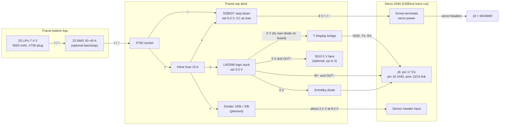

# Spooder hardware check

`mise run test` and the firmware build are the automated gates. This workflow is the hardware gate.

- It needs the board connected and, for anything that moves, a person present.
- Tell the user before flashing anything that drives servos. Once the supply is accepted, the robot starts moving.
- Record results in the OpenSpec change being verified.

## Power and wiring rules (read first)

- **Servo supply:** into the screw terminals, rated 10 A continuous, reverse-polarity protected, servos up to 11 V.
  - With the board's "Separate USB and Ext. Power" trace intact, the terminal supply also feeds USB VBUS and J6 pin 17 (5V).
  - For any supply above 5 V, **cut that trace**, then power the logic from USB or a separate 5 V supply on J6 pin 17. J6 pin 17 is the board's 5V net, which is USB VBUS with no diode (schematic, `hardware/pimoroni-servo2040/`): feed it through a Schottky diode, or a computer on the USB port is back-fed.
- **Ground:** connect external logic ground (bridge, sensors) only to **logic GND**, on J6 pins 1, 3, 5, 11 or 16 or the Qw/ST GND.
  - **Never** use the servo-connector ground pins. The current shunt sits in the servo ground return, so current returned through it is mis-measured.
- **3.3 V logic only on J6.** No pin is 5 V tolerant.
- **Pull-ups:** the board has none on GPIO19–21 or 26–28. I²C sensors need breakouts with pull-ups, or 4.7 kΩ resistors to 3V3.
- **Bench supplies:** use a current-limited bench supply for first power-up and protection tests. Set the limit below the firmware's trip current.

J6 (unpopulated 17-pin header), pin → signal: 1 GND, 2 USER_SW, 3 GND, 4 RESET, 5 GND, 6 SWDIO, 7 SWCLK, 8 GPIO28, 9 GPIO27, 10 GPIO26, 11 GND, 12 GPIO19, 13 GPIO21, 14 GPIO20, 15 3V3, 16 GND, 17 5V. Allocation: see `spooder-firmware-shape`.

**Bridge link wiring** (three wires, 3.3 V on both sides):

| TTGO T-Display | Servo 2040 |
|---|---|
| GPIO27 (TX) | J6 pin 13, GPIO21 (RX) |
| GPIO26 (RX) | J6 pin 14, GPIO20 (TX) |
| GND | J6 pin 16 (logic GND) |

- **Never connect the boards' 5 V rails together.** Power the bridge from its own USB or a separate 5 V supply.
- Cross TX to RX. With the bridge unplugged, the robot's RX pull-up keeps the line idle.

**Battery wiring** (2S pack in the frame bottom's bay; the rest on the frame top, in the printed electronics mount, `hardware/spooder-electronics-mount/`, whose README gives the cable routes and the assembly order):



- **Servo power:** pack → XT60 → 15 A fuse → SZBK07 → screw terminals, in 14–16 AWG. Set the SZBK07 to 6.0 V with a multimeter before connecting the Servo 2040 (the MG996R's limit is 7.2 V), lock its potentiometer, and set its current limit to maximum. Its heatsinks are live at the input voltage: nothing may touch them.
- **Logic power:** one LM2596 module, the logic buck, from the fused pack (22–24 AWG), not from the 6 V servo rail, which sags under load. Set it to 5.0 V with a multimeter before connecting either board. It feeds J6 pin 17 through a Schottky diode (a 1N5819 inline on its output lead, in heat-shrink: about 4.7 V reaches the board) and the T-Display's 5V header pin directly: the T-Display has its own 1N5819 from VBUS, so neither board back-feeds a computer on its USB port, and the boards' 5 V rails are never joined.
- **Dropout near an empty pack:** the LM2596 needs its input about 1.5 V above its output. Near empty (about 6.4 V, 3.2 V a cell) its output sags to about 4.9 V, and J6 pin 17 to about 4.6 V after the diode. The power protection does not cover this: it watches the servo rail behind the SZBK07, not the pack, and the battery sense is not read yet. The boards' own regulators are expected to cope at 4.6 V; check it with a bench supply at 6.4 V on the XT60 and the fans running, measuring J6 pin 17 (the mount's fit check, task 7.3 of `add-electronics-mount`). Stop and charge before the pack gets there.
- **Fans (optional):** 3010 5 V fans in the mount's exhaust and intake positions run from the LM2596's output pads, before the diode, so their current (about 0.1 A each) does not pass it. The exhaust blows out, the intake in.
- **One ground point:** the logic buck's input and output negatives, the T-Display's GND and the divider's ground all go to the Servo 2040's logic GND (J6); the fans' negatives go to the logic buck's OUT−. The pack's negative reaches the board only through the SZBK07 and the screw terminals, so servo current never returns through the thin logic wires, and the board's current shunt and reverse-polarity MOSFET stay in its path.
- **Battery sense (planned):** 100 kΩ from the fused pack to a sensor input, 33 kΩ to logic GND: 8.4 V reads as about 2.1 V, within the 3.3 V input. The firmware does not read it yet.
- **XT60:** the socket on the robot, the plug on the battery, so a disconnected pack's pins are never exposed. Disconnecting it is the power switch.
- **BMS (optional):** between the pack and its plug in the bay, rated above the servos' surges (30–40 A), as a hard cut-off if the firmware or the robot is left on. It drops power at once; the firmware's battery sense is the graceful stop.

## Build and flash

**Robot (Servo 2040):**

```sh
# power_limits.h must exist (copy power_limits.example.h and set the limits for the fitted servos and supply)
mise run build            # commands from the bridge link (default)
SPOODER_SERVO_PROFILE=MG996R mise run build  # the fitted servo model (default MG996R; see core/movement/servo_profile.h)
# put the board in BOOTSEL: hold BOOT/USER, tap RESET; the RPI-RP2 drive must be mounted
mise run upload           # rebuilds, then copies the .uf2
mise run monitor          # USB console, timestamped text; Ctrl+C to exit
mise run monitor --frames # plus one line per link frame (--telemetry-every 10 to thin telemetry)

mise run upload --serial  # the USB serial keys instead of the link
mise run monitor --keys   # the console for that build: typed keys go to the robot
```

- `mise run monitor` only observes: it never sends a frame (no controller, no e-stop), so it can watch the robot while the bridge drives. Without `--keys` it writes nothing at all. `--port PATH` picks another port or a pseudo-terminal. `mise run monitor-raw` is the old raw console, in which frames show as junk.

- The default build ignores serial keys and drives the robot from the bridge or a USB host speaking the link protocol. For movement bring-up without either, use `mise run upload --serial`. `upload` rebuilds first and passes the flag on, so give it to `upload` itself, not only to an earlier `build`.
- In the default build, with no bridge and no USB host in control, the robot never leaves Sleep: LED 6 blinks amber fast (link stale).
- **Flash both boards together** whenever the link protocol version changes (it is 2 now): build and flash the robot and the bridge from the same commit. A mismatch shows as `Link: LOST` on the bridge and a sleeping robot. Roll back both from the previous commit.

**Bridge (TTGO T-Display):**

```sh
mise run build-bridge                         # first run downloads ESP-IDF and the toolchain
BRIDGE_PORT=/dev/ttyUSB0 mise run upload-bridge
mise run monitor-bridge                       # Bluepad32 console; type `help`
```

- Flashing overwrites whatever the TTGO runs (for example LilyGO's factory demo).
- Use a direct USB port: a hub has caused `error -71` drop-outs on this CP2104.
- If flashing fails to connect, hold GPIO0 (left button) while tapping RST.

- If `upload` reports no RPI-RP2 drive, mount it first. The task looks it up with `findmnt` by its label.
- The console takes a second or two to re-enumerate after a reset.

## What the board shows

**Serial (USB):**
- once per second: `supply <A> A (avg <A> A), <V> V; output on|off; mode <n>; faults 0x..`;
- `output allowed: starting movement` when the body starts (boot, or restart after a fault);
- `movement stopped: waiting for the fault to clear and a new request` when a fault cuts output;
- `fault latched: <name> (<A> A, <V> V)` once per fault;
- `point impossible to reach: (...) leg n` once per rejection;
- `servo profile <name>: joint speed budget <n> deg/s` on the first tick;
- `output rate backstop: <n> ticks held back; most: leg <n> <joint>, <deg> deg behind` after a status line, only when the backstop held a joint back since the last one. Expected only at speed dial 100, rarely: at the default dial it points to a bug or a calibration change made in one jump;
- `operator source: none|bridge|USB|conflict (bridge and USB): sleeping` on each change (default build).

In the default build, a connected USB host also receives binary link frames (telemetry every 100 ms, calibration reports in Calibrate) between the text lines. `mise run monitor` keeps them out of the text (and decodes them with `--frames`); a plain terminal (`monitor-raw`) shows them as stray characters. A text line marked `[n stray 0xA5]` held a byte 0xA5 outside a frame: debug text must stay ASCII.

**LEDs** (`core/status/led_pattern`; LEDs 1–5 = main indication, LED 6 = command source):

| Pattern | Meaning |
|---|---|
| All six pulsing amber | Waiting for a valid supply (USB only, supply off, or settling) |
| All six alternating a colour with red, brighter | Latched fault: white overcurrent, magenta brown-out, blue overvoltage, orange sustained current, yellow undervoltage |
| LEDs 1–5 slowly breathing blue | Body stopped: supply valid, waiting for a new command (after a fault, or a Sleep request at start) |
| Green, *n* of LEDs 1–5 lit | Running; *n* = mode + 1 (1 Initialise, 2 Stand, 4 Sleep, 5 Calibrate) |
| Load bar on LEDs 1–5 in the gait's colour | Walking: lit segments = supply current against the trip limit (1.8 A each at a 9 A trip); segments past the sustained limit are red. Gait colours: Tri green, Wave sky blue, Ripple violet, Bi yellow, Quad mint, Hop pink |
| LED 6 dim white | Commands from the USB serial hook |
| All six steady red | Emergency stop latched (from the bridge) |
| LED 6 cyan / blinking magenta / fast-blinking amber | Bridge link up with gamepad / without gamepad / link stale |
| LED 6 blue | A USB host with a connected controller is in control |
| LED 6 alternating magenta and cyan | Source conflict: the bridge and a USB host both claim control; the robot sleeps until one lets go |

**Serial keys** (only in a `--serial` build; type them in `mise run monitor --keys`):

| Key | Action |
|---|---|
| `s` | Stand |
| `w` | Walk forward |
| `r` | Walk rotating |
| `x` | Walk with no input |
| `g` | Next gait |
| `f` | Toggle fixed stride |
| `z` | Sleep |
| `c` | Calibrate |
| `+` / `-` | Raise or lower body height |
| `!` | Clear faults |
| `p` | Print readings now |

## Staged bring-up

Stop at the first stage that misbehaves.

1. **USB only, no servo supply.**
   - Expect pulsing amber, output off, and a voltage near 0 V with current near 0 A.
   - Expect no faults: an absent supply isn't a fault.
2. **Bench supply, no servos, current-limited.**
   - Raise it into the configured voltage window.
   - Within 500 ms, expect `output allowed: starting movement`, and the LEDs turn green.
   - Check the reported voltage against a meter (±2 %).
3. **Overvoltage and undervoltage.**
   - With no servos: raise the supply above `SPOODER_MAX_V`. Expect an overvoltage fault immediately, with output off. Restore, then `!` clears it.
   - Lower it below `SPOODER_MIN_V` for longer than the debounce time. Expect an undervoltage fault and Sleep.
4. **One servo, on output 1.**
   - Check a 1500 µs pulse on a scope or logic analyser: ±2 %, 20 ms period.
   - Unpowered outputs show no pulse.
5. **Overcurrent.**
   - Stall the servo by hand, briefly, or set the bench limit to just above the trip current.
   - Above `SPOODER_TRIP_CURRENT_A`, expect output off once the current has stayed there for `SPOODER_TRIP_PERSIST_MS` (60 ms: about 80 ms from the rise at worst), and the overcurrent LEDs. A shorter surge, such as all the servos starting together in Stand, does not trip.
   - Above `SPOODER_CEILING_CURRENT_A` (13 A), a single reading cuts output within 20 ms.
   - Clear with `!` once the current is normal. Nothing moves until you also give a new command (for example `s`), and the supply has been valid for 500 ms. The body then restarts from Initialise.
6. **One leg, then all 18,** with the robot on a stand, feet off the ground.
   - Boot runs Initialise, then Stand.
   - Then `w`, `g`, `r`, `z` (legs fold, then go limp), `s` (wakes through Stand) and `c`.
   - Walking is capped at the servo profile's joint speed budget: high speed dial settings walk no faster than the servos can follow, and strides at body height 100 are shorter. If the feet still lag or the current is high, lower the profile's load share (`core/movement/servo_profile.h`) and rebuild.
7. **Geometry and calibration.**
   - Measure the new frame's link lengths, and compare them with `kinematics::COXA/FEMUR/TIBIA_LENGTH`.
   - Recalibrate the joints per the `spooder-leg-kinematics` skill (live calibration in Calibrate, then export to `core/movement/calibration_defaults.cpp`), on the bench with the desktop calibrator (below).

## Bridge bring-up

Robot on the bench supply with **no servos** until step 4; default (link) robot build.

The status screen has three pages: **drive** (the mode chip, voltage and current with bars, height and speed, stride and stick mode, `OUT ON`/`OUT OFF`; a white tick on the current bar holds the recent peak and on the voltage bar the recent low, for 3 s before easing back; a value turns amber for a second when it sets a new high or a deeper sag), **power** (the last 60 s of voltage and current as 10 Hz traces, with the lowest voltage and highest current) and **link** (frames per second each side accepts and rejects, the telemetry's age, the source the robot follows, the pad and its battery). A short press of the left button (GPIO0) shows the next page; the dots at the bottom mark the page. The header (mode, `PAD`, link state) and the status strip (`NO FAULTS`, or the e-stop, every latched fault, `LINK LOST`, `SOURCE CONFLICT`, `USB IN CONTROL`, filled orange or amber) are on every page.

1. **Bridge alone, on USB.** The header shows `NO PAD` and `LOST`, the strip `LINK LOST`. The console prints the Bluepad32 banner.
2. **Link on a bench cable.** Wire the three link wires.
   - Within a second the header shows `LINK` and the robot's mode, the strip `NO FAULTS`, and the drive page the supply voltage and current and `OUT ON`/`OUT OFF`. `USB IN CONTROL` or `SOURCE CONFLICT` in the strip means a USB host claims control too.
   - The link page shows about 50 frames per second accepted by the robot and about 10 by the bridge, none rejected.
   - LED 6 on the robot blinks magenta (link up, no gamepad).
   - Pull the cable: the strip shows `LINK LOST` within about 1 s on whichever page is shown, the power traces stop (a gap), and the robot sleeps (LED 6 fast amber).
3. **Gamepad.** Put the pad in pairing mode (see below).
   - The header shows `PAD` (with its battery when the pad reports one); the robot stands (LED 6 cyan). The power page shows the stand's current and the sag it causes.
   - Check every row of the controls table, including the left stick's forward direction (+Y must walk forward).
   - Switch the pad off: the robot sleeps.
4. **Emergency stop.** Press the bridge's right button (GPIO35).
   - Screen: `E-STOP` in the strip, on every page. Robot: all six LEDs steady red, output off within 20 ms (scope a servo pulse line against the bridge's TX line).
   - Press again to release: output stays off. Hold both stick buttons for 1 s to clear, then make a new mode request (`Home`) to move again.
5. **Timing under load.** With a logic analyser on the link TX, confirm a command frame at least every 20 ms while the screen changes many values.
6. **All 18 servos,** robot on a stand: walk through the controls again.

Record results in `openspec/changes/archive/2026-10-20-add-gamepad-bridge/tasks.md` (task 4.2).

## Setup mode and portal calibration

Setup mode turns the bridge into a WiFi access point with a captive portal; Bluetooth is off throughout, so no gamepad can connect. The link and the bridge's e-stop button work as in normal operation.

- **Enter:** power up or reset the bridge, and once the logo is up, hold the left button (GPIO0) for 1 s. Never hold it while pressing RST or plugging in: that enters the ROM download mode instead. The bridge restarts and shows `SETUP MODE`, the network name (`spooder-` and four hex digits), the password, `192.168.4.1`, `Portal: yes/no`, the link state, the e-stop and the body mode, with a joining QR code on the right.
- **Leave:** Exit on the portal, or RST. Both restart into normal operation; a power-up always starts normally.
- **Join:** scan the QR code with the phone's camera, or type the password. The password is made once and kept by the bridge. The phone's sign-in page opens the portal by itself (on Android, tap the "sign in to network" notification if it does not); otherwise browse to `http://192.168.4.1/`. One phone at a time.
- **Console:** `mise run monitor-bridge` shows `spooder bridge: setup mode (Bluetooth off)` and the access point line; the Bluepad32 console is not running.

**Calibration workflow** (robot on a stand, one servo, then one leg, then all):

1. Press **Calibrate** on the portal. The robot reports its table, and the joint editor and table fill in. Edits are refused until the first report, and the robot rejects them outside Calibrate.
2. Pick a leg and joint. Nudge the offset (±0.5°, ±1°, ±5°; a coxa's is shown from the servo centre, stored minus 90°), the 0° and 180° pulses (±10, ±50 µs) or the direction. `Waiting for the robot...` shows until a report confirms the change; the shown values are always the robot's, and `Last change: clamped` or `rejected` says the robot changed or refused it. The joint follows at 60°/s at most.
3. **E-stop:** the bridge's right button stops output as in normal operation, and the portal shows `EMERGENCY STOP`. The button toggles: press it again to release the stop, then press **Clear faults** and a mode button to move again.
4. **Phone away:** close or lock the phone, or walk out of range. Within about 1 s the portal stops counting as a controller, and the robot sleeps. The portal's mode stays Sleep when it comes back, until a mode button is pressed.
5. **Export:** press Export, then Copy (or select the text by hand). Paste it over `core/movement/calibration_defaults.cpp` whole (leave `test/golden/` alone: its files are format fixtures), and run `mise run test`. Rebuild and flash the robot, then check in Calibrate that the robot reports the same table.

Record results in `openspec/changes/archive/2026-10-20-add-bridge-setup-portal/tasks.md` (task 3.2).

## Desktop calibrator (bench calibration over USB)

The desktop app in `desktop/` speaks the link protocol on the robot's USB port. It needs the default (link) robot build: in a `--serial` build the USB link is not compiled.

**Set-up (Linux):**
- Build dependencies: `mise run desktop-deps` names what is missing. On Fedora: `sudo dnf install wayland-devel libxkbcommon-devel libxkbcommon-x11-devel libX11-devel libXcursor-devel libXfixes-devel mesa-libEGL-devel vulkan-headers`.
- Port access: `sudo usermod -aG dialout $USER`, then log in again. Without it the header says `no access to /dev/ttyACM0: add yourself to the dialout group`.
- Close `mise run monitor` first: the port can be open in one program only.
- `mise run desktop-run` from the checkout. The export pane then offers that checkout (or pass `--checkout DIR` to the binary, `build/desktop/spooder-calibrator`).

**Bench workflow,** robot on a stand, bench supply, one servo first:
1. **Connect.** The Servo 2040 (USB ID 2e8a:000a) is preselected; press Connect.
   - The debug log shows the robot's text lines and the telemetry strip its mode, supply and faults. Frames go to the frames pane, never into the log.
   - A `Stray 0xA5` banner means a text line held a byte 0xA5 outside a frame: debug text must stay ASCII.
2. **Observe.** The **Bridge** cell shows the bridge link from the robot's side: `down`, or `up · no pad` / `up · pad` with its frame counts (`mise run monitor --frames` prints the same as `bridge up (...)`). With the bridge running, `up` and rising counts confirm the UART link both ways without pairing a gamepad. The app reports no controller: with the gamepad driving, nothing changes on the robot (LED 6 stays cyan). Space (or E-stop) still stops it: all six LEDs steady red, output off. Press Space again to release the app's e-stop; the fault stays latched.
3. **Take control** with the bridge's gamepad off and the app's e-stop released. Clear fault (`F`; the fault cannot clear while any e-stop is still signalled), then Calibrate (`2`; `1` Stand, `3` Sleep). From Stand, keys `4`–`8` (or the gesture buttons) play say hi, wiggle, dance, attack and ball; rehearse them on the virtual robot first (`mise run desktop-sim`). The keys are listed under the mode buttons while in control. LED 6 shows blue (USB in control) once the fault is cleared, and the source shows `USB (this app)`.
4. **Drive.** In control, from Stand (`1`):
   - **Drive keys:** hold `W`/`S` to walk forward and back, `A`/`D` to steer (turning on the spot without `W`/`S`, mirrored when reversing), and `Q`/`E` to step sideways. The first press requests Walk. Releasing every key holds the feet, and `1` stands again.
   - **Settings:** `Z`/`X` set the speed dial, `C`/`V` the height (steps of 10), `G` the next gait and `T` the stride mode. The line under the mode buttons shows what is sent.
   - **Stopping:** losing the window focus stops the input, and Space is the e-stop.
   - Rehearse on the virtual robot first, and keep the robot on a stand until the gait looks right.
5. **Calibrate.** Select a joint with the arrow keys or the pointer; `=`/`-` nudge fine, Shift coarse, `R` flips the direction. A change shows `pending` until the robot's report confirms it; clamped or rejected changes are marked and show the robot's value. The joint moves at 60°/s at most.
   - **4 views** (top bar) opens a second window with the whole robot from the pose: top, front, left and isometric. The body is a schematic plate, and the ground is at the lowest foot. The selected leg is in the accent and limits are ringed. Put it on a second screen to judge a stance, a gait or a gesture while driving or calibrating.
   - The **charts** tab shows, on one time axis, the last 30 s, 2 min or 10 min of:
     - power: the supply voltage against its limits, and the current and averaged current against the trip and sustained limits, each with its held extreme (`low` voltage, `peak` current: held 3 s, then easing back to the reading);
     - links: frames accepted and rejected on the robot's, the bridge's and the host link;
     - a mode, output and fault timeline;
     - joints: the fastest joint speed per kind against the budget and rated speed, and the selected leg's servo angles;
     - the robot's internals: the budget's motion share, the control tick's time against 20 ms, and backstop hits.

     Hover reads every chart at one moment; Save CSV writes the kept history to the downloads folder. Use it to see supply sag under load, links dropping frames, or the servos being asked for more than they can do.
   - The **legs** pane draws the selected leg as the robot commands it (calibration pose: coxa straight out, femur straight up, tibia horizontal outward), each joint's pulse, and all six legs from above. Compare the real leg with the drawing: a joint that differs needs its offset changed. Rings mark joints near or at the 0°/180° servo limits. The top view's leg placement (legs 1–3 left; legs 1 and 6 the front pair, 3 and 4 the rear) matches the gait code and is confirmed on the robot. The body outline is a simple schematic.
6. **Release control.** The robot sleeps (LED 6 fast amber without a bridge). Closing the window or pulling the cable does the same within about 1 s.
7. **Conflict.** Take control while the gamepad is connected: the app and the bridge screen show the conflict, LED 6 alternates magenta and cyan, and the robot sleeps until one side lets go.
8. **Export.** Show difference, check it, Write file: only `core/movement/calibration_defaults.cpp` changes. Or Copy text. Run `mise run test` (it checks the file's format and round trip, not its values), rebuild and flash, then confirm the robot reports the same table in Calibrate. Leave `test/golden/` alone: its files are format fixtures.

Record results in `openspec/changes/archive/2026-10-20-add-desktop-calibrator/tasks.md` (task 4.2).

**Rehearse without the board first.** The virtual robot (`tools/virtual-robot`) runs the robot's own control tick (`core/robot/robot_tick`) behind a pseudo-terminal: `mise run desktop-sim` (debug text echoed in this terminal, the calibrator opened on the robot's USB port; closing either ends both). Type commands into the robot's terminal: `supply 7.5` (overvoltage), `estop` / `estop off` (the bridge's e-stop), `bridge gamepad` (a conflict), `load 5` (overcurrent), `unplug` / `plug`, `status`. Steps 1–6 behave as on the board, minus the LEDs and the servos; `mise run e2e` checks them automatically. It proves the logic and the protocol, not timing, wiring or power: the steps above still need the board.

## Gamepad controls

Button names are Bluepad32's (Xbox layout: `a` bottom, `b` right, `x` left, `y` top). `core/gamepad_mapping` implements this table.

| Input | Effect |
|---|---|
| Left stick, steer mode (default) | Y walks forward or back; X steers: right turns clockwise, mirrored when reversing (more than 10 % back). 8 % dead zone |
| Left stick, crab mode | Walk direction and speed, strafing too |
| `b` | Toggle steer / crab mode (kept across reconnects; the drive page shows `STEER` or `CRAB`) |
| Right stick X | Turn (right: clockwise), added in both modes |
| `Home` (system) | Toggle Stand / Walk |
| `y` | Toggle Sleep (returns to the previous mode) |
| `Back` + `Home` held 1 s | Toggle Calibrate (leaving returns to Stand) |
| `r1` / `l1` | Next / previous gait |
| D-pad up / down | Body height ±10 |
| D-pad right / left | Speed ±10 |
| `x` | Toggle stride: dynamic / fixed |
| Both stick buttons held 1 s | Clear faults |
| `l2` held + `a` / `b` / `x` / `y` / `r2` | Gesture: say hi / wiggle / dance / attack / ball, from a settled Stand (the buttons' own functions are off while `l2` is held; dance, attack and ball are not scripted yet and do nothing) |
| Bridge right button (GPIO35) | Toggle emergency stop |

- One gamepad at a time; a second is refused.
- Rumble (`core/gamepad_mapping/rumble`), on pads that have it (the SF30 Pro in its Switch and Windows modes): a long strong rumble when a protection fault latches; a short strong one when the bridge's e-stop goes on, a light tap when it goes off; a medium one when the robot link is lost, a light tap when it returns; a light tap when a gesture request did not play within 0.6 s (walking, a transition, or a gesture not scripted yet). Faults already latched when the pad connects do not rumble.
- Disconnecting requests Sleep with zero input. Reconnecting starts in Stand with height, speed, gait and stride kept.
- After any fault: clear it, then make a new mode request; clearing alone never restarts motion.
- Pairing: DualShock 4 and DualSense hold Share + PS; Switch Pro holds the sync button; 8BitDo pads use their pairing combination. Bluepad32 remembers paired pads; `del_bluetooth_keys` in the bridge console forgets them.

## Report

- State what was flashed: the commit or "working tree", plus the limits file.
- List each stage and its result, and anything not checked.
- Quote serial lines rather than paraphrasing them.
- If the user did the steps, ask for their output rather than assuming it.
