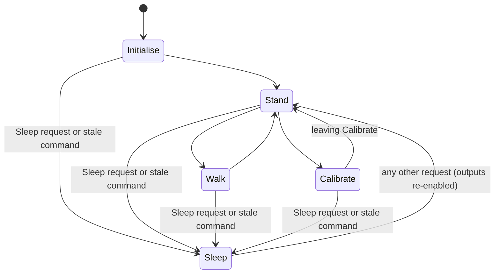

# Spooder leg kinematics and gaits

Behaviour is specified in OpenSpec (`locomotion` and `leg-actuation` capabilities in `openspec/specs/`, with pending deltas in the active changes under `openspec/changes/`). Units are millimetres, degrees and milliseconds. The maths derives from Aecert's Hexapod V1 (upstream `ca5ed27`).

## Layout

| File | Role | Hardware-free |
|---|---|---|
| `firmware/servo2040/src/main.cpp` | Keeps the requested and applied calibration tables, steps the applied one, sets each leg's offsets, calls `body::step(bodyState, cmd, now)` every 20 ms after protection, reports rejections, hands the state and the applied table to `servo_output` | no |
| `movement_command.h` | `MovementCommand`, `RequestedMode`, `StrideMode` | yes |
| `body.h/.cpp` | `BodyState` and the state machine: modes, transitions, smoothing, walking | yes |
| `gait.h/.cpp` | Gait table, progress rate, Bézier foot paths (`footTarget`) | yes |
| `kinematics.h/.cpp` | `solveLeg`, link lengths, `servoOutputIndex` | yes |
| `joint_calibration.h/.cpp` | Per-joint `Joint` (offset, 0° and 180° pulses, reversed), `Table`, `clampJoint`, rate-limited `step`, `toPulse`, `legOffsets` | yes |
| `calibration_defaults.cpp` | `joint_calibration::DEFAULTS`, the compiled defaults in a fixed format (export target) | yes |
| `vectors.h` | `Vector2`/`Vector3`, `lerp`, `mapFloat` | yes |
| `firmware/servo2040/src/servo_output.*` | `ServoCluster` on PIO 0 (GPIO0–17): batched pulses, one `load()` per step, output on/off, protection inhibit | no |

Hardware-free files must not include Arduino or driver headers: they build in the `native` env and are covered by `mise run test` (`test/test_*`).

## Command interface

A controller builds a `MovementCommand` each loop, and `main` passes it, after protection and the resume gate, to `body::step`:

- **Fields:** `mode` (Stand/Walk/Sleep/Calibrate), `translate` (magnitude ≤ 100), `rotate` (±100), `height` (0–100; higher raises the body), `speed` (0–100), `gait` (index into `gait::Gait`), `stride` (Dynamic/Fixed) and `issuedAtMs`.
- **Clamping:** `body::clampCommand` clamps out-of-range and non-finite values. An unknown gait is ignored.
- **Authority:** movement alone changes mode, gait and leg state; a command only requests.
- **Staleness:** a command older than `COMMAND_TIMEOUT_MS` (1 s) counts as stale and puts the body to sleep.

Until the gamepad bridge exists, commands come from the USB serial hook (`firmware/servo2040/src/serial_commands`); see the `spooder-hardware-check` skill for its keys.

## Body modes



- **Pre-emption:** Sleep and stale commands pre-empt everything. Other requests, including waking, wait until `transitionActive()` is false (Initialise, an active Stand transition, a Sleep fold). A command stamped up to `MAX_COMMAND_LEAD_MS` (100 ms) after `nowMs` is fresh. Once a command is stale, that `issuedAtMs` stays stale (latched), so `millis()` wrap can never revive it; only a new stamp wakes the body.
- **Initialise:** holds (160,0,0) for 25 ms, then (225,0,115) for 500 ms, then enters Stand.
- **Stand:** a Bézier move from each foot's position, through a lifted midpoint, to (190, 0, ground).
  - Coming from Walk, it moves three legs at a time, highest first.
  - Coming from Initialise, Sleep or Calibrate, it moves all legs at once.
  - Once settled, the feet track height changes.
- **Time grid:** `body::step` runs the whole state machine in 5 ms sub-steps (`INTEGRATION_STEP_MS`), carrying leftover time across transitions, so behaviour does not depend on tick length. Sub-steps only record feet (cheap `isValidTarget` check); IK is solved once per step (`solveAngles`) for legs that moved.
- **Walk:** gait progress and phase tracking (`gait::trackPhase`) advance per sub-step, so a ground phase shorter than a tick is not skipped. Foot paths are evaluated once per step, after progress.
  - On a ground↔swing phase change, a leg starts its new segment from the previous segment's end point, which keeps the path independent of step size.
  - Zero input stops progress and holds every foot.
- **Sleep:** feet ease to `REST_POSE` (130,0,−46), snap within 1 mm, then `outputsEnabled` goes false and `servo_output` disables every output. Waking re-enables output and passes through Stand.
- **Calibrate:** first raises only the feet below −20 mm. It then steps every coordinate towards `CALIBRATION_POSE` (224,0,116) at 50 mm/s, from either side.

## Leg frame and IK

Each leg is solved in its own frame, with the origin at the coxa pivot, **x** pointing outward, **y** along the body and **z** up (positive). Ground height is `groundForHeight(h) = −60 − 1.7·h`.

Link lengths are coxa 41, femur 116 and tibia 183 mm; `LEG_REACH` is 340 mm.

```
theta1 = atan2(y, x)                     + offset.x   // coxa
l1     = sqrt(x² + y²) - a1
h      = sqrt(l1² + z²)
phi1   = acos((h² + a2² - a3²) / (2·h·a2))           // clamped to [-1, 1]
phi2   = atan2(z, l1)
theta2 = (phi1 + phi2)                   + offset.y   // femur
phi3   = acos((a2² + a3² - h²) / (2·a2·a3))
theta3 = 180 - phi3                      + offset.z   // tibia
```

- **Target validation:** `solveLeg` rejects non-finite targets and targets beyond reach.
  - On rejection the body keeps the leg's recorded position, writes nothing, and sets `newlyRejected` once per accepted→rejected change. `movement.cpp` prints that rejection once.
- **Offsets:** the body holds each leg's three offsets (`BodyState::offsets`, defaults from `body::init`); `main` sets the applied table's values with `body::setOffsets` every tick, and a change re-solves the leg even if its foot did not move.
- **Pulse conversion:** `joint_calibration::toPulse` clamps the angle to 0–180°, mirrors it to 180° − angle for a reversed joint, and interpolates between the joint's 0° and 180° pulses (by default 500 and 2500 µs).
- **Pulse output:** `servo_output` drives all 18 outputs from one `ServoCluster` (PIO 0, 50 Hz, crystal-timed). Its per-channel calibration limits are off; only the cluster's 400–2600 µs hard limits apply.
  - Every joint the body has set is converted through the applied table each tick, so a calibration change moves a joint whose angle did not change.
  - It writes changed joints with `pulse(i, us, false)` and calls `load()` once, so a step lands in one frame.
  - It never calls `enable()`, which would send a servo with no pulse set to mid-travel.
  - It writes nothing while protection inhibits output.

## Servo map and calibration

Leg index `i` (0–5) and joint `j` (0 coxa, 1 femur, 2 tibia) map to servo output `kinematics::servoOutputIndex(i, j) = 3i + j` (0-based; board output label 3i + j + 1, GPIO 3i + j).

| Leg | Outputs (coxa / femur / tibia) | GPIO | Default offsets (coxa, femur, tibia) |
|---|---|---|---|
| 0 | 1 / 2 / 3 | 0 / 1 / 2 | 90, 75, −18 |
| 1 | 4 / 5 / 6 | 3 / 4 / 5 | 93, 75, −15 |
| 2 | 7 / 8 / 9 | 6 / 7 / 8 | 93, 75, −18 |
| 3 | 10 / 11 / 12 | 9 / 10 / 11 | 87, 80, −26 |
| 4 | 13 / 14 / 15 | 12 / 13 / 14 | 85, 89, −16 |
| 5 | 16 / 17 / 18 | 15 / 16 / 17 | 93, 85, −24 |

These default offsets (`calibration_defaults.cpp`, all with 500/2500 µs and normal direction) are upstream's 2023 values and have never been measured on this robot.

- `STRIDE_MULTIPLIER = {1,1,1,−1,−1,−1}` puts legs 0–2 on one side and 3–5 on the other.
- `ROTATION_MULTIPLIER = {−1,0,1,−1,0,1}`, combined with `LEG_PLACEMENT_ANGLE = 56°` and `STRIDE_MULTIPLIER = {1,1,1,−1,−1,−1}`, places the corner legs at ±56°. Because the right side's leg frames run the other way (stride multiplier −1), equal signs do not mean the same end: indices 0 and 5 (legs 1 and 6) are the front pair, 1 and 4 (legs 2 and 5) the middle, and 2 and 3 (legs 3 and 4) the rear. Legs 1–3 are on the left. Confirmed on the robot (2026-10-18).

To recalibrate, put the robot on a stand and request Calibrate to reach the calibration pose. The IK geometry is authoritative for this robot: at (224, 0, 116) the joint angles are 0°/90°/90°, which puts the coxa straight out from its mount, the femur straight up and the tibia horizontal pointing outward, with the foot 116 mm above the coxa pivot. (Upstream's description, femur horizontal and tibia vertical, does not apply here.) The desktop calibrator's legs pane draws the same pose.

- **Live:** a front-end (the bridge's setup portal, or the desktop calibrator on USB) sends calibration set frames, one joint at a time. The robot accepts them only in Calibrate with output allowed, clamps the offset to the default ±30° and each pulse to 400–2600 µs (end points at least 1000 µs apart), and moves the joint there at no more than 60°/s. Live values stay in RAM until the robot restarts. Reports show the accepted table. Both front-ends show a coxa offset from the servo centre (stored minus 90°, so 0 is the IK's straight-out at mid-travel); the table, the link and the export keep the stored value. Every default must let its servo reach the calibration pose: the IK angle there (coxa 0°, femur and tibia 90°) plus the offset within 0–180°.
- **Defaults:** export the reported table as the complete text of `core/movement/calibration_defaults.cpp`, run `mise run test` and rebuild. `test/golden/calibration_defaults.cpp` is a format fixture and stays as it is. Without a front-end, edit the file by hand in the same format.

## Gait table (`gait.cpp`)

Phase offsets are in progress units out of `CYCLE_POINTS` = 1000. Legs are listed in order 0–5.

| Gait | Phase offsets | `pushFraction` | speed × | stride × | lift × | max stride | max speed |
|---|---|---|---|---|---|---|---|
| Tri | 0, ½, 0, ½, 0, ½ | 3.1/6 | 1 | 1.2 | 1.1 | 240 | 200 |
| Wave | 0, 1/6, 2/6, 5/6, 4/6, 3/6 | 5/6 | 0.4 | 2 | 1.3 | 150 | 160 |
| Ripple | 0, 4/6, 2/6, 5/6, 1/6, 3/6 | 3.2/6 | 1 | 1.3 | 1 | 220 | 200 |
| Bi | 0, ⅓, ⅔, 0, ⅓, ⅔ | 2.1/6 | 4 | 1 | 1.8 | 230 | 130 |
| Quad | 0, ⅓, ⅔, 0, ⅓, ⅔ | 4.1/6 | 1 | 1.2 | 1.8 | 220 | 200 |
| Hop | all 0 | 3/6 | 1 | 1.6 | 2.5 | 240 | 200 |

- **Progress rate:** progress advances at `max(|translate|, |rotate|) · speed× · speedScale`, clamped to `maxSpeed · speedScale`, × 50 per second. `speedScale = (speed + 10) / 100`; the rotation scale is fixed at 0.55.
- **Fixed stride:** stride and rotation length are a constant 70, and the input sets direction only.
- **Adding a gait:** add an enum member, a `GAITS[]` row and raise `GAIT_COUNT`.

## Time-based rates (`body.cpp`)

These are converted from the original per-loop values at a 20 ms reference step and are meant to be tuned on hardware:

| Constant | Value |
|---|---|
| `STAND_RATE` | 1250 units/s |
| Translate smoothing τ | 250 ms |
| Rotate smoothing τ | 160 ms |
| Height smoothing τ | 500 ms |
| Sleep fold τ | 330 ms |
| `CALIBRATION_RATE` | 50 mm/s |
| `MAX_STEP_MS` | 100 ms |

Changing them does not change the spec. Keep the tick-rate test (`test_walk_is_tick_rate_independent`, ≤ 5 mm) passing.
