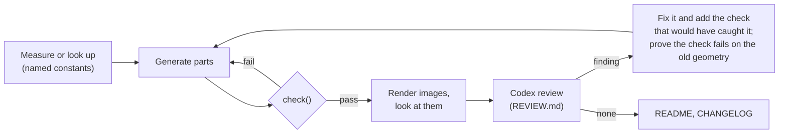

# Spooder printed parts

Printed parts are code: one build123d script per part set, which generates the geometry from named measurements, checks it and only then writes the print and CAD files. A part set lives in its own `hardware/<name>/` folder with the script, a preview renderer and a README covering printing, hardware, assembly and the measurements to check; the electronics mount (`add-electronics-mount`) is the first. The names in backticks below (`teardrop()`, `frame_height()`, `overhangs()`, `PRINT_UP`, `BRIDGE` and so on) are the conventions such a script uses.

## Toolchain

- **build123d 0.13.0**, pinned in the script's inline metadata with `[tool.uv] exclude-newer` (older build123d breaks on a newer ocpsvg). Add numpy, trimesh and matplotlib the same way, at exact versions.
- **Run it with** `uv run --quiet --python 3.12 <script>`, wrapped in mise tasks (the mount's: `mise run cad`, `mise run cad-preview`). `--check` checks without writing files.
- **Previews:** matplotlib, with every part's triangles in one `Poly3DCollection`. Separate collections are drawn in the wrong depth order.
- **Never name a script after a standard-library module.** An `inspect.py` next to the script shadows the real one.

## The loop

- **Every size is a named constant at the top of the script**, with its source in a comment (drawing, datasheet, STEP model, measured).
  - Unverified values go in the README's "Measure before printing" list, with the name of the constant to change.
- **Look at the renders, not only the check output.** The open assembly shows the held parts in blue and the wiring zones in yellow. Send the user a screenshot at milestones.
- **Codex review:**
  - give it the diff against the previous version, the reference files and the goals, and ask for physical and assembly problems the checks cannot see;
  - run `codex exec -s read-only` in the background, with no timeout;
  - answer every finding.
- **A real finding becomes a check.**
  - Prove the new check would have failed on the old geometry: import the old script, or monkeypatch the old values, and run the check against them.
  - The same goes for any new check: test it on a known-bad shape before trusting a pass. A check that reports nothing at all is suspect until shown otherwise.

## Coordinates and placement

- **Model in the robot's frame:** the frame top's coordinates, mm, +y forward, the frame top at z 25.75. Export parts in their assembled position, so they load into an assembly with `hardware/aecert-hexapod-v1/stl/`.
  - The README gives each part's print orientation.
  - `PRINT_UP` in the script records it for the checks.
- **Reference models:**
  - Place vendor STEP models by a rotation, never a mirror, and turn their solids into boxes for the checks.
  - Drop solids that don't exist on the real board, such as header pins on a board with soldered wires, and record that in the docstring.
  - For a board with no model (the Servo 2040), build boxes from the drawing's dimensions (`hardware/pimoroni-servo2040/README.md`).
- **The frame top STL is the truth for what lies under the deck.**
  - The ring is solid at |x| ≥ 52 and along the front and rear edges; most of the rest is open.
  - Query the STL with `frame_height()` (a point-in-triangle height map), never guess.
- **Leg keep-clear region:** r ≤ 78.8 mm above the frame top, plus the front and rear tabs (|x| ≤ 24, |y| ≤ 79). Nothing printed goes outside it.

## Printing rules

**Orientation first.** Choose each part's print orientation before detailing it, then design every feature for that orientation:
- the deck prints flat;
- the cover lid-down (up is −z);
- the cradle on the back of its portal (up is +y);
- the bumpers upright.

No part may need support.

- **The 45° rule:** no face may look down more steeply than 45° unless it can bridge, i.e. it is at most 3 mm wide (`BRIDGE`).
- **Holes running horizontally as printed are teardrops**, pointed up as printed: `teardrop(r, length, x, y, z, axis, up)`.
  - On a lid-down part, "up" is −z.
  - A hole that is vertical in the robot can be horizontal as printed (the cradle's feet).
  - Vertical holes stay round.
- **Faces on the bed get no flat recesses:** a recess there bridges over air.
  - Bevel windows at 45° instead (`extrude(..., taper=45)`).
  - Engraving whose strokes are under 3 mm wide is fine (the lettering, the chevrons).
- **Styling on the cover is recessed, never raised:** a raised detail on the lid would keep the lid off the bed.
- **Things that lean out lean at 45°:**
  - gussets under arms;
  - 45° undersides on pegs and lips;
  - rail ends as 45° wedges, whose slope is also the bumper's stop.
- **Every feature rises from the bed face, or from something below it as printed.** If a feature would start in mid-air:
  - extend it down to the bed;
  - add a 45° slope under it;
  - or drop it if it's only a nicety (the cradle's USB-end front lip).
- **Split a part when one orientation can't serve all its features.** The T-Display cradle is separate from the deck because its arms would be cantilevers if printed with the deck.
- **Each part is one solid.** Joining two pieces needs real overlap, not a shared edge.
  - A 0.3 mm clearance gap between a lip and the arm it hangs from leaves a floating island.
  - Merge lid openings that are less than 2 mm apart, so no sliver of lid is left between them.
- **Coplanar contacts:** leave 0.05 mm, or the boolean leaves sliver overlaps.
- **Bed size:** 220 mm.

## Fits and fasteners

| Use | Value |
|---|---|
| Clearance round a held part, per side (`FIT`) | 0.3 |
| Sliding fit, TPU on a PLA rail | 0.15 (measured normal to the slope too) |
| Walls | 2.4 |
| M3 clearance | 3.4; ISO 7380 button-head counterbore 6.4 × 2.0 |
| M3 heat-set insert (`M3_INSERT`) | Ø4.4 × 5, the frame's size; a teardrop when horizontal |
| M2.5 self-tapping into PLA | pilot 2.2, clearance 2.9 |
| Board standoffs | 5 mm (Servo 2040) |

- **Screws that are undone in service go into heat-set inserts.** Self-tapping is for fit-once parts (boards, the cradle's feet).
- **Every screw needs a straight driver path,** checked with a Ø4 cylinder above the head.

## Assembly and service

- **Keep everything electrical on the deck,** so the cover is a bare shell that lifts off after its screws, with nothing to unplug.
- **A spring fixed at both ends pries its mounts.** A leaf or arch pressed flat pushes its ends apart, several times the load on a shallow one, so fix one end and let the other slide (the bumpers' free hook); a check moves the free end through the spring's travel.
- **Hold parts captive by geometry where possible.** The SZBK07's stops are taller than the lid's gap above it, so the cover holds it; tape only holds it with the cover off.
- **Check access for every connector and adjuster:**
  - USB-C plugs reach through the wall: receptacle 6 mm or less from the outer face, with a 14 × 13 opening;
  - terminals keep the space their wires need to enter from.
- **Write the assembly order into the README,** and make sure nothing blocks a later step.

## Wiring

- **Model wiring as zones:** boxes that no printed or held part may enter (zones may overlap each other).
  - Draw them from the real terminal positions and wire-entry directions.
  - For example: the Servo 2040's EXT terminal takes its wires from the board's right edge, so it needs free space to its right.
- **Cable-tie holes come in pairs** (`TIE_HOLE` 3.4 × 2.0). The frame STL must show at least 1.5 mm free under the deck along the tie's path (`TIE_GAP`); lead slots likewise.
- **The electrical rules live in `spooder-hardware-check`** ("Battery wiring"). The mount's layout follows them, and its README's "Cable routes" describe the physical runs.

## Checks every part set carries

- one solid per part;
- the leg keep-clear region, nothing below the frame floor, the bed size;
- no overhang needing support in the print orientation (`overhangs()`);
- holes on the frame's inserts;
- printed parts don't overlap; no held part overlaps a printed part or another held part;
- wiring zones are clear;
- tie holes and slots have room under them on the frame;
- the cover encloses everything except what is meant to show through it;
- part-specific checks: the rail's wedge and slot clearance, cradle contact at both ends of the board, captive stops, screwdriver paths.

## build123d pitfalls

- **`Box` and `Cylinder` are centred by default.** Use `align=(CENTER, CENTER, MIN)` or the `box()` helper, which takes a corner. A test hole at the top face of a centred box is a groove, not a hole.
- **Check rotations and extrude directions with a bounding box.** `Rot(Z=90) * (Rot(X=90) * extrude(...))` extrudes towards −x; `yz_prism` compensates. Nest the rotations explicitly.
- **`Face.normal_at()` already respects the face's orientation.** Don't flip it again.
- **Face tessellation can return only part of a curved face** (half of a hole's cylinder). For normals, sample `position_at(u, v)` and keep the points that pass `is_inside()`.
- **`offset()` on a face with holes fails.** For a face's width, measure the farthest sample point from its edges instead.
- **Tessellating a whole vendor STEP model can throw on a single face.** To render or mesh one, tessellate face by face inside a try. The checks avoid this by reducing the model to boxes.
- **A 45° cutter must be centred on its plane.** Offsetting it by `grow` needs `grow·√2` along the axis. Measure the result rather than trusting the arithmetic.
