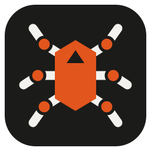
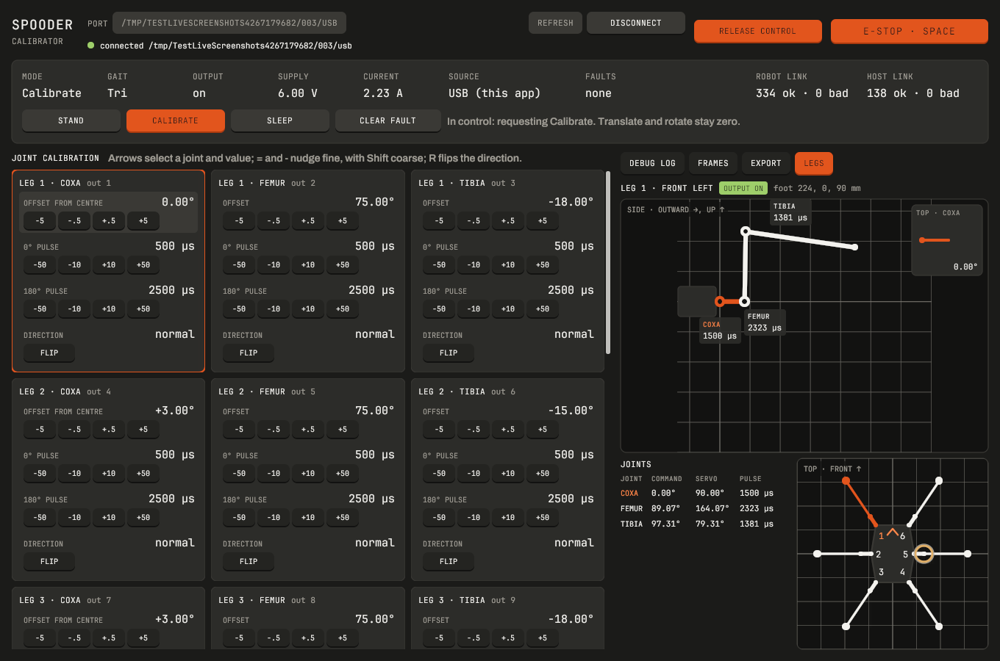
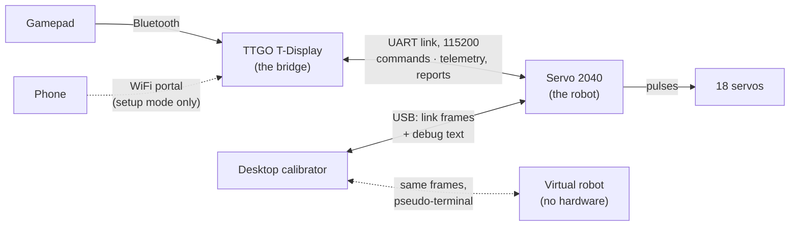

# Spooder

> A shameless iteration over [Aecert's Hexapod V1](https://github.com/Ryan-Mirch/Aecerts_Hexapod_V1).

Spooder is the firmware and tooling for a six-legged, eighteen-servo walking robot. The movement code (inverse kinematics, Bézier foot paths, the gait table) comes from Aecert's design. The rest is new: other boards, a power-protection layer, a gamepad bridge, live calibration, and a desktop calibrator that rehearses everything against a virtual robot before the real one is powered.

<picture>
  <source media="(prefers-color-scheme: light)" srcset="docs/images/calibrator-light.png">
  
</picture>

*The desktop calibrator, connected to the virtual robot.*

## How it fits together



- **The robot**: a Pimoroni Servo 2040 (RP2040), C++ on the pico-sdk with pimoroni-pico. It runs a 20 ms control tick: link input → power protection → supervisor → calibration → body state machine → servo output → status LEDs → telemetry.
- **The gamepad bridge**: a LilyGO TTGO T-Display v1.1 (ESP32), on ESP-IDF, Arduino and Bluepad32. It pairs a Bluetooth gamepad, sends commands to the robot every 20 ms, and shows the robot's status on its screen.
  - Hold the left button during the boot logo to enter **setup mode**. The bridge then starts a WiFi access point (joined via a QR code on the screen) and a captive portal, through which a phone calibrates the robot. Bluetooth and WiFi never run together.
- **The desktop calibrator**: Go with a Gio UI, in the Blackfyre look. It speaks the same link protocol on the robot's USB port, to monitor, drive and calibrate it without the bridge.
- **The virtual robot**: the robot's own control tick, compiled natively, behind a pseudo-terminal that behaves like the board's USB port. It runs the calibrator and the end-to-end tests without hardware.

## Features

- **Gaits**: tri, wave, ripple, bi, quad and hop, from the upstream gait table, with dynamic or fixed stride and adjustable height and speed.
- **Power protection**: overcurrent, overload, brown-out, low and high voltage, and an emergency stop. Faults latch, and clearing one never restarts motion by itself: a new mode request must follow.
- **Link protocol v3**: CRC-16 framed messages for commands (with gesture requests), telemetry, calibration sets and reports, and the pose. It is pinned by golden vectors that the C++ and Go implementations both test against.
- **Live joint calibration**: per joint, an offset, the pulses for 0° and 180°, and the direction.
  - Changes are guarded (Calibrate only, offset within ±30° of the default, pulses 400–2600 µs) and rate-limited to 60°/s.
  - They are held in RAM, confirmed by the robot's reports, and exported as the compiled defaults.
  - Coxa offsets are shown from the servo centre.
- **Source arbitration**: the bridge or USB, whichever reports a connected controller. If both do, the robot sleeps.
- **Rumble feedback**: the gamepad rumbles when a fault latches, the bridge's e-stop switches, the robot link drops or returns, or a gesture is refused.
- **Gestures**: say hi and wiggle, from Stand: scripted, rate-limited moves that any other request, the e-stop or a fault interrupts. Dance, attack and ball follow once the body geometry is measured.
- **Legs pane**: forward kinematics of the reported pose, each joint's pulse, rings at the servo limits, and a top view of all six legs.
- **Four-view window**: the whole robot from the top, front, left and isometrically, from the same pose.
- **Charts**: ten minutes of supply, current, link counters and robot internals (motion share, backstop, tick time), with CSV export.
- **Keyboard driving**: walk, steer, step aside and change gait, speed, height and stride from the calibrator.

## Getting started

[mise](https://mise.jdx.dev) provides every toolchain. The SDKs are pinned git submodules.

```sh
mise install          # Python, PlatformIO, CMake, Ninja, Arm GNU toolchain, Go
mise run setup        # fetch the pinned submodules
```

The robot firmware needs power limits chosen for your servos and supply. Copy `firmware/servo2040/src/power_limits.example.h` to `power_limits.h` and adjust it. The servo model sets how fast the joints may turn: `SPOODER_SERVO_PROFILE` names it (default `MG996R`; the table is in `core/movement/servo_profile.h`).

### Try it without hardware

```sh
mise run desktop-sim
```

This builds the virtual robot and the calibrator, runs the robot in your terminal and opens the calibrator on its port. Click **Connect**, then **Calibrate**. In the terminal, `supply 7.5`, `estop on`, `load 5`, `unplug` or `bridge gamepad` exercise the faults and the arbitration. `quit` or closing the window ends both.

The calibrator needs cgo and the Wayland, X11 and EGL development packages on Linux. `mise run desktop-deps` names any that are missing. `mise run desktop-install` adds it to your desktop's launcher with its icon.

### Flash the boards

```sh
mise run build && mise run upload      # robot: copy the .uf2 to the Servo 2040 in BOOTSEL mode
mise run build-bridge                  # bridge: build...
mise run upload-bridge                 # ...and flash (BRIDGE_PORT, default /dev/ttyUSB0)
mise run monitor                       # the robot's USB console; --frames decodes the link
```

Flash both boards together when the link protocol changes. A mismatched pair fails safe: each side discards the other's frames, and the robot sleeps.

### Wiring the link

| TTGO T-Display | Servo 2040 (J6) |
|---|---|
| GPIO27 (TX) | J6 pin 13, GPIO21 (RX) |
| GPIO26 (RX) | J6 pin 14, GPIO20 (TX) |
| GND | J6 pin 16 (logic GND) |

3.3 V logic only, and no 5 V on these pins. The bridge's right button (GPIO35) toggles the emergency stop.

## Gamepad controls

| Input | Effect |
|---|---|
| Left stick (steer mode, default) | Y walks forward or back, X steers like a car (mirrored when reversing) |
| Left stick (crab mode) | Walk in any direction, strafing too |
| `B` | Toggle steer / crab |
| Right stick X | Turn, added to the steering in both modes |
| `Home` | Toggle Stand / Walk |
| `Y` | Toggle Sleep |
| `Back` + `Home` held 1 s | Toggle Calibrate |
| `R1` / `L1` | Next / previous gait |
| D-pad up / down | Body height |
| D-pad right / left | Speed |
| `X` | Toggle stride: dynamic / fixed |
| Both stick buttons held 1 s | Clear faults |
| `L2` held + `A` / `B` | Gesture: say hi / wiggle (from Stand) |

## Verification

```sh
mise run test            # host-side Unity tests of core/, and the bridge build script's tests
mise run build           # robot firmware (also with --serial: USB keys instead of the link)
mise run build-bridge    # bridge firmware, with its image-size check
mise run desktop-test    # gofmt, go vet, go test
mise run e2e             # the calibrator's link and session against the virtual robot
```

Hardware behaviour (timing, wiring, power) can only be confirmed on the boards. The staged bring-up is in [`.claude/skills/spooder-hardware-check`](.claude/skills/spooder-hardware-check/SKILL.md).

## Layout

| Path | What |
|---|---|
| `core/` | Hardware-free C++ shared by both firmwares, the virtual robot and the host tests: movement, protection, protocol, the control tick, gamepad mapping, status, setup mode |
| `firmware/servo2040/` | The robot: pico-sdk CMake project |
| `firmware/bridge/` | The bridge: ESP-IDF PlatformIO project, including the portal page |
| `desktop/` | The desktop calibrator and the console monitor, a separate Go module |
| `tools/virtual-robot/` | The virtual robot |
| `test/` | Unity host tests; `test/golden/` holds the fixtures other implementations test against |
| `openspec/` | Specifications and changes: the source of truth for intended behaviour |

## Status

The firmwares, the calibrator and the virtual robot are built and tested on the host. Bring-up on the rebuilt robot is in progress. I²C body sensing (VL6180X range, LSM6DSO IMU) is specified but suspended.

## Credits

- [Aecert's Hexapod V1](https://github.com/Ryan-Mirch/Aecerts_Hexapod_V1): the mechanical design and the original movement code.
- [Bluepad32](https://github.com/ricardoquesada/bluepad32), [LovyanGFX](https://github.com/lovyan03/LovyanGFX), [pimoroni-pico](https://github.com/pimoroni/pimoroni-pico), the [pico-sdk](https://github.com/raspberrypi/pico-sdk) and [Gio](https://gioui.org).
- The calibrator's fonts are Archivo and JetBrains Mono (OFL). `desktop/internal/appearance` and `desktop/internal/winreg` come from bopen (MIT, see `desktop/LICENSE.bopen`).

## Licence

Spooder is released under the [MIT licence](LICENSE). The movement code is derived from Aecert's Hexapod V1 and is included under this licence with its author's permission. `desktop/internal/appearance` and `desktop/internal/winreg` keep their own MIT notice (`desktop/LICENSE.bopen`). The fonts are under the OFL. See [CHANGELOG.md](CHANGELOG.md) for the history of changes.
