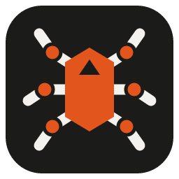
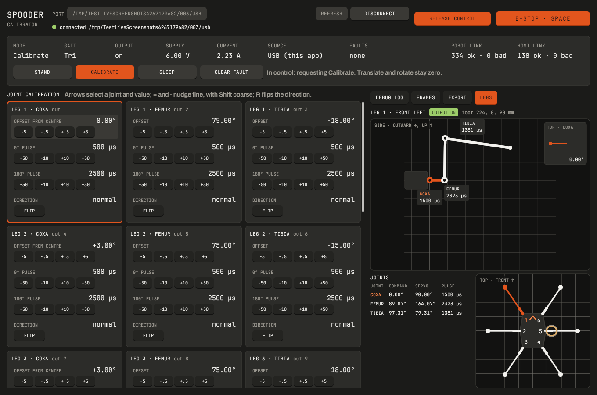
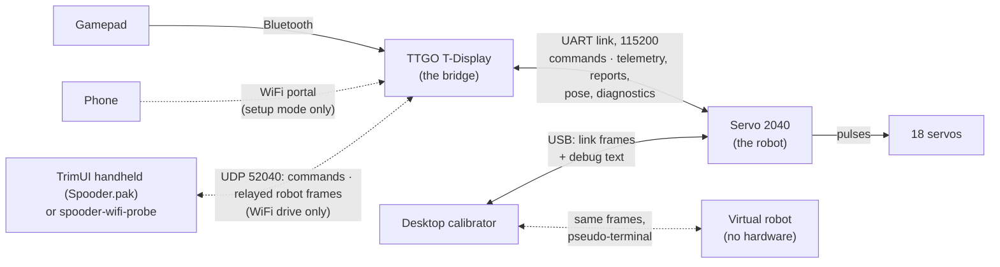
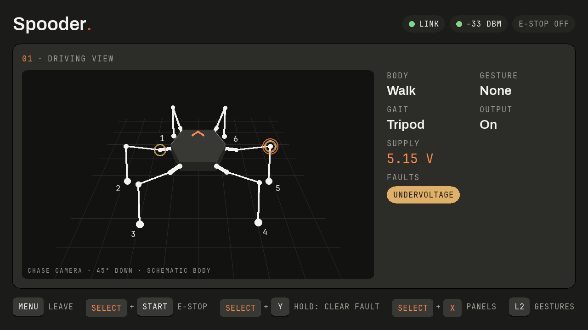

# Spooder

> A shameless iteration over [Aecert's Hexapod V1](https://github.com/Ryan-Mirch/Aecerts_Hexapod_V1).

Spooder is the firmware and tooling for a six-legged, eighteen-servo walking robot. The movement code (inverse kinematics, Bézier foot paths, the gait table) comes from Aecert's design. The rest is new: other boards, a power-protection layer, a gamepad bridge, a WiFi handheld, live calibration, and a desktop calibrator that rehearses everything against a virtual robot before the real one is powered.

<picture>
  <source media="(prefers-color-scheme: light)" srcset="docs/images/calibrator-light.png">
  
</picture>

*The desktop calibrator, connected to the virtual robot. More in [Screenshots](docs/screenshots.md).*

## How it fits together



- **The robot**: a Pimoroni Servo 2040 (RP2040), C++ on the pico-sdk with pimoroni-pico. It runs a 20 ms control tick: link input → power protection → supervisor → calibration → body state machine → servo output → status LEDs → telemetry.
- **The gamepad bridge**: a LilyGO TTGO T-Display v1.1 (ESP32), on ESP-IDF, Arduino and Bluepad32. It pairs a Bluetooth gamepad, sends commands to the robot every 20 ms, and shows the robot's status on its screen.
  - A latching switch from GPIO32 to ground selects the drive mode at boot: open (or not fitted) is **Bluetooth drive**, closed is **WiFi drive**, in which the bridge runs a WiFi access point (`spooder-drive-XXXX`) instead of Bluetooth and one handheld drives the robot with link-protocol command frames over UDP. The bridge keeps the link's safety rules for the handheld (150 ms liveness, its own fault-clear and request counters, one sender at a time) and relays the robot's frames back to it. `spooder-wifi-probe` on a laptop stands in for the handheld in the bench checks.
  - Hold the left button during the boot logo to enter **setup mode**, from either drive mode. The bridge then starts a WiFi access point (joined via a QR code on the screen) and a captive portal, through which a phone calibrates the robot. Bluetooth and WiFi never run together.
- **The handheld controller**: a TrimUI Smart Pro running NextUI, with the tool pak `Spooder.pak` (Go, gabagool and SDL2, in `desktop/handheld/`). It drives the robot through WiFi drive with the gamepad's mapping, and shows the robot's state, a chase-camera driving view and the WiFi link's quality on its 1280×720 screen. See [the handheld controller](docs/handheld.md).
- **The desktop calibrator**: Go with a Gio UI, in the Blackfyre look. It speaks the same link protocol on the robot's USB port, to monitor, drive and calibrate it without the bridge.
- **The virtual robot**: the robot's own control tick, compiled natively, behind a pseudo-terminal that behaves like the board's USB port. It runs the calibrator and the end-to-end tests without hardware.

## Features

- **Gaits**: tri, wave, ripple, bi, quad and hop, from the upstream gait table, with dynamic or fixed stride and adjustable height and speed.
- **Power protection**: overcurrent, overload, brown-out, low and high voltage, and an emergency stop. Faults latch, and clearing one never restarts motion by itself: a new mode request must follow.
- **Link protocol v3**: CRC-16 framed messages for commands (with gesture requests), telemetry, calibration sets and reports, the pose and the diagnostics; the robot sends the pose and the diagnostics on both links, and the bridge relays them to the handheld in WiFi drive. It is pinned by golden vectors that the C++ and Go implementations both test against.
- **Live joint calibration**: per joint, an offset, the pulses for 0° and 180°, and the direction.
  - Changes are guarded (Calibrate only, offset within ±30° of the default, pulses 400–2600 µs) and rate-limited to 60°/s.
  - They are held in RAM, confirmed by the robot's reports, and exported as the compiled defaults.
  - Coxa offsets are shown from the servo centre.
- **Bench simulation**: the real robot board driven end to end on USB alone, with no servo supply, its servo output forced off until restart. The calibrator, the bridge screen and the handheld show `SIM`. See [Getting started](docs/getting-started.md#bench-simulation).
- **Source arbitration**: the bridge or USB, whichever reports a connected controller. If both do, the robot sleeps.
- **Rumble feedback**: the gamepad rumbles when a fault latches, the bridge's e-stop switches, the robot link drops or returns, or a gesture is refused.
- **Gestures**: say hi and wiggle, from Stand: scripted, rate-limited moves that any other request, the e-stop or a fault interrupts. Dance, attack and ball follow once the body geometry is measured.
- **Legs pane**: forward kinematics of the reported pose, each joint's pulse, rings at the servo limits, and a top view of all six legs.
- **Four-view window**: the whole robot from the top, front, left and isometrically, from the same pose.
- **Charts**: ten minutes of supply, current, link counters and robot internals (motion share, backstop, tick time), with CSV export.
- **Handheld driving**: the gamepad's controls on a TrimUI Smart Pro over WiFi, with an e-stop and fault clear on Select combinations, a drive screen with the link's signal, frame rates, lost and late frames, and a driving view of the robot from behind.
- **Keyboard driving**: walk, steer, step aside and change gait, speed, height and stride from the calibrator.



*The handheld's driving view, rendered on the host by the pak's own drawing code.*

## Quick start

```sh
mise install          # the toolchains
mise run setup        # the pinned submodules
mise run desktop-sim  # the virtual robot and the calibrator, no hardware needed
```

[Getting started](docs/getting-started.md) covers the power limits, flashing the boards, bench simulation and wiring the link; [Controls](docs/controls.md) lists the gamepad's and the handheld's.

## Documentation

- [Getting started](docs/getting-started.md)
- [Controls](docs/controls.md)
- [The handheld controller](docs/handheld.md)
- [Screenshots](docs/screenshots.md)
- [Development](docs/development.md): the verification gates, the layout and regenerating the screenshots
- The hardware bring-up: [`spooder-hardware-check`](.claude/skills/spooder-hardware-check/SKILL.md)
- Specifications: [`openspec/`](openspec/), the source of truth for intended behaviour

## Status

The firmwares, the calibrator, the handheld's pak and the virtual robot are built and tested on the host. On the bench, the robot board and the bridge run in WiFi drive with the pak on the TrimUI, driving the board in bench simulation; the rest of the on-device checks are still open. The robot itself is being rebuilt and is not yet assembled. I²C body sensing (VL6180X range, LSM6DSO IMU) is specified but suspended.

## Credits

- [Aecert's Hexapod V1](https://github.com/Ryan-Mirch/Aecerts_Hexapod_V1): the mechanical design and the original movement code.
- [Bluepad32](https://github.com/ricardoquesada/bluepad32), [LovyanGFX](https://github.com/lovyan03/LovyanGFX), [pimoroni-pico](https://github.com/pimoroni/pimoroni-pico), the [pico-sdk](https://github.com/raspberrypi/pico-sdk), [Gio](https://gioui.org), [gabagool](https://github.com/BrandonKowalski/gabagool) and [go-sdl2](https://github.com/veandco/go-sdl2).
- The calibrator's fonts are Archivo and JetBrains Mono (OFL). `desktop/internal/appearance` and `desktop/internal/winreg` come from bopen (MIT, see `desktop/LICENSE.bopen`).

## Licence

Spooder is released under the [MIT licence](LICENSE). The movement code is derived from Aecert's Hexapod V1 and is included under this licence with its author's permission. `desktop/internal/appearance` and `desktop/internal/winreg` keep their own MIT notice (`desktop/LICENSE.bopen`). The fonts are under the OFL. See [CHANGELOG.md](CHANGELOG.md) for the history of changes.
