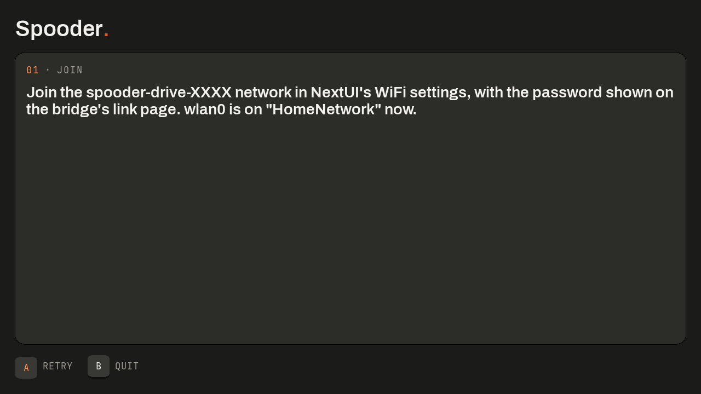
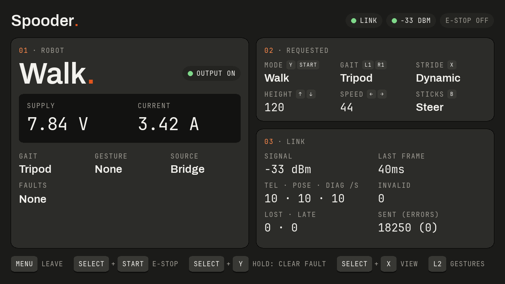
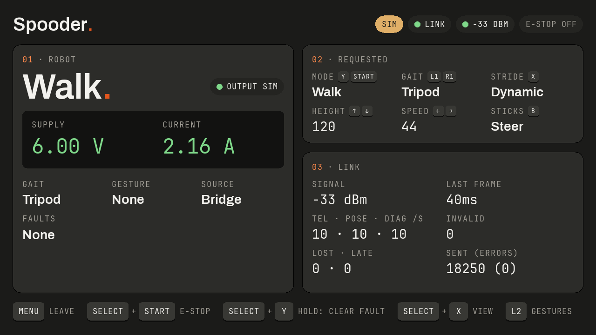
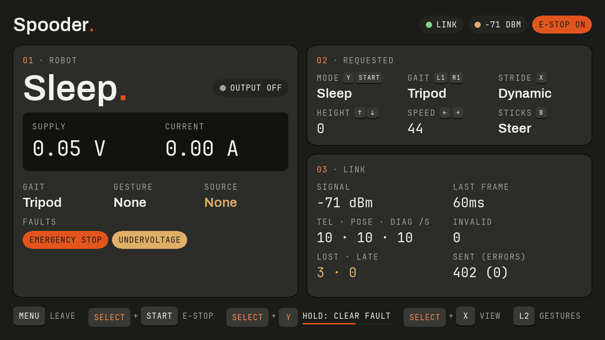
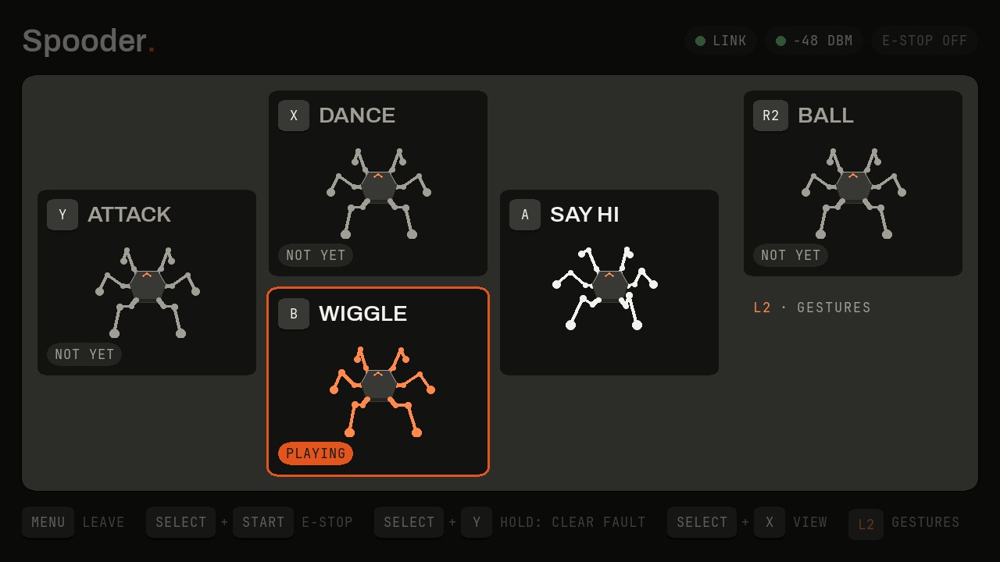
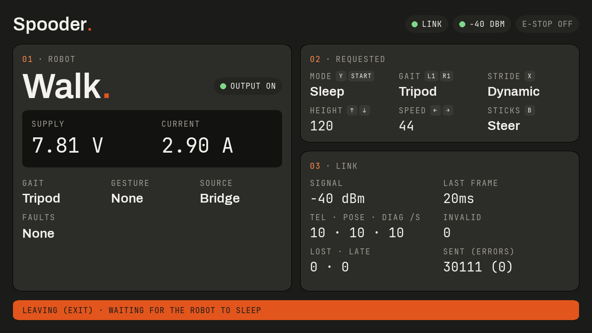

# The handheld controller

`Spooder.pak` is a NextUI tool pak for the TrimUI Smart Pro (Go, gabagool and SDL2, in `desktop/handheld/`). It drives the robot through the bridge's WiFi drive with the gamepad's mapping, and shows the robot's state and the WiFi link's quality on its 1280×720 screen.

## Install

1. Build the pak with `mise run handheld-package` (arm64, under rootless Podman). It writes `build/handheld/Spooder.pak.zip`.
2. Unzip it into `Tools/tg5040/` on the TrimUI's SD card, replacing any earlier `Spooder.pak`.
3. Put the card back in the TrimUI.

## Join and drive

1. Close the bridge's drive mode switch (GPIO32) and start the bridge in WiFi drive.
2. Join the bridge's `spooder-drive-XXXX` network in NextUI's WiFi settings. The password is on the bridge's link page.
3. Start **Spooder** from Tools.
4. Press `Y` to stand the robot, then `Start` to walk it.

The pak starts only on a network named `spooder-drive-` and four hex digits: on another network, the bridge's setup network `spooder-XXXX` included, or on none, it names the network to join; on the bridge's network without a 192.168.4.x address, it renews its address once first. The start screen shows the check, then what to do: `A` checks again, `B` or `Menu` quits.

While it drives, it checks the network once a second: if NextUI's WiFi moves the TrimUI to another network, the pak sends nothing (the robot sleeps, as when the handheld goes out of range), the header's link chip reads `OFF NETWORK` and the robot panel (on the driving view, its title) names the network to rejoin. Back on that network, it sends again with Sleep requested; press `Y` to stand again. Another bridge's network counts as another network: restart the pak to drive that robot. The controls are in [Controls](controls.md#trimui-handheld).

## The drive screen

The panels page shows the robot (body mode, output, supply voltage and current, gait, gesture, the source in control and the faults by name), what the pak requests, with small keys naming the controls that change each value (each presses down while its control is held, unless `Select` or `L2` turns it to another function), and the link's quality: the signal (also in the header, its dot green from -67 dBm, amber from -80 dBm, orange below), frames per type and second, invalid datagrams, lost and late frames, and the time since the last frame. The keycaps along the bottom press down while their control is held; the fault clear's fills as its hold runs. On both pages the supply voltage and current read green, amber or orange by band against the protection limits the robot reports in its diagnostics: amber within the gap between the brown-out and undervoltage limits of either voltage limit, or from the sustained current; orange at or past undervoltage, overvoltage or the trip current. The figures stay the label; before the robot has reported its limits they read white, and while stale, grey.

`Select` + `X` switches to the driving view: the robot from a chase camera fixed behind it, looking forward and 45° down in perspective over a ground grid at the lowest foot, drawn from the robot's pose frames. Joints near or at their servo limits are ringed, the orange chevron marks the front, and the body mode, the gesture playing, gait, output, supply and faults sit beside it. The camera follows the body, and with no odometry the grid does not move as the robot walks.

While the robot reports bench simulation, a `SIM` chip leads the header on both pages and the output reads as simulated.

Faults are named chips, the emergency stop in orange. Holding `Select` + `Y` fills the fault clear's keycap until the clear is sent.

## Sound

The pak plays short generated tones, at about -12 dBFS, so the driver hears what happens without looking at the screen. They are the bridge's rumble events, and two more:

| Event | Tone |
|---|---|
| A protection fault latched (the e-stop's excepted) | three short low beeps |
| E-stop set / released | a falling / a rising two-tone |
| Link lost (no telemetry for 500 ms, after it arrived) / regained (not at the start or a resume) | one low / one high tone |
| Gesture refused (not playing 600 ms after the request) | a short low buzz |
| Gesture accepted (telemetry reports it playing) | a short high blip |
| Leaving (Menu or Power) | a falling three-tone |

One event sounds at most once a second, and a safety tone cuts a confirmation short. The device's volume buttons set the level. `Select` + `B` switches the sound off (a `SOUND OFF` chip shows in the header) and on again; the choice is kept in the pak's folder as the file `sound-off`. Whether NextUI's mute silences the pak has not been checked on the device yet; `Select` + `B` always does. Without an audio device the pak drives silently.

## Gestures

While `L2` is held beyond half travel, on either page, the gesture overlay covers the drive screen, and it closes when `L2` is released. It only shows the layer: the controls and the command frames are the same with it open. Its five tiles sit as their buttons do on the TrimUI, `A`, `B`, `X` and `Y` as a diamond with `R2` beside it, each with the gesture's name and its keycap, which presses down while the button is held.

- Say hi (`A`) and wiggle (`B`) have scripts: their tiles loop the robot playing them, drawn from the joint angles of the robot's own script every 50 ms, holding the last pose briefly before starting again.
- Dance (`X`), attack (`Y`) and ball (`R2`) have no script yet: their tiles show the standing robot muted and marked `NOT YET`, and the robot does not play them.
- A request lights its tile for a moment, marked `REQUESTED`. While fresh telemetry reports a gesture playing, its tile stays lit, marked `PLAYING`.
- `STAND FIRST` shows while the robot cannot start a gesture: no telemetry, telemetry stale for 500 ms, or a body mode other than Stand or Perform. The robot plays a gesture only from a settled Stand: release `L2`, then press `Y` to stand it from Sleep or `Start` to stop it walking, and wait for it to settle.

Which gestures have a script, and the tiles' animations, come from `test/golden/gestures.txt`, which a host test writes from the robot's gesture player and keeps in step with it; the pak embeds a table generated from it (see [desktop/CLAUDE.md](../desktop/CLAUDE.md)).

## Leaving

Menu, a short Power press (suspend) and a 2 s Power hold (power off) first request Sleep, and act once two newer telemetry frames in a row report Sleep or output off, or after 3 s. If the pak stops sending without that, the bridge's 150 ms lapse makes the robot sleep. WiFi power saving is turned off while the pak runs and restored however it exits.

## Without the board

`build/virtual-robot/virtual-robot --wifi-bridge` runs a virtual bridge in WiFi drive on 127.0.0.1:52040, and `mise run handheld-build` gives a desktop build (`build/handheld/amd64/spooder-handheld`) that drives it with `--addr 127.0.0.1:52040`. The handheld's end-to-end tests (`mise run e2e`) drive the same pair.

Installing, joining and the on-device checks are in the [hardware check](../.claude/skills/spooder-hardware-check/SKILL.md).
