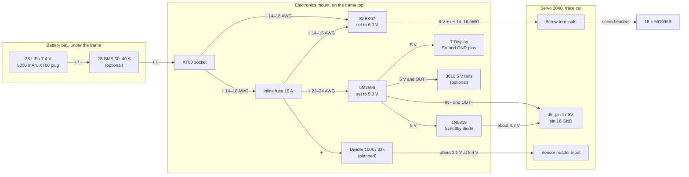
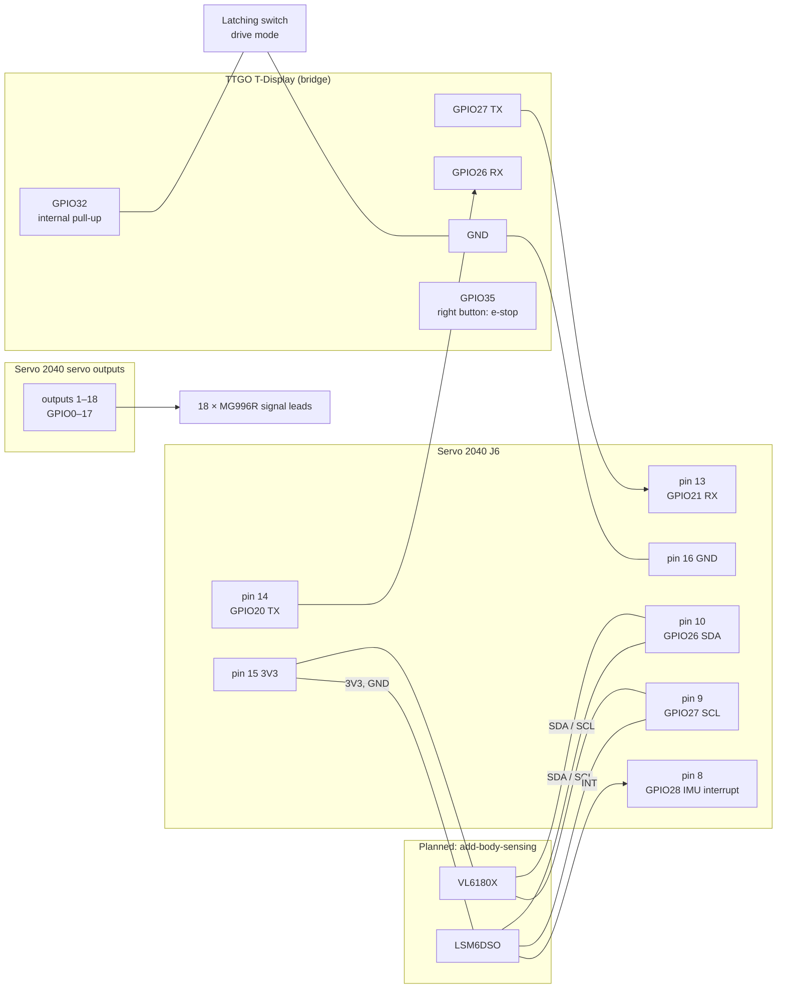

# Wiring

How Spooder's power and signals are wired. The parts are in the [bill of materials](bom.md). The cable routes on the deck are in [the electronics mount's README](../hardware/spooder-electronics-mount/README.md#cable-routes), and the staged bring-up (set the converters, then power on one stage at a time) is in the [`spooder-hardware-check`](../.claude/skills/spooder-hardware-check/SKILL.md) skill. Where this page and that skill disagree, the skill wins.

## Rules

- **Cut the Servo 2040's "Separate USB and Ext. Power" trace** before connecting the 6 V servo rail. With it intact, the terminal supply also feeds USB VBUS and J6 pin 17.
- **Set the converters before connecting a board:** the SZBK07 to 6.0 V (the MG996R's limit is 7.2 V), the LM2596 to 5.0 V, each with a multimeter.
- **External ground goes only to logic GND:** J6 pins 1, 3, 5, 11 or 16. Never use the servo connectors' ground pins: the current shunt is in the servo ground return.
- **J6 is 3.3 V logic only.** No pin is 5 V tolerant.
- **Never join the two boards' 5 V rails.** Each takes 5 V from the LM2596 by its own path, and each has a diode from its USB port.
- **The XT60 is the power switch.** Unplug the pack before opening the cover.

## Power

- **Servo current** flows pack → XT60 → fuse → SZBK07 → screw terminals → servos. The pack's negative reaches the board only through the SZBK07 and the screw terminals, so servo current never returns through the thin logic wires.
- **One ground point:** the LM2596's input and output negatives, the T-Display's GND and the divider's ground all go to J6 logic GND. The fans' negatives go to the LM2596's OUT−.
- **The fans** take 5 V from the LM2596's output pads, before the diode, so their current does not pass through it.
- **Near an empty pack** (about 6.4 V), the LM2596's output sags to about 4.9 V and J6 pin 17 to about 4.6 V. Power protection watches the servo rail, not the pack, so stop and charge before the pack gets that low.

## Signals

### Bridge link

| TTGO T-Display | Servo 2040 (J6) |
|---|---|
| GPIO27 (TX) | pin 13, GPIO21 (RX) |
| GPIO26 (RX) | pin 14, GPIO20 (TX) |
| GND | pin 16 (logic GND) |

Cross TX to RX. With the bridge unplugged, the robot's RX pull-up keeps the line idle.

### Drive mode switch

A latching switch between the T-Display's GPIO32 and its GND, with no resistor: the bridge enables the internal pull-up. Open boots Bluetooth drive, closed boots WiFi drive. The bridge reads the switch once at boot. Before soldering, confirm that GPIO32 reaches the header on the fitted v1.1 board.

### J6 header

| Pin | Signal | Use |
|---|---|---|
| 1, 3, 5, 11, 16 | GND | logic ground |
| 2 | USER_SW (GPIO23) | the BOOT/USER button: bench simulation's entry |
| 4 | RESET | |
| 6, 7 | SWDIO, SWCLK | debug |
| 8 | GPIO28 | IMU interrupt (planned) |
| 9 | GPIO27 | I²C1 SCL (planned) |
| 10 | GPIO26 | I²C1 SDA (planned) |
| 12 | GPIO19 | spare |
| 13 | GPIO21 | link RX, from the bridge's TX |
| 14 | GPIO20 | link TX, to the bridge's RX |
| 15 | 3V3 | sensor supply (planned) |
| 17 | 5V | logic supply in, through the Schottky diode |

The board has no pull-ups on GPIO19–21 or 26–28. The I²C sensors need breakouts with pull-ups, or 4.7 kΩ resistors to 3V3.

### Servos

Leg *i* (0–5) and joint *j* (0 coxa, 1 femur, 2 tibia) plug into board output 3*i* + *j* + 1 (GPIO 3*i* + *j*). Legs 0–2 are on the left, front to rear, and legs 3–5 on the right, rear to front.

| Leg | Position | Coxa | Femur | Tibia |
|---|---|---|---|---|
| 0 | left front | 1 | 2 | 3 |
| 1 | left middle | 4 | 5 | 6 |
| 2 | left rear | 7 | 8 | 9 |
| 3 | right rear | 10 | 11 | 12 |
| 4 | right middle | 13 | 14 | 15 |
| 5 | right front | 16 | 17 | 18 |

The servo leads go down from the header through the deck's two lead slots to the frame below.
