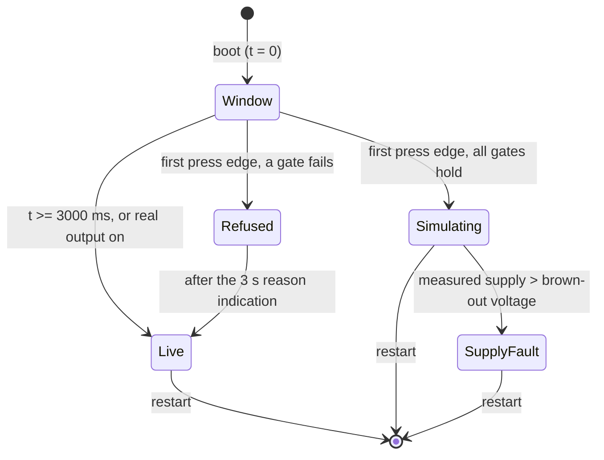

# Design

## Context

See proposal.md for the motivation. The robot's control loop is `core/robot/robot_tick`, shared with the virtual robot. `firmware/servo2040/src/main.cpp` reads the links and `power_monitor::read()` into `robot_tick::Inputs` every 20 ms and implements `robot_tick::Hardware` in its `Board` class, which forwards the servo calls (`setInhibited`, `stopServos`, `applyServos`, `servosOn`, `servoPulses`) to `servo_output`. The virtual robot implements the same interface over `sim::Servos` and feeds the tick `sim::Supply::read(servos)` (`tools/virtual-robot/src/sim.{h,cpp}`): the model of `servo_output`'s rules and of the supply current.

Board facts the design relies on: the USER button is GPIO23 (`servo2040::USER_SW`, active low), and it is the combined BOOT/USER switch, so holding it through reset enters the ROM's BOOTSEL and the firmware never runs. RESET is the RUN pin and cannot be read. The board has no VBUS sense GPIO, and pico-sdk forces VBUS detect present, so a charger or a bare cable cannot be told from a host by VBUS; only enumeration (`tud_mounted()`) shows a host. `stdio_usb_connected()` also needs DTR, so it is false for a host that has not opened the port. The servo supply's voltage sense (C21 220 µF draining through R3 + R8, 13.9 kΩ) takes about 5.5 s to fall from 6 V to 1 V.

## Goals / Non-Goals

**Goals:** the smallest firmware mode that makes the real board drivable on the bench with no servo supply, with the no-pulse invariant held at the board boundary and host-tested, and the mode visible to every viewer on main.

**Non-goals:** simulation in the virtual robot; persisting the mode; entering simulation from a link frame or the console; simulating sensors; a protocol version change; the setup portal's SIM indication (a follow-up below); the handheld pak's is in `add-handheld-controller`.

## Decisions

### D1. The supply and servo model moves into `core/robot/bench_model`

`sim::Servos`, `sim::Supply` and their constants move unchanged into `core/robot/bench_model.{h,cpp}` (namespace `bench_model`), hardware-free and listed in the root `platformio.ini`. The virtual robot keeps `sim::Bridge` and uses the moved types (a `using` in `sim.h`, so its `main.cpp` changes little). Its behaviour does not change, so the `virtual-robot` spec and the end-to-end tests stay as they are. Alternative considered: a second, firmware-only model; rejected because the two would drift, and the virtual robot's model is already what the e2e tests check protection against.

In simulation the firmware uses `voltageV = DEFAULT_SUPPLY_V` (6.0 V) and load 1. The model's `Servos` is the servo state in simulation: its `on`, `desiredUs` and `legsOn` stand in for `servo_output` (D3), so pose frames carry modelled pulses.

### D2. Entry: `bench_sim::Entry`, a per-tick decision in core

`core/robot/bench_sim.{h,cpp}` holds the entry decision. The firmware calls `bench_sim::step(entry, inputs)` once per tick, before `robot_tick::tick`, with the tick time, the USER button level, the measured supply voltage, whether real servo output is on, and whether a USB host is attached. It returns the phase and the LED indication.

- Window: `WINDOW_MS = 3000` from the first tick's time (boot). Each tick is one sample of the button; a 20 ms sample period is the debounce. A press edge is a pressed sample after at least one released sample inside the window, so a button held at boot (or stuck) never selects simulation.
- Supply gate: `supplyAbsent` starts true and becomes false, for the rest of the boot, on the first tick whose measured voltage is at or above `ABSENT_SUPPLY_V = 1.0 V`. Not the 4.8 V brown-out limit: a flat battery is still a supply, and an uncut USB/external trace puts USB 5 V on the servo rail, which must block entry.
- Output gate: real output on at any tick closes the window (it cannot be on without a supply, so this is the backstop for a sensing fault).
- USB gate: `tud_mounted() && !tud_suspended()` at the press, read by the firmware in `main.cpp` (both builds have TinyUSB; `usb_link` exists only in the links build). Not `stdio_usb_connected()` (needs DTR).
- One decision per boot: the first press edge decides. A refused press closes the window and shows the reason for `REFUSED_SHOW_MS = 3000`; supply first, then USB, when both fail. Allowing retries was considered; rejected because a retry inside 3 s cannot fix the supply gate (it is "since boot"), and one decision keeps the LED story simple. A late-enumerating host is the only case a retry would help: the window starts at boot and enumeration takes about 1 s, so pressing after the LEDs show the window is enough; if not, RESET and press again.
- Simulating latches for the rest of the boot. It is held in the `Entry` object in RAM (a static in `main.cpp`), zeroed at every start-up; nothing writes the watchdog scratch registers or flash. A USB loss in simulation is ignored: the USB gate is read only at the press.
- Supply fault: in Simulating, a measured voltage above `limits.brownoutV` on any tick latches `supplyFault` until restart.

Alternatives considered: entering from a link frame (rejected: a mode that removes the servos must not be reachable from a computer that might be talking to a powered robot), and holding the button through reset (impossible: that is BOOTSEL).

### D3. No pulse by construction: `bench_sim::BenchBoard`

`BenchBoard` (in `bench_sim.h`) implements `robot_tick::Hardware` with `final` servo methods, and declares the real servo port as protected pure virtual hooks: `realSetInhibited`, `realStop`, `realApply`, `realOn`, `realPulses` and `realForceOff`. The firmware's `Board` derives from `BenchBoard` and implements only the hooks (forwarding to `servo_output`) and the non-servo methods. `BenchBoard::enterSimulation()` first sets a flag that is never cleared, then calls `realForceOff()` once, so the sticky barrier below is in place before `enterSimulation()` returns, ahead of any further tick or stop; from then on:

- `setInhibited(x)` calls `realSetInhibited(true)` and sets the model's `inhibited = x`;
- `stopServos()` calls `realStop()` and the model's `stop()`;
- `applyServos(...)` calls only the model's `apply(...)`; there is no path to `realApply`;
- `servosOn()` and `servoPulses()` return the model's.

Before entry each method forwards to its hook, unchanged, and `realForceOff` is never called. The host test derives a fake from `BenchBoard` that records `realForceOff` (called exactly once, inside `enterSimulation()`), whose `realApply` fails the test if called after entry and whose `realSetInhibited(false)` fails likewise, and drives `robot_tick::tick` through Stand, Walk, Calibrate, an e-stop and a fault clear.

As a second, independent barrier in the firmware, `servo_output` gains `forceOff()`: it stops and disables every output and sets a sticky flag that makes `apply()` return at once and `setInhibited(false)` a no-op until restart. The `realForceOff()` hook calls it; `realStop()` stays the ordinary stop. This one is not host-testable (it is pico-sdk code); it is checked by review and on the bench with a logic analyser or oscilloscope (task 7.1).

Alternative considered: a `simulated` check inside `Board` only; rejected because it puts the invariant in untested firmware code, which the brief rules out.

### D4. What the tick sees: `robot_tick::Inputs::bench`

`robot_tick::Inputs` gains `bench`: `simulated`, `supplyFault` and the LED indication (D5), all zero by default, so the virtual robot and the existing tests are unchanged. In simulation the firmware sets `in.power = model.read(servos)` instead of `power_monitor::read()`; the measured reading still goes to `bench_sim::step`. The tick's working-time measurement (`previousTickUs`, reported in diagnostics) starts before `bench_sim::step` and the model's reading, so it covers all the new per-tick work. The tick uses `bench` to:

- set `TELEMETRY_SIMULATED` in every telemetry frame (D6);
- pass `supplyFault` to protection as a present condition (below);
- pass the indication to `led_pattern::State`;
- add `; SIMULATION` to the status line, and log `bench simulation: entered` / `bench simulation refused: <reason>` once (the firmware's `Entry` reports the transition; the tick logs it, so the text goes through `Hardware::log` and stays printable ASCII).

Protection gains a fault, `SIMULATION_SUPPLY = 1u << 6`, in `INHIBITING_FAULTS`. `protection::step` gains a defaulted parameter `simulationSupply` that makes the condition present; like the emergency stop it latches at once, and since `bench_sim` holds the condition until restart, a clear never removes it (the existing rule: a clear keeps faults whose condition persists). Supervisor, LEDs and telemetry then treat it like any inhibiting fault. Alternative considered: keeping the fault outside protection, in `bench_sim`; rejected because telemetry's `faults` and the supervisor's stop path already come from protection, and a second fault source would need its own reporting everywhere.

### D5. LED indications

All on LED 5, so the main LEDs keep their normal start-up indication (amber pulse while waiting for the supply):

| State | LED 5 |
|---|---|
| Window open, no USB host yet | amber, on for 500 ms of each 1 s, in every state (overrides LED 5's normal content); a press now is refused. Slower than the stale link's 250 ms amber blink, so the two stay distinct |
| Window open, USB host attached | white, blinking at 250 ms, in every state (overrides LED 5's normal content, until the window closes at 3 s) |
| Refused, supply present | red alternating with amber, 250 ms, for 3 s |
| Refused, no USB host | red alternating with blue, 250 ms, for 3 s |
| Simulating | violet (160, 0, 255) for half of each 1 s period, LED 5's normal content for the other half, in every state including faults, except the simulation supply fault (below) |

The simulation supply fault gets its own fault colour, cyan alternating with red on all six (cyan is not a fault colour today), and is placed first in the fault priority list, ahead of the emergency stop: a real supply on a robot whose operator thinks nothing can move is the most important thing to show. While it is latched it also replaces the simulation overlay on LED 5, so all six LEDs show cyan and red; the fault itself only exists in simulation, so nothing is lost. `led_pattern::State` gains a `bench` field (an enum: none, available, refused-supply, refused-USB, simulating).

### D6. Reporting and compatibility

- `TELEMETRY_SIMULATED = 1u << 5` in `core/protocol/protocol.h` and `desktop/internal/protocol`. Bits 6-7 stay free.
- `Telemetry.outputsOn` and the pose frame's outputs-on flag report the modelled output (the tick takes them from `hw.servosOn()`, which `BenchBoard` answers from the model), so viewers draw the legs as on and charts look as on a powered robot; the flag carries the truth. Reporting off was considered; rejected because the leg view and charts would then hide the simulated motion, which is the point of the mode, and every viewer on main marks SIM (D7).
- Receivers checked, each tests flag bits with masks and ignores the rest: the bridge's `status_screen` (`TELEMETRY_SOURCE_CONFLICT`, `TELEMETRY_USB_IN_CONTROL`), the setup portal's page script (`fl&1`, `fl&2`, `fl&4`), the desktop's `session.SourceFrom`, `console` (masks the bridge bits), `ui/model.go`, `session/csv.go`; the decoders (`protocol.cpp`, `protocol.go`) copy the byte unchanged; the golden vector `telemetry_extremes` already has `flags=255`. Unknown fault bits are shown as `0x0040` on the bridge strip, `fault bit 6` on the desktop and `0x40` on the portal. So `protocol::VERSION` stays 3, following the precedent of the reserved telemetry bytes 23-26. A new golden vector, `telemetry_bench_simulation` (flags 32, faults 64, output on), pins the bit for other implementations.
- The virtual robot leaves `bench` zero, so it reports the flag clear.

### D7. Viewers

- Bridge (`core/status/status_screen`): `SIM` in the status strip, warning tone, after the source state and before the switch notice; the drive page's output field shows `OUT SIM` instead of `OUT ON`; strip and fault names for the new fault (`SIM SUPPLY`, `sim supply`). Tested in `test_status_screen`.
- Desktop: a banner (`Bench simulation`: no servo moves; the robot simulates its supply), the output cell as `on (sim)`, the fault name `supply in simulation`, and `SIM` in the console's telemetry line. CSV export is unchanged (follow-up).
- Implementation notes (task group 4): `SIM` and `OUT SIM` need fresh telemetry, like every robot value on the bridge screen; output off in simulation stays `OUT OFF` (desktop: `off`). `OUT SIM` takes the warning tone. The strip words wrap as before: the combinations reachable in simulation (the modelled supply raises no voltage or current fault at load 1, so an e-stop, the supply fault and either source state) fit whole beside `SIM`; only unreachable ones, such as every fault at once with a source conflict, cut the last word, as the strip already did. The desktop banner reads from the latest telemetry, fresh or not, like the source conflict banner; its wording: "No servo moves: the robot runs on USB power and simulates its servos and supply. Restart it to leave." The console line gives `SIM` as its own field right after the output field. The banners' list was moved into a pure `bannerSpecs` so the tests can check it without a GPU.

### D8. Builds

Simulation is in both robot builds (links and `--serial`): the board boundary and entry are shared, and the serial build shows it on the LEDs and the console. Nothing is behind a build flag, so the default build is the one tested on the bench.

## Risks / Trade-offs

- [The servo model and real output could disagree about the mode] → One flag in `BenchBoard`, set once; `servo_output::forceOff` sticky below it; host test with a fake that fails on any real apply after entry.
- [A fault in the voltage sense reads 0 V with a supply connected] → Simulation could then be entered on a powered robot. The forced-off output still holds; the supply fault would not latch. Accepted: entry also needs a deliberate button edge in the first 3 s and a USB host, and `forceOff` does not depend on the sense.
- [TinyUSB may report a host disconnect as unmount or as suspend, or a charger may enumerate] → Only the entry gate depends on it, and simulation ignores USB after entry whichever is reported; the bench check (task 7.4) records the RP2040's behaviour; a mistaken "attached" only allows entry, never pulses. The board is powered from USB in simulation, so a physical unplug powers it off and the next start is live: the bench check disconnects the host logically (deauthorising the device, suspending it) instead.
- [The window blink on LED 5 hides the source indication for 3 s at start-up] → The source is rarely settled in the first 3 s; accepted.
- [`outputsOn` reports on while nothing moves] → The SIM indication on both viewers on main; the handheld pak shows its own (`add-handheld-controller`).
- [Boards that boot with the button held enter BOOTSEL] → The documented gesture is press after the LEDs show the window.

## Migration Plan

Flash the robot; the bridge and desktop can follow in any order (older ones show the new fault by number and ignore the flag). Rollback is flashing the previous robot image. Risk tier: high (safety path); it goes through the `REVIEW.md` security lens.

## Assumptions

- The window is measured from the first control tick (boot), and the press is the sampled level on a tick, active low with the internal pull-up.
- One press decides per boot; a refusal closes the window.
- The simulated supply is a steady 6.0 V at load 1; there is no runtime control of it on the board.
- The simulation supply fault threshold is the configured brown-out voltage; a reading between 1 V and that, during simulation, does not latch it.
- The simulation supply fault is a new protection fault bit (6), inhibiting, first in the LED priority.
- Simulation is available in the `--serial` build too.
- In simulation `outputsOn` and the pose output flag report the modelled output.
- The main `power-protection`, `controller-link` and `pose-telemetry` requirements gain a simulation exception (this change's deltas), so they do not contradict `bench-simulation`.
- The bench has a logic analyser or oscilloscope for the no-pulse check (task 7.1); a multimeter's DC average cannot show an isolated pulse. With fewer channels than 18 outputs, the pins are captured in groups over repeated runs.
- The move of the model into `core/robot/bench_model` (D1) keeps its behaviour; `core/`'s lint asks for two textual edits: `Servos::apply`'s declared parameter is named `released`, as in its definition, and the powered-servo count is converted to `float` explicitly (it is at most 18).
- The golden vector `telemetry_bench_simulation` is a walk in simulation with the supply fault latched: seq 40, Walk, gait 1, output on, 6.00 V, 2.16 A, link counts 812/3 and bridge counts 1207/1, flags 32 and faults 64 only. Existing desktop console fixtures (`console_test.go`'s expected lines, `testdata/transcript.txt`) gain its line as an older receiver formats it (`faults fault bit 6`, no SIM) until task 4.2 names both.
- The tick's working time in diagnostics includes `bench_sim::step` and the model's reading, so the existing diagnostics frame measures the whole of the new per-tick work; the acceptance limit is a longest working time below 20 ms.
- Entering simulation arms the supervisor's resume gate like a latched fault: a request held from before the entry (a front-end repeating Stand while the supply was absent) does not start the body once the modelled supply settles; a new request made after the entry does. This is how the core reads "the body starts on the next new request".
- The 250 ms of the window and refusal patterns is the blink period (on for the first 125 ms), as for the existing 250 ms LED 5 blinks; the simulation overlay is violet for the first 500 ms of each second.
- The window and refusal overlays replace LED 5 in every state, as the window does; all LED 5 overlays take the brightness of the state they are drawn in (fault brightness during a fault).
- With the simulation supply fault first in the fault list, the firmware's servo-output failure indication, which showed every fault bit (0xFFFF) and so the emergency stop's steady red, now names the emergency stop alone, to keep that steady red.
- `bench_sim::step` reports each entry or refusal once, as `robot_tick::BenchEvent` on the tick of the press; robot_tick logs it then (`bench simulation: entered`, `bench simulation refused: servo supply present`, `bench simulation refused: no USB host`), and names the new fault `simulation supply` in `fault latched:` lines.
- LED numbering (task group 5): this design, the tasks and `core/status/led_pattern` count the LEDs from 0, so "LED 5" is the sixth LED, the command-source LED (`led_pattern::INPUT_LED`). The user-facing docs (the `spooder-hardware-check` skill, the readme, the changelog) count from 1, as they already did for the command source, and so call it LED 6; the skill states the mapping.

## Follow-ups

- The setup portal's SIM indication and fault name (it shows `Out on` and `0x40`).
- A simulation column in the desktop's CSV export.
- A SIM page in `tools/bridge-screenshots`.
- Simulation in the virtual robot, if wanted for e2e tests of the viewers' SIM indication against a running robot.
