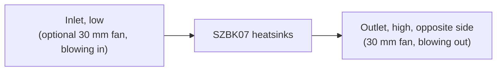

# Design

## Context

The frame top (`hardware/aecert-hexapod-v1/stl/Frame Top.stl`) is the base.
- **Surfaces:** its raised ring is at z 25.75 and its recessed floor at z 20.
- **Inserts:** eight M3 heat-set inserts, at (±20, ±73) on the ring and (±12.86, ±19.06) on the floor.
- **Solid and open areas:** the ring is solid at |x| ≥ 52 and along the front and rear edges. Most of the rest is open into the battery bay, which the 2S pack fills.
- **The legs:** nothing on them comes nearer the centre than r 81.8 above the frame top, which gives a keep-clear radius of 78.8 with a 3 mm margin.

The electrical wiring is set by the hardware-check skill ("Battery wiring"). This change updates it for logic power on the boards' pins. See proposal.md for the scope and the specs for the requirements.

## Goals / Non-Goals

**Goals:**
- Every requirement in `specs/electronics-mount` is backed by a check in the build, or by a stated measurement on the printed parts.
- Print-ready output for a P1P with an AMS: STL for the single-colour parts, 3MF for the cover.
- A layout driven by the wiring: the cable runs come out short and direct, rather than wiring being fitted around a layout drawn first.

**Non-Goals:**
- A parametric framework for other robots: constants and checks serve this frame.
- Finite-element strength analysis. Strength comes from wall and rib sizes chosen with margin, and a test print of the bumper.

## Decisions

### Generated geometry with checks, in build123d
The parts are Python (build123d, pinned in inline script metadata, run with `uv`). Every size is a named constant with its source.

- **Why:** a reviewable diff, a deterministic build, and computable checks: overlaps, keep-clear, overhangs, routes.
- **Alternatives:**
  - FreeCAD or Fusion by hand: no diffable source and no automatic checks.
  - OpenSCAD: weak on chamfers and on importing a STEP for clearance.

### Layout follows the wiring
The parts are placed by their connections:
- the Servo 2040's EXT terminal faces the SZBK07's output end;
- J6 faces the LM2596 and the T-Display;
- the servo header faces the lead slots;
- the sensor header faces the end-stop entry;
- the XT60 and the fuse sit at the SZBK07's input end.

The USB-C ports need no wall, because both boards are reached by opening the cover. That freedom is what lets the boards turn to face their wiring.

- **Alternative:** a board fixed at a wall for external USB access. It was rejected once opening the cover became acceptable, because it bent the cable runs round the box.

### Everything electrical on the deck
The cover carries nothing electrical: no T-Display and no fan with a fixed lead. The T-Display sits in a holder on the deck, under a window in the lid. A fan on the cover's wall connects through a 2-pin plug, or sits in a holder on the deck behind its grille, whichever the measurements favour.

- **Why:** running open is routine, and the cover must lift off with nothing to unplug.

### Fastening: M3 screws into heat-set inserts
There are as few screws as hold the cover square, about four. They sit through the walls or down through the lid, wherever the bumpers leave a straight path. The inserts go in the deck's posts, and horizontal insert holes are teardrops.

- **Alternatives:**
  - magnets: instant to open, but less secure on a walking robot;
  - printed snap latches: PETG fatigue;
  - a hinge: a weak point, and the wiring would have to flex.

### Cooling path

The outlet sits high on the opposite side because warm air rises, so the passive draught and the exhaust fan both work the same way. An exhausting fan lowers the pressure in the box, so air also enters at small gaps: the XT60 window, the lead slots, the seam. That is harmless, because the inlet is the largest opening. The fans run on 5 V from the LM2596.

### Bumpers: PETG leaf springs on rails
Each corner has a rail on the cover, and a bumper slides down it: a curved PETG leaf about 1.2–1.6 mm thick, standing off the corner. Its depth and stand-off are set so the bumpers stand proud of the body and the lid, while staying inside the keep-clear region.

- **Why:** without TPU, compliance has to come from shape. A leaf spring flexes and recovers where a solid PETG block would pass the knock straight on.
- **Later:** the rail's profile is the interface, so a TPU bumper later is a drop-in.
- **Alternative:** a printed honeycomb crush zone, rejected because it only works once.

### Shape: a faceted body
The body is faceted, with chamfered edges. 45° corner faces carry the bumpers inside the keep-clear radius, and the top edge has a 45° chamfer, which prints lid-down. Detail on the walls is recessed. Detail on the lid comes from flush colour inlays, not recesses: the lid's outer face prints first, on the bed, so a recess there would bridge over air.

### Colour through the AMS
- The cover is exported as a 3MF with the body and the inlays as separate parts. The inlays fill only the first 3–4 layers, so the purge waste stays small.
- Single-colour parts are exported as STL.
- Colours: the body black, the inlays and bumpers yellow, the deck black, the inside holders white.

### Print orientation per part
Each part has a stated orientation:
- the deck prints flat;
- the cover lid-down;
- the bumpers upright;
- each holder is oriented so its features rise from the bed.

The overhang check uses the same orientation. A feature that cannot print in its part's orientation moves to a separate part. The T-Display holder is the expected case.

### Verification
The build runs these checks, and fails on any of them:
- one solid per part;
- the keep-clear region, nothing below the frame floor, the bed size;
- holes on the frame's inserts;
- overlaps between printed and held parts;
- enclosure;
- reserved routes kept clear;
- frame clearance under ties and slots;
- overhangs;
- screwdriver paths;
- the IMU pad's position;
- the fan positions.

Each new check is first shown to fail on a deliberately bad shape. What can't be computed is checked on test prints and on the robot: the bumper's flex and fit, insert holding strength, the fan's fit and airflow direction, and a fit check on the frame.

## Risks / Trade-offs

- **[Unmeasured part sizes]** The SZBK07 varies by batch (about 60 × 53–54 × 27–28 mm), and its terminal ends are assumed. The LM2596's hole spacing varies too. → The first build uses nominal values (task 1.0). Measure before printing (task 1.1, a hardware task that keeps the change unarchived until done). Every size is one constant, and the checks re-validate after a change.
- **[The LM2596's dropout]** It needs its input about 1.5 V above its output. Near empty (about 6.4 V), the 5 V rail sags to about 4.9 V, and to about 4.6 V after the Schottky diode. → The RP2040's regulator copes. The power protection's minimum voltage should trip before that matters. Document it in the hardware-check skill.
- **[PETG bumpers crack]** A leaf spring can crack under a hard impact. → Bumpers are replaceable, and the test print checks their flex. TPU stays a drop-in later.
- **[The cover warps]** Tall PETG walls on an open-frame P1P can warp. → Chamfered corners, a brim if needed, and no draughts.
- **[Heat]** The real load of the SZBK07 is unknown. → The fan positions are ready. Measure the converter's temperature after a 10-minute walk.
- **[The IMU near the converter]** Heat and switching noise can disturb the IMU. → The IMU pad is placed at a minimum distance from the SZBK07, and is checked.

## Migration Plan

The uncommitted prototype in `hardware/spooder-electronics-mount/` is replaced, not built on. Its reusable lessons are the checks and the build123d pitfalls, which the implementation reapplies. Nothing on the robot changes until the parts are printed and fitted. Rollback means not printing.

## Open Questions

- **The exact placement** of each part, within the principles above, follows from the measurements in task group 1.
- **The fan's mounting:** on the cover's wall with a plug, or in a holder on the deck. This depends on the measured clearances; either satisfies the spec.
