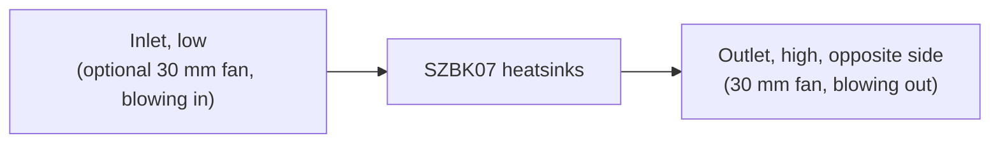

# Design

## Context

The frame top (`hardware/aecert-hexapod-v1/stl/Frame Top.stl`) is the base.
- **Surfaces:** its raised ring is at z 25.75 and its recessed floor at z 20.
- **Inserts:** eight M3 heat-set inserts, at (±20, ±73) on the ring and (±12.86, ±19.06) on the floor.
- **Solid and open areas:** the ring is solid at |x| ≥ 52 and along the front and rear edges. Most of the rest is open into the battery bay, which the 2S pack fills.
- **The legs:** nothing on them comes nearer the centre than r 81.8 above the frame top, which gives a keep-clear radius of 78.8 with a 3 mm margin.

The electrical wiring is set by the hardware-check skill ("Battery wiring"). This change updates it for logic power on the boards' pins. See proposal.md for the scope and the specs for the requirements.

## Goals / Non-Goals

**Goals:**
- Every requirement in `specs/electronics-mount` is backed by a check in the build, or by a stated measurement on the printed parts.
- Print-ready output for a P1P with an AMS: STL for the single-colour parts, 3MF for the cover.
- A layout driven by the wiring: the cable runs come out short and direct, rather than wiring being fitted around a layout drawn first.

**Non-Goals:**
- A parametric framework for other robots: constants and checks serve this frame.
- Finite-element strength analysis. Strength comes from wall and rib sizes chosen with margin, and a test print of the bumper.

## Decisions

### Generated geometry with checks, in build123d
The parts are Python (build123d, pinned in inline script metadata, run with `uv`). Every size is a named constant with its source.

- **Why:** a reviewable diff, a deterministic build, and computable checks: overlaps, keep-clear, overhangs, routes.
- **Alternatives:**
  - FreeCAD or Fusion by hand: no diffable source and no automatic checks.
  - OpenSCAD: weak on chamfers and on importing a STEP for clearance.

### Layout follows the wiring
The parts are placed by their connections:
- the Servo 2040's EXT terminal faces the SZBK07's output end;
- J6 faces the LM2596 and the T-Display;
- the servo header faces the lead slots;
- the sensor header faces the end-stop entry;
- the XT60 and the fuse sit at the SZBK07's input end.

The USB-C ports need no wall, because both boards are reached by opening the cover. That freedom is what lets the boards turn to face their wiring.

- **Alternative:** a board fixed at a wall for external USB access. It was rejected once opening the cover became acceptable, because it bent the cable runs round the box.

### Everything electrical on the deck
The cover carries nothing electrical: no T-Display and no fan. The T-Display sits in a holder on the deck, under a window in the lid. Each fan sits in a holder on the deck behind its vent's grille.

- **Why:** running open is routine, and the cover must lift off with nothing to unplug.
- **Alternative:** a fan on the cover's wall with a 2-pin plug, rejected because the plug would have to be pulled to lift the cover off.
- **The Schottky diode** is an axial part carried inline on the LM2596's output lead in heat-shrink, tied down at a tie point on that route, rather than in a holder of its own. It is the one held part allowed inside a reserved route, its own: a deliberate exception to the `spooder-printed-parts` skill's rule that no held part enters a wiring zone, because the diode is part of that run's wiring.

### Fastening: M3 screws into heat-set inserts
There are as few screws as hold the cover square, about four. They sit through the walls or down through the lid, wherever the bumpers leave a straight path. The inserts go in the deck's posts, and horizontal insert holes are teardrops.

- **Alternatives:**
  - magnets: instant to open, but less secure on a walking robot;
  - printed snap latches: PETG fatigue;
  - a hinge: a weak point, and the wiring would have to flex.

### Cooling path

The outlet sits high on the opposite side because warm air rises, so the passive draught and the exhaust fan both work the same way. The passive path is reserved as an air channel whose free cross-section is nowhere smaller than the inlet's net open area (the grille's openings, not its outline); the build checks that no part enters it. An exhausting fan lowers the pressure in the box, so air also enters at small gaps: the XT60 window, the lead slots, the seam. That is harmless, because the inlet is the largest opening. The fans run on 5 V from the LM2596.

### Bumpers: PETG leaf springs on rails
Each corner has a rail on the cover, and a bumper slides down it: a curved PETG leaf about 1.2–1.6 mm thick, standing off the corner. Its depth and stand-off are set so the bumpers stand proud of the body and the lid, while staying inside the keep-clear region.

- **Why:** without TPU, compliance has to come from shape. A leaf spring flexes and recovers where a solid PETG block would pass the knock straight on.
- **Later:** the rail's profile is the interface, so a TPU bumper later is a drop-in.
- **Alternative:** a printed honeycomb crush zone, rejected because it only works once.

### Shape: a faceted body
The body is faceted, with chamfered edges. 45° corner faces carry the bumpers inside the keep-clear radius, and the top edge has a 45° chamfer, which prints lid-down. Detail on the walls is recessed. Detail on the lid comes from flush colour inlays, not recesses: the lid's outer face prints first, on the bed, so a recess there would bridge over air.

### Colour through the AMS
- The cover is exported as a 3MF with the body and the inlays as separate parts. The inlays fill only the first 3–4 layers, so the purge waste stays small.
- Single-colour parts are exported as STL.
- Colours: the body black, the inlays and bumpers yellow, the deck black, the inside holders white.

### Print orientation per part
Each part has a stated orientation:
- the deck prints flat;
- the cover lid-down;
- the bumpers upright;
- each holder is oriented so its features rise from the bed.

The overhang check uses the same orientation. A feature that cannot print in its part's orientation moves to a separate part. The T-Display holder is the expected case.

### Verification
The build runs these checks, and fails on any of them:
- one solid per part;
- the keep-clear region, nothing below the frame floor, the bed size;
- holes on the frame's inserts;
- overlaps between printed and held parts;
- enclosure;
- reserved routes kept clear;
- frame clearance under ties and slots;
- overhangs;
- screwdriver paths;
- the IMU pad's position;
- the fan positions.

Each new check is first shown to fail on a deliberately bad shape. What can't be computed is checked on test prints and on the robot: the bumper's flex and fit, insert holding strength, the fan's fit and airflow direction, and a fit check on the frame.

## Risks / Trade-offs

- **[Unmeasured part sizes]** The SZBK07 varies by batch (about 60 × 53–54 × 27–28 mm), and its terminal ends are assumed. The LM2596's hole spacing varies too. → The first build uses nominal values (task 1.0). Measure before printing (task 1.1, a hardware task that keeps the change unarchived until done). Every size is one constant, and the checks re-validate after a change.
- **[The LM2596's dropout]** It needs its input about 1.5 V above its output. Near empty (about 6.4 V), the 5 V rail sags to about 4.9 V, and to about 4.6 V after the Schottky diode. → The power protection does not cover this: it watches the servo rail behind the SZBK07, not the pack, and the battery sense is not read yet. The boards' own regulators are expected to cope at 4.6 V; task 7.3 measures J6's 5 V with a bench supply at 6.4 V and the fans running, and the hardware-check skill documents the sag.
- **[PETG bumpers crack]** A leaf spring can crack under a hard impact. → Bumpers are replaceable, and the test print checks their flex. TPU stays a drop-in later.
- **[The cover warps]** Tall PETG walls on an open-frame P1P can warp. → Chamfered corners, a brim if needed, and no draughts.
- **[Heat]** The real load of the SZBK07 is unknown. → The fan positions are ready. Measure the heatsink after a 10-minute walk at full speed (task 7.3). The limit is 70 °C, a margin below PETG's softening near 80 °C (an assumption, not a datasheet value for the converter).
- **[The IMU near the converter]** Heat and switching noise can disturb the IMU. → At least 10 mm between the breakout's outline and the SZBK07's, checked by the build. The distance is an assumption that fits within the 30 mm of the centre; it can grow if the layout allows.
- **[Sensor inputs]** The Servo 2040's sensor header has six inputs, and the hardware-check skill plans the battery sense on one of them, so six end-stops and the battery sense need seven. → The mount only reserves the wires' entry and route; assigning inputs belongs to the change that adds the end-stops.

## Migration Plan

`hardware/spooder-electronics-mount/` is created new: no prototype is in the repository. The lessons from an earlier, uncommitted attempt are recorded in the `spooder-printed-parts` skill (its checks and build123d pitfalls), which the implementation follows. Nothing on the robot changes until the parts are printed and fitted. Rollback means not printing.

## Assumptions

Decided without the user while delivering, and open to change:
- the IMU pad's 10 mm separation from the SZBK07, and the 70 °C heatsink limit (see Risks);
- the pad is sized for the LSM6DSO that `add-body-sensing` reads. An ADXL345 breakout may fit the same bosses mechanically, but no firmware reads it;
- the Schottky diode is a DO-41 part (such as a 1N5819) inline in heat-shrink, until measured.

From task group 1 (measurements and reference data), also open to change:
- **Where the constants live:** `hardware/spooder-electronics-mount/measurements.py`, a standard-library module the build script (task 2.1) imports, rather than the top of the build script, so its README test runs without the CAD toolchain. `test_measurements.py` (the README table and the sources) and `reference_check.py` (the reference data against its files, with its dependencies locked by `uv lock --script` and run with `--locked`) run by hand until task 2.1 wires them into `mise run cad`.
- **Nominal values beyond task 1.0's list,** each in the "Measure before printing" table: the LM2596's hole positions (on the diagonal, 31 × 15 mm apart) and pad inset, the fan's hole diameter and corner wire exit, the LSM6DSO breakout's two M2 holes 15 mm apart, the diode's 20 mm sleeve, and a seated servo plug's 20 mm height with its lead bent back (task 1.1 measures it).
- **The Servo 2040 drawing:** its 13.60 and 17.40 dimensions run to the centres of the servo header's groups, and its 3.90 to the "+" row, with "−" above it and the signal row below, as the drawing's pads and silk labels show; its 14.00 is the EXT terminal's centre below the top edge. `hardware/pimoroni-servo2040/README.md` reads them differently (column 1 at 13.60, the signal row at 3.90, rows 14.00 deep); that text predates this change and is left for a later fix. Undimensioned positions (J6's row, at 1.50 on average from the bottom edge with its pads staggered, and the EXT terminal's x and pole pitch) are scaled from the drawing and re-checked against its pads.
- **The wire sides on the Servo 2040** are nominal and listed to check on the board: the EXT terminal's (the board's right edge, from the `spooder-printed-parts` skill; the drawing does not show the terminal's opening) and the sensor header's (the right edge too, the nearest edge clear of other headers; its pins stand vertical).
- **The T-Display model** has no USB-C connector, and its header pins stand out of the screen face. The holder treats both faces of the header rows as occupied and bears only on the bare spots (`TD_BARE`) of the other face.

From task group 2 (generator and checks), also open to change:
- **Files:** `build.py` (generate, check, export, `--check`, `--test`) and `preview.py` are the two scripts with inline dependencies, each locked in its `.lock`; `model.py`, `checks.py` and `export.py` are modules they import. The unit tests (`test_build.py`, and `test_measurements.py` with them) run in `build.py`'s environment through `--test`, so no third lock is needed. `mise run cad` runs `reference_check.py`, the tests, then the build.
- **Each check runs on what the part set declares.** An empty set passes every check (task 2.1); with no cover there is nothing to check enclosure against, and with no air channel nothing to keep clear. Only the insert-hole check requires a part (the deck) once any part exists. The finished set's completeness is checked when the cover and the cooling are added (tasks 4.1 and 4.3) and in task 7.1.
- **The keep-clear region is enforced from the frame floor (z 20) up,** not only above the ring's top (z 25.75) as the spec states: below the ring a part outside it would meet the frame or the coxa servos.
- **The bed is 256 mm,** the P1P's, as the spec states; the `spooder-printed-parts` skill's "Bed size: 220 mm" predates the printer choice and is left for a later fix. A part fits if some turn about the vertical fits its footprint on the bed.
- **Enclosure** is checked with rays along ±x, ±y and +z from points about 3 mm apart on each held part's faces, each of which must meet the cover. A held part declares its exposed regions with a direction (`Exposure`): the T-Display's screen and buttons upwards and the XT60's mating face outwards must meet nothing of the cover; a fan behind its grille is only exempt. Downwards is the deck's side and is not checked.
- **Overhangs:** a downward planar face passes when it lies on the bed or is at most 3 mm wide (twice the farthest sample's distance from its edges) and, since task 7.1, no point of it lies more than 3 mm from where it hangs from material; a downward curved face never passes, which is what makes a round horizontal hole fail and a teardrop pass. Exactly 45° passes.
- **The air channel** is a chain of axis-aligned boxes, each with its flow axis, between the free spaces just inside the inlet's and the outlet's grilles, which no part may enter either. Its cross-section is each box's area across its flow, and at each junction (inlet to the first box, box to box, the last box to the outlet) the smaller of the shared region's areas across the two flows. It passes the SZBK07 when a box comes within 1 mm of its outline. The held fans (`FANS` in `model.py`) are left out of it, as the spec checks the passive case without them; their holders are not, and the fans' fit is task 4.3's check.
- **Only the Schottky diode may lie in a route,** and only the LM2596's output route: the names are `SCHOTTKY` and `LM2596_OUTPUT_ROUTE` in `model.py`, and any other held part that claims a route fails.
- **The bed check** tries the turns that lay each edge of the footprint's convex hull along the bed, and every 0.05° between.
- **Screwdriver paths** leave out the parts fitted after the screw is driven (`Screw.after`), such as the cover over the deck's own screws.
- **Insert holes** are probed with a Ø3.3 cylinder through the deck (Ø3.4 less 0.05 per side for boolean noise), and need material out to r 3.0 round them for an M3 button head (Ø5.7).
- **Output:** `print/` (STL, and the cover's 3MF with the body and the inlays as separate objects) and `step/`. Files of parts no longer built are deleted. The STEP header's time is fixed and the 3MF's UUIDs and archive dates are derived, so an unchanged part writes an unchanged file. Whether Bambu Studio loads the 3MF's two objects as one object with two parts is task 4.4's check.

From task group 3 (deck and layout), also open to change:
- **The layout** (`layout.py`, the README's "Layout"): the SZBK07 across the rear, input end left and output end right; the Servo 2040 unturned in front of it; a corridor up the right from the SZBK07's output end to the EXT terminal and the sensor header; the LM2596 beyond the corridor with the T-Display above it; the XT60 and the fuse on the left. The cover's footprint is 130 × 124 mm with 45° corner faces (corners within r 71.6, leaving the bumpers about 7 mm), wider than deep so that the strips beside the board are 31 mm wide.
- **The IMU under the board.** With the SZBK07 at least 10 mm from the breakout and the breakout within 30 mm of the centre, no flat layout leaves the centre free for it beside a 62 × 42 mm board and a 60 × 54 mm SZBK07. The breakout sits on its pad under the Servo 2040, which stands on 9 mm standoffs (not the skill's 5 mm) to clear it; its wires reach J6 under the board's rear edge. The whole breakout, not only its centre, is held within 30 mm of the centre.
- **The T-Display above the LM2596.** Its holder (task 5.2) stands over the module, so the screen sits beside the SZBK07, not over it (the lid has no opening over the SZBK07). The LM2596 is adjusted before the holder goes on, and its screws go in first.
- **Wire sides not given by a drawing or a model:** J6's wires leave over the board's rear edge (-y), the T-Display's wires are soldered into its header holes from below (the model's pins stand up out of the screen face), the LM2596's at its ends, the fuse holder's at its ends, the IMU breakout's at its rear edge, and the SZBK07's terminals across the middle 30 mm of each short end (`SZBK07_TERMINAL_SPAN`).
- **A route reaches a terminal** when it holds the space 0.4–1.4 mm off the held part's outline on the terminal's side, over the terminal's cross-section (`check_route_ends`); "wide enough to carry the diode" is read as every box of the LM2596's output route being at least the sleeve's 6 mm in each direction.
- **The LM2596's output to J6** runs under the board (clear of the IMU and the standoffs) and up at J6's 5V end, so it shares no box with the other runs; the diode lies in front of the module, on the J6 branch, after the T-Display's branch splits off.
- **Floor inserts:** the deck prints flat, so posts down to the floor inserts would hang in mid-air; they are separate printed spacers (`spacer`, Ø7 × 5.75 mm). The four floor screws lie under the SZBK07 and the board, so they go in before them.
- **Retention:** the Servo 2040, the LM2596 and the LSM6DSO are screwed down with self-tapping screws into the deck's standoffs and bosses (M2.5, M2.5 and M2; the LM2596's 3 mm holes do not pass an M3). The SZBK07 is located by blocks at its rear corners and 3 mm ribs at its front corners, low enough for wires to pass over; the cover is to hold it down (task 4.x). The XT60 is pushed against back stops either side of its solder cups when plugged in, and held against the pull by a cable tie through the deck over its body, which the test print in task 7.2 checks. The fuse holder is tied down at both ends; the T-Display's holder is task 5.2.
- **The XT60** faces out of the left wall, 9 mm in from the cover's outer face, so the mated plug (`XT60_PLUG_LENGTH`) ends within the keep-clear radius: the spec's region is for printed parts, but the plug stays on while the robot walks.
- **The USB-C cable** is a route reserved only with the cover off (`Route.cover_off`): the cable runs out over the deck's edge where the cover's wall stands when it is on.
- **New nominal values** (`SZBK07_TERMINAL_SPAN`, `XT60_SIZE`, `XT60_CUP_LENGTH`, `XT60_CUP_SECTION`, `XT60_PLUG_LENGTH`, `FUSE_HOLDER_SIZE`, `S2040_PCB_THICKNESS`, `S2040_UNDERSIDE_LEADS`, `USB_C_PLUG`, `LSM6DSO_HEIGHT`, `SERVO_PLUG_SECTION`, `SENSOR_WIRE_D`) are in the "Measure before printing" table; `TD_HEADER_PIN_DEPTH` is reference data from the STEP model.
- **Cooling is not placed yet** (task 4.3). The left wall behind the XT60 is left free for the intake. The right wall behind the SZBK07's output end is taken by the LM2596 and the T-Display, so the exhaust's position may move parts there; the checks re-validate whatever moves.

From task group 4 (cover), also open to change:
- **The exhaust in the front-right corner face.** The right wall is taken by the LM2596 and the T-Display, the rear by the SZBK07, and the rear-right corner would put the fan over the SZBK07 (a box about 15 mm taller). In the front-right corner the fan's outer face lies on the limit for held parts, clear of the LM2596's output route in front of the module (`OUT_FRONT_Y1`) and of the servo leads' route; it overhangs the Servo 2040's front-right corner, so it stands on its holder 1 mm above the board (`EXH_Z0`). That sets the cover's height: the lid's underside FIT above the fan, where the inside of the top chamfer comes down over it, 45.6 mm above the deck in all. The intake stands on the deck low in the left wall, so the inlet is low and the outlet high, on opposite sides, with the SZBK07 between them; the passive channel passes over its heatsinks.
- **Turned air-channel boxes.** A box may be given in a frame turned about the vertical (`turned()`), for the run into the corner; the corner fan's space cannot be held by axis-aligned boxes as wide as the inlet. Where boxes in differently turned frames meet, the junction's cross-section across a flow is the shared region's widest section across it, which for two boxes in one frame is the existing rule.
- **The T-Display raised.** It stands as high as its header pins allow under the lid (and under the inside of the top chamfer by the right wall), so the screen sits 9.5 mm below the lid's top rather than 20; its holder (task 5.2) is that much taller.
- **The window** is one opening, the screen's and the buttons' outline at the lid's underside with a notch out to the button beside the screen (less than 2 mm from it), widening at 45° to the top. The notch's outer end stays straight, as the bevel would run into the top chamfer. The board's face between the screen and the buttons shows through it, and is exempt from enclosure (`must_show=False`).
- **Fastening:** three screws, not four: the front-right corner holds the exhaust fan, and no post fits beside it clear of the LM2596's output route and the corner face. The screws go down through the lid into heat-set inserts in posts on the deck; all their holes are vertical, so none needs a teardrop. Each post is clipped to the inside of the cover (the top chamfer), keeping about 1.5 mm round its insert at the top. The button heads sit on the lid's top: a counterbore would be a flat recess in the bed face.
- **Holding the SZBK07 down:** blocks under the lid come within 0.5 mm of its corners, nearer than its ribs (3 mm) are tall (`Held.held_down`, checked by `check_cover`), leaving the channel over its middle clear.
- **Fan holders** are part of the deck for now, black; task 5.3 may make them separate white parts. Each locates its fan between cheeks at its ends and lips on its faces: for the intake, lips inside and outside its foot and the XT60 cradle's rear wall; for the exhaust, lips reaching in from its cheeks over its inner face (above the servo leads' route on the left, between the LM2596's output route and the T-Display on the right), while the cover's wall, 0.3 mm off, stops it sliding out. With the cover off, the exhaust is kept from sliding out only by its fit between the cheeks; task 7.2's test print checks the fit. Nothing held a fan down but its weight and the fit (the lid is 13 mm above the intake); task 7.1 adds a block under the lid over the intake. The exhaust's columns stand clear of the board's corner, so the screw there stays reachable.
- **Enclosure** counts a vent's grille as closed (it keeps fingers and debris out), and a ray stopped by another printed part or another held part as enclosed, except by a fan, which is optional. Without it, the LM2596 under the T-Display would count as showing through the window.
- **New checks:** `check_fans` (each fan position seated and located by parts other than the cover, the cover no nearer than 0.1 mm, a vent in front, the exhaust facing out, an exhaust position whenever there is a channel) and `check_cover` (screens below its top, held-down parts, no lid opening over the SZBK07, lifting straight off: nothing above a face of it that looks up, and no overlap at a series of heights). `check_fans` also moves each fan 1 mm each way across its width and inwards, where it must meet its holder, and outwards, where it may meet the cover's wall.
- **The inlays** are the name in a block letter face drawn as rectangles (no font file, so the build is the same everywhere) and three chevrons pointing forwards, 2 mm strokes so the body's pockets over them print lid-down. The 3MF is one object (one build item) whose two components are the body's and the inlays' meshes; Bambu Studio 2.8.2, loading it from the command line and saving a project, kept it as one object of two normal parts.

From task group 5 (bumpers and holders), also open to change:
- **Two rails per corner, at the face's ends.** A rail down the middle of a corner face would cross the outlet's grille in the front-right one, so each face carries two vertical dovetails near its ends instead, clear of the grille. Their tops are 45° wedges flush with the top chamfer (which prints lid-down), and the bumper's slots end in the same slope, which is its stop. The fit is 0.2 mm normal to each face (`SLIDE`), PETG on PETG. An M2 × 6 self-tapping screw through the fixed hook into its rail (and the cover's wall behind it) keeps the bumper on when the robot is turned over or shaken; it comes out from outside to change the bumper.
- **The bumper:** a hook round each rail, joined by a curved leaf 1.5 mm thick and 12 mm tall at the top, bowing 8 mm out from the face's middle. The leaf stops above most of the outlet's grille, which a full-height leaf would cover. The hooks stand past the side walls, so the bumper is the outermost thing at its corner; its top is 3.5 mm above the lid, above the cover's screw heads. One part, turned, fits all four corners (one print file).
- **One end of the leaf floats.** A knock that flattens the leaf pushes its ends apart, about three times the knock's force on a leaf this shallow. With both hooks fitted round their rails, that force spreads the hooks off them and the bumper falls away (the user's review of task group 5). So only one hook is fixed, by the screw; the other hook's slot is 1 mm longer towards the fixed end (`FLOAT_SLOT`), so it slides outwards along its rail as the leaf flattens (0.64 mm when pressed flat, `leaf_travel()`). The rails' heads are 6.4 mm wide (`RAIL_HEAD`), so the longer slot's mouth stays narrower than the head and the free hook cannot be pulled off. The leaf bottoms on the corner face after about 6.5 mm, which then takes the knock. A strap tying the two hooks together was rejected: it would relieve the rails, but a tied shallow arch is almost rigid and would crack rather than flex.
- **The bumpers' screws are self-tapping, against the skill's rule.** The printed-parts skill puts screws that are undone in service into heat-set inserts, and a bumper's screw comes out when the bumper is replaced. An M2 insert needs a hole of about Ø3.2, wider than the rail's 3 mm neck (`RAIL_NECK`), so it would cut through the dovetail's flanks; a wider neck would change the rail, the interface a TPU bumper is meant to drop onto. A bumper is replaced only when it breaks, a few times over the mount's life, and an M2 thread re-cut into a 1.6 mm pilot in PETG takes that. If a pilot strips, an M2.5 self-tapping screw (pilot 2.2, `PILOT_M25_D`) goes into the same hole. Test prints (task 7.2) check the screw's hold after a few changes; if it does not hold, the rail is widened for an insert.
- **Bumpers print on their tops** (up −z), not upright as "Print orientation per part" says: the leaf hangs from the top, and the slots' sloped ends then face up.
- **"Proud" as checked:** in every horizontal direction (5° apart) and upwards, the bumpers reach at least 1 mm beyond the cover, every held part and the cover's screw heads. The deck's tabs and their screws lie at the frame's level, outside this. The bumpers ride on the cover: the cover's lift-off check leaves them out, as they come off with it, and the fans' vent check counts them.
- **The holders sit loose in pockets.** The LM2596's standoffs, the IMU's pad, the fans' holders and the T-Display's holder are separate white parts in 1.5 mm pockets in the deck (0.2 mm clearance each side), each kept there by what lies over it (`check_captive`): the T-Display's holder over the LM2596, the Servo 2040's underside leads 1 mm over the IMU, the cover over the T-Display's pins, and the lid 0.5 mm over the fan holders' cheeks, so they stay with the optional fans left out. The check follows a stack: a holder that meets another loose part, or a held part one carries, pushes it, and rises only as far as that can (the LM2596's standoffs rise about 0.8 mm before the board's pins meet the cover). Screwing them to the 3 mm deck would leave too little thread. The Servo 2040's standoffs stay part of the deck (black), which takes its screws.
- **The LM2596 is raised** on its standoffs to lie FIT under the T-Display holder's plate (13.5 mm off the deck, not 3), so that the plate keeps it and its standoffs down. Its wires are soldered to pads on its board, so its terminals and their routes rise only 3.8 mm above its board's underside (`LM_WIRE_H`), under the exhaust holder's right lip.
- **The T-Display's holder** is a portal over the LM2596, printed on its back (up +y): a wall between the module and the cover's right wall, a wall behind the module's input route, and a plate over the module FIT under the board's underside parts. Pads rise from the plate into the three bare spots; their faces towards the rear slope at 45° inside the spots, so they print. It is not screwed down: the cover over the board's header pins (0.3 mm above them under the top chamfer by the right wall, 1.2 mm under the flat of the lid) holds the board within its lips (2 mm above its underside) and the holder in its pockets. This relies on the pins standing out of the screen face as in the model; a board without them needs a spacer under the lid (task 7.3's fit check shows it).
- **Locating the T-Display:** lengthwise by a lip beyond each end (the front one's foot slopes under the end's bare strip; the rear one is a block), sideways by the pads in the bare spots between its underside parts. Its long edges carry the header rows' wires, and the corridor and the cover's wall leave no room for lips there. The board's rear end has no bare spot, so it is supported at its middle and front end; the plate 0.3 mm under its rear underside parts stops it tilting when the rear buttons are pressed.
- **New checks:** `check_bumpers` (reach, a retaining screw into the cover, stop, sliding fit, lifting off with the cover on), `check_bumper_ends` (one free end, unscrewed, which moves the leaf's full travel away from the fixed end meeting nothing and stays hooked on its rail along it; it fails the bumper as first built, with both hooks fitted round their rails), `check_captive` (a loose part lifted by its pocket's depth with what rests on it meets something) and `check_supports` (bearing on the declared regions only, with the held part located).

## Open Questions

- **The exact placement** of each part, within the principles above, follows from the measurements in task group 1.

From task group 6 (documentation), also open to change:
- **Print settings** in the README are starting values, not yet tried: 0.2 mm layers (the inlays' 0.6 mm is three), 3 walls with 15–30 % infill, 4 walls for the bumpers so the 1.5 mm leaf is solid walls, and a 5 mm brim on the cover against warping. Task 7.2's test prints confirm or change them.
- **Screw lengths** follow from the stack-up in `layout.py`: M3 × 6 at the ring's inserts and M3 × 10 through the floor's spacers (heads in 2 mm counterbores in the 3 mm deck), M3 × 10 for the cover (the 2.4 mm lid over a 5 mm insert, `SCREW_TAIL` below it), M2.5 × 6 self-tapping for the Servo 2040 (a 1.6 mm board over a 5 mm pilot) and the LM2596 (its pilot runs down the standoff), M2 × 5 for the IMU breakout (over a 4 mm pilot: `IMU_PILOT_DEPTH`'s comment said M2 × 6, which would run past it, and now says M2 × 5), and the bumpers' M2 × 6.
- **The fans' leads** have no reserved route: they are two thin wires each, the exhaust fan's run to the LM2596's output pads beside it, the intake fan's along the route from the fuse to the LM2596. They take the LM2596's output before the Schottky diode. Task 7.3's fit check shows whether they lie clear.
- **The README's parts table is checked** by `test_build.py` against the built parts (each print file once, its copies, colour and print orientation), as task 6.1's verification; the "Measure before printing" table stays checked by `test_measurements.py`.

From task group 7 (verification), also open to change:
- **Codex's review of physical and assembly problems** (task 7.1) found four, each fixed with a regression test.
- **Overhangs: what a face hangs from.** A narrow downward face held at one end only is a cantilever, not a bridge: the first exhaust lips hung 3.4 and 4.9 mm out from their cheeks, and a strip of the T-Display holder's plate 6.5 mm beyond the 5 V wire's notch.
  - The check now finds the points along a face's edges where a neighbouring face carries on below. No point of the face may lie more than `BRIDGE` (3 mm) from them.
  - The spec's rule (at most 3 mm wide) is kept as it is. The stricter reading is that a face must also hang from something within that distance, which is what "can bridge" means. A one-sided ledge up to 3 mm passes, such as the T-Display holder's front lip, which stands 2.65 mm above the slope under it.
  - The exhaust lips' undersides now rise at 45° from the cheeks, and the lips rise further towards their tips. No material is added under them, because the LM2596's output route and the servo leads' route run there. The notch for the 5 V wire runs out through the plate's front end.
- **The intake fan held down.** Upside down it could lift 13 mm, over its 10 mm lips, and slide in. A block under the lid now ends 2 mm above it (`INTAKE_HOLD_GAP`), clear of the air channel. The cover still carries no fan: it comes no nearer than 0.1 mm. Each fan is a held-down part (`FAN_HOLD_H`), so `check_cover` checks this.
- **Grilles measured through the cover.** The air channel check now measures each vent's open area from the cover's geometry. It takes the narrowest planar section across the wall. Between consecutive depths where the wall or the cover in it has a vertex, a section through planar faces has an area quadratic in the depth: three sections fix it, and one more is taken at its turning point. A slot shut at any depth, however thin the skin, counts as shut. (Curved faces are taken between their tessellation's vertices, which is close but not exact.) Each vent must have its declared area (within 1 %) and no less than the inlet's. A vent declares its direction through the wall (`Vent.across`).
- **Measured values the layout takes as given.** The SZBK07's terminals on its short ends, its heatsinks within its outline, holes that pass their screws (M2.5 for the LM2596, M2 for the IMU) and the diode inside its sleeve are checked by `layout.measurement_failures()`, which the build reports with the checks' failures.
  - The fans' hole spacing, hole diameter and wire exit are recorded only (`REFERENCE_ONLY`). The holders hold the fans by their frames, and the leads are routed by hand, which task 7.2's test print checks.
  - A test requires every value in "Measure before printing" to be read by `layout.py` or `checks.py`, or to be listed as reference only.
