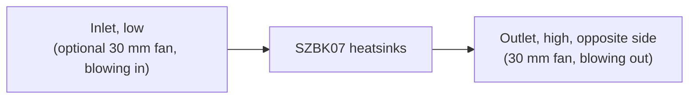

# Design

## Context

The frame top (`hardware/aecert-hexapod-v1/stl/Frame Top.stl`) is the base.
- **Surfaces:** its raised ring is at z 25.75 and its recessed floor at z 20.
- **Inserts:** eight M3 heat-set inserts, at (±20, ±73) on the ring and (±12.86, ±19.06) on the floor.
- **Solid and open areas:** the ring is solid at |x| ≥ 52 and along the front and rear edges. Most of the rest is open into the battery bay, which the 2S pack fills.
- **The legs:** nothing on them comes nearer the centre than r 81.8 above the frame top, which gives a keep-clear radius of 78.8 with a 3 mm margin.

The electrical wiring is set by the hardware-check skill ("Battery wiring"). This change updates it for logic power on the boards' pins. See proposal.md for the scope and the specs for the requirements.

## Goals / Non-Goals

**Goals:**
- Every requirement in `specs/electronics-mount` is backed by a check in the build, or by a stated measurement on the printed parts.
- Print-ready output for a P1P with an AMS: STL for the single-colour parts, 3MF for the cover.
- A layout driven by the wiring: the cable runs come out short and direct, rather than wiring being fitted around a layout drawn first.

**Non-Goals:**
- A parametric framework for other robots: constants and checks serve this frame.
- Finite-element strength analysis. Strength comes from wall and rib sizes chosen with margin, and a test print of the bumper.

## Decisions

### Generated geometry with checks, in build123d
The parts are Python (build123d, pinned in inline script metadata, run with `uv`). Every size is a named constant with its source.

- **Why:** a reviewable diff, a deterministic build, and computable checks: overlaps, keep-clear, overhangs, routes.
- **Alternatives:**
  - FreeCAD or Fusion by hand: no diffable source and no automatic checks.
  - OpenSCAD: weak on chamfers and on importing a STEP for clearance.

### Layout follows the wiring
The parts are placed by their connections:
- the Servo 2040's EXT terminal faces the SZBK07's output end;
- J6 faces the LM2596 and the T-Display;
- the servo header faces the lead slots;
- the sensor header faces the end-stop entry;
- the XT60 and the fuse sit at the SZBK07's input end.

The USB-C ports need no wall, because both boards are reached by opening the cover. That freedom is what lets the boards turn to face their wiring.

- **Alternative:** a board fixed at a wall for external USB access. It was rejected once opening the cover became acceptable, because it bent the cable runs round the box.

### Everything electrical on the deck
The cover carries nothing electrical: no T-Display and no fan. The T-Display sits in a holder on the deck, under a window in the lid. Each fan sits in a holder on the deck behind its vent's grille.

- **Why:** running open is routine, and the cover must lift off with nothing to unplug.
- **Alternative:** a fan on the cover's wall with a 2-pin plug, rejected because the plug would have to be pulled to lift the cover off.
- **The Schottky diode** is an axial part carried inline on the LM2596's output lead in heat-shrink, tied down at a tie point on that route, rather than in a holder of its own. It is the one held part allowed inside a reserved route, its own: a deliberate exception to the `spooder-printed-parts` skill's rule that no held part enters a wiring zone, because the diode is part of that run's wiring.

### Fastening: M3 screws into heat-set inserts
There are as few screws as hold the cover square, about four. They sit through the walls or down through the lid, wherever the bumpers leave a straight path. The inserts go in the deck's posts, and horizontal insert holes are teardrops.

- **Alternatives:**
  - magnets: instant to open, but less secure on a walking robot;
  - printed snap latches: PETG fatigue;
  - a hinge: a weak point, and the wiring would have to flex.

### Cooling path

The outlet sits high on the opposite side because warm air rises, so the passive draught and the exhaust fan both work the same way. The passive path is reserved as an air channel whose free cross-section is nowhere smaller than the inlet's net open area (the grille's openings, not its outline); the build checks that no part enters it. An exhausting fan lowers the pressure in the box, so air also enters at small gaps: the XT60 window, the lead slots, the seam. That is harmless, because the inlet is the largest opening. The fans run on 5 V from the LM2596.

### Bumpers: PETG leaf springs on rails
Each corner has a rail on the cover, and a bumper slides down it: a curved PETG leaf about 1.2–1.6 mm thick, standing off the corner. Its depth and stand-off are set so the bumpers stand proud of the body and the lid, while staying inside the keep-clear region.

- **Why:** without TPU, compliance has to come from shape. A leaf spring flexes and recovers where a solid PETG block would pass the knock straight on.
- **Later:** the rail's profile is the interface, so a TPU bumper later is a drop-in.
- **Alternative:** a printed honeycomb crush zone, rejected because it only works once.

### Shape: a faceted body
The body is faceted, with chamfered edges. 45° corner faces carry the bumpers inside the keep-clear radius, and the top edge has a 45° chamfer, which prints lid-down. Detail on the walls is recessed. Detail on the lid comes from flush colour inlays, not recesses: the lid's outer face prints first, on the bed, so a recess there would bridge over air.

### Colour through the AMS
- The cover is exported as a 3MF with the body and the inlays as separate parts. The inlays fill only the first 3–4 layers, so the purge waste stays small.
- Single-colour parts are exported as STL.
- Colours: the body black, the inlays and bumpers yellow, the deck black, the inside holders white.

### Print orientation per part
Each part has a stated orientation:
- the deck prints flat;
- the cover lid-down;
- the bumpers upright;
- each holder is oriented so its features rise from the bed.

The overhang check uses the same orientation. A feature that cannot print in its part's orientation moves to a separate part. The T-Display holder is the expected case.

### Verification
The build runs these checks, and fails on any of them:
- one solid per part;
- the keep-clear region, nothing below the frame floor, the bed size;
- holes on the frame's inserts;
- overlaps between printed and held parts;
- enclosure;
- reserved routes kept clear;
- frame clearance under ties and slots;
- overhangs;
- screwdriver paths;
- the IMU pad's position;
- the fan positions.

Each new check is first shown to fail on a deliberately bad shape. What can't be computed is checked on test prints and on the robot: the bumper's flex and fit, insert holding strength, the fan's fit and airflow direction, and a fit check on the frame.

## Risks / Trade-offs

- **[Unmeasured part sizes]** The SZBK07 varies by batch (about 60 × 53–54 × 27–28 mm), and its terminal ends are assumed. The LM2596's hole spacing varies too. → The first build uses nominal values (task 1.0). Measure before printing (task 1.1, a hardware task that keeps the change unarchived until done). Every size is one constant, and the checks re-validate after a change.
- **[The LM2596's dropout]** It needs its input about 1.5 V above its output. Near empty (about 6.4 V), the 5 V rail sags to about 4.9 V, and to about 4.6 V after the Schottky diode. → The power protection does not cover this: it watches the servo rail behind the SZBK07, not the pack, and the battery sense is not read yet. The boards' own regulators are expected to cope at 4.6 V; task 7.3 measures J6's 5 V with a bench supply at 6.4 V and the fans running, and the hardware-check skill documents the sag.
- **[PETG bumpers crack]** A leaf spring can crack under a hard impact. → Bumpers are replaceable, and the test print checks their flex. TPU stays a drop-in later.
- **[The cover warps]** Tall PETG walls on an open-frame P1P can warp. → Chamfered corners, a brim if needed, and no draughts.
- **[Heat]** The real load of the SZBK07 is unknown. → The fan positions are ready. Measure the heatsink after a 10-minute walk at full speed (task 7.3). The limit is 70 °C, a margin below PETG's softening near 80 °C (an assumption, not a datasheet value for the converter).
- **[The IMU near the converter]** Heat and switching noise can disturb the IMU. → At least 10 mm between the breakout's outline and the SZBK07's, checked by the build. The distance is an assumption that fits within the 30 mm of the centre; it can grow if the layout allows.
- **[Sensor inputs]** The Servo 2040's sensor header has six inputs, and the hardware-check skill plans the battery sense on one of them, so six end-stops and the battery sense need seven. → The mount only reserves the wires' entry and route; assigning inputs belongs to the change that adds the end-stops.

## Migration Plan

`hardware/spooder-electronics-mount/` is created new: no prototype is in the repository. The lessons from an earlier, uncommitted attempt are recorded in the `spooder-printed-parts` skill (its checks and build123d pitfalls), which the implementation follows. Nothing on the robot changes until the parts are printed and fitted. Rollback means not printing.

## Assumptions

Decided without the user while delivering, and open to change:
- the IMU pad's 10 mm separation from the SZBK07, and the 70 °C heatsink limit (see Risks);
- the pad is sized for the LSM6DSO that `add-body-sensing` reads. An ADXL345 breakout may fit the same bosses mechanically, but no firmware reads it;
- the Schottky diode is a DO-41 part (such as a 1N5819) inline in heat-shrink, until measured.

From task group 1 (measurements and reference data), also open to change:
- **Where the constants live:** `hardware/spooder-electronics-mount/measurements.py`, a standard-library module the build script (task 2.1) imports, rather than the top of the build script, so its README test runs without the CAD toolchain. `test_measurements.py` (the README table and the sources) and `reference_check.py` (the reference data against its files, with its dependencies locked by `uv lock --script` and run with `--locked`) run by hand until task 2.1 wires them into `mise run cad`.
- **Nominal values beyond task 1.0's list,** each in the "Measure before printing" table: the LM2596's hole positions (on the diagonal, 31 × 15 mm apart) and pad inset, the fan's hole diameter and corner wire exit, the LSM6DSO breakout's two M2 holes 15 mm apart, the diode's 20 mm sleeve, and a seated servo plug's 20 mm height with its lead bent back (task 1.1 measures it).
- **The Servo 2040 drawing:** its 13.60 and 17.40 dimensions run to the centres of the servo header's groups, and its 3.90 to the "+" row, with "−" above it and the signal row below, as the drawing's pads and silk labels show; its 14.00 is the EXT terminal's centre below the top edge. `hardware/pimoroni-servo2040/README.md` reads them differently (column 1 at 13.60, the signal row at 3.90, rows 14.00 deep); that text predates this change and is left for a later fix. Undimensioned positions (J6's row, at 1.50 on average from the bottom edge with its pads staggered, and the EXT terminal's x and pole pitch) are scaled from the drawing and re-checked against its pads.
- **The wire sides on the Servo 2040** are nominal and listed to check on the board: the EXT terminal's (the board's right edge, from the `spooder-printed-parts` skill; the drawing does not show the terminal's opening) and the sensor header's (the right edge too, the nearest edge clear of other headers; its pins stand vertical).
- **The T-Display model** has no USB-C connector, and its header pins stand out of the screen face. The holder treats both faces of the header rows as occupied and bears only on the bare spots (`TD_BARE`) of the other face.

From task group 2 (generator and checks), also open to change:
- **Files:** `build.py` (generate, check, export, `--check`, `--test`) and `preview.py` are the two scripts with inline dependencies, each locked in its `.lock`; `model.py`, `checks.py` and `export.py` are modules they import. The unit tests (`test_build.py`, and `test_measurements.py` with them) run in `build.py`'s environment through `--test`, so no third lock is needed. `mise run cad` runs `reference_check.py`, the tests, then the build.
- **Each check runs on what the part set declares.** An empty set passes every check (task 2.1); with no cover there is nothing to check enclosure against, and with no air channel nothing to keep clear. Only the insert-hole check requires a part (the deck) once any part exists. The finished set's completeness is checked when the cover and the cooling are added (tasks 4.1 and 4.3) and in task 7.1.
- **The keep-clear region is enforced from the frame floor (z 20) up,** not only above the ring's top (z 25.75) as the spec states: below the ring a part outside it would meet the frame or the coxa servos.
- **The bed is 256 mm,** the P1P's, as the spec states; the `spooder-printed-parts` skill's "Bed size: 220 mm" predates the printer choice and is left for a later fix. A part fits if some turn about the vertical fits its footprint on the bed.
- **Enclosure** is checked with rays along ±x, ±y and +z from points about 3 mm apart on each held part's faces, each of which must meet the cover. A held part declares its exposed regions with a direction (`Exposure`): the T-Display's screen and buttons upwards and the XT60's mating face outwards must meet nothing of the cover; a fan behind its grille is only exempt. Downwards is the deck's side and is not checked.
- **Overhangs:** a downward planar face passes when it lies on the bed or is at most 3 mm wide (twice the farthest sample's distance from its edges); a downward curved face never passes, which is what makes a round horizontal hole fail and a teardrop pass. Exactly 45° passes.
- **The air channel** is a chain of axis-aligned boxes, each with its flow axis, between the free spaces just inside the inlet's and the outlet's grilles, which no part may enter either. Its cross-section is each box's area across its flow, and at each junction (inlet to the first box, box to box, the last box to the outlet) the smaller of the shared region's areas across the two flows. It passes the SZBK07 when a box comes within 1 mm of its outline. The held fans (`FANS` in `model.py`) are left out of it, as the spec checks the passive case without them; their holders are not, and the fans' fit is task 4.3's check.
- **Only the Schottky diode may lie in a route,** and only the LM2596's output route: the names are `SCHOTTKY` and `LM2596_OUTPUT_ROUTE` in `model.py`, and any other held part that claims a route fails.
- **The bed check** tries the turns that lay each edge of the footprint's convex hull along the bed, and every 0.05° between.
- **Screwdriver paths** leave out the parts fitted after the screw is driven (`Screw.after`), such as the cover over the deck's own screws.
- **Insert holes** are probed with a Ø3.3 cylinder through the deck (Ø3.4 less 0.05 per side for boolean noise), and need material out to r 3.0 round them for an M3 button head (Ø5.7).
- **Output:** `print/` (STL, and the cover's 3MF with the body and the inlays as separate objects) and `step/`. Files of parts no longer built are deleted. The STEP header's time is fixed and the 3MF's UUIDs and archive dates are derived, so an unchanged part writes an unchanged file. Whether Bambu Studio loads the 3MF's two objects as one object with two parts is task 4.4's check.

## Open Questions

- **The exact placement** of each part, within the principles above, follows from the measurements in task group 1.
