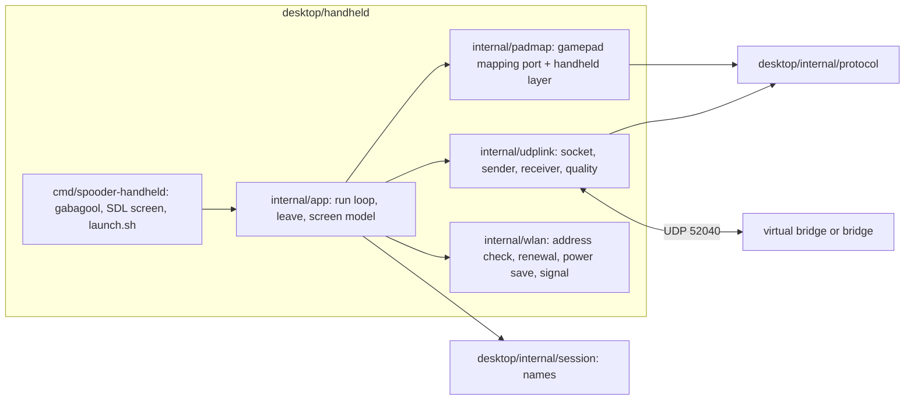

# Design

## Context

See proposal.md for the motivation. The bridge's WiFi drive (`add-wifi-drive`, design D3 and D4) takes one 21-byte command frame per UDP datagram on 192.168.4.1:52040, locks the first sender, starts each session in Sleep, ends it after 150 ms without a valid frame or on a sequence jump, and relays every robot frame (telemetry, pose and diagnostics at 10 Hz each since `relay-pose-diagnostics`) to the locked sender, byte for byte. It obliges the handheld to keep one source port per run and to send nothing for its first 150 ms. The desktop module (`desktop/`, Go, Gio) already has the link protocol (`internal/protocol`, tested against `test/golden/protocol_v3.txt`) and the names of body modes, gestures and faults (`internal/session`), neither of which imports Gio. The gamepad mapping the handheld must match is C++ (`core/gamepad_mapping`). gabagool v2.26.6 (`pkg/gabagool/init.go`) starts a power-button goroutine when `IsNextUI` is set on tg5040 (`/dev/input/event1`, code 116): a press under 2 s runs `/mnt/SDCARD/.system/tg5040/bin/suspend`, a hold of 2 s runs `/sbin/poweroff`, with no way for the application to step in. `GetWindow()` exposes the SDL window and its `Renderer`.

## Goals / Non-Goals

**Goals:** the smallest pak that drives the robot through the bridge safely (start-up, driving, the e-stop, leaving, the power button) and shows the robot's state and the link's quality, with its logic hardware-free and tested, end to end against the virtual robot, and a reproducible device build.

**Non-goals:** the leg view, voltage and current over time, the diagnostics screen (follow-ups); calibration from the handheld (the portal's job); any protocol or firmware change; joining WiFi from inside the pak (NextUI's settings do it).

## Decisions

### D1. A nested Go module at `desktop/handheld/`

The pak is the module `github.com/blackfyre/spooder/desktop/handheld` in `desktop/handheld/`, with `replace github.com/blackfyre/spooder/desktop => ../`. Go's internal rule is by import path: `desktop/internal/...` may be imported by any package whose path lies under `github.com/blackfyre/spooder/desktop`, which a nested module's packages do, so nothing moves. The nested module keeps cgo SDL2 and gabagool, and the patched gabagool's directory (D6), out of the calibrator's module: `desktop-test`, `desktop-build` and `vulncheck` stay as they are and need no SDL2 headers.

Alternatives: `desktop/cmd/spooder-handheld` in the desktop module (every desktop gate would need SDL2 headers and the fetched gabagool before it could vet or build); moving `protocol` and `session` out of `internal/` (a larger move touching every importer). If the go command refuses the nested import, the fallback is `desktop/cmd/spooder-handheld` with the fetch step added before the desktop tasks; task 1.2 checks this first.

Only `cmd/spooder-handheld` imports gabagool or go-sdl2; everything below it is tested on the host without SDL.

### D2. The mapping: a Go port of `core/gamepad_mapping`, kept in step by a golden file

`internal/padmap` ports `gamepad_mapping::update`, `stickToVector` and `toCommand` line for line (Bluepad32 units, the same dead zone, combos, steer and crab, gesture layer). A new `test/golden/gamepad_mapping.txt` lists input steps (time, connected, axes, buttons, D-pad, misc) and the expected desired state after each; a new C++ host test runs `core/gamepad_mapping` over it and the Go test runs the port over it, as `protocol_v3.txt` keeps the Go protocol in step. The golden file is written by hand from the gamepad-control scenarios plus the cases the port could get wrong (the dead-zone edge, the diagonal clamp, reverse mirroring, gait wrap, dial limits, the 1 s combos, the gesture layer, a reconnect).

The handheld layer, also in `padmap`, turns the TrimUI's controls into the gamepad's `PadState` before the port sees them, so the port stays identical to the C++:

| TrimUI | PadState |
|---|---|
| Left / right stick (SDL −32768..32767) | `axisX/Y`, `axisRX/RY`, scaled to −511..512 (SDL Y is negative for up, as Bluepad32's) |
| L2 / R2 (SDL 0..32767) beyond 16384 | `BUTTON_L2` / `BUTTON_R2` |
| A, B, X, Y, L1, R1, D-pad | the same bits |
| Start (Select not held) | `MISC_HOME` |
| Select + Start (press) | nothing; toggles the handheld's e-stop flag |
| Select + Y held | `BUTTON_THUMB_L | BUTTON_THUMB_R` (the port's 1 s fault-clear hold) |
| Y (Select held) | nothing |
| Select, Menu, Power | nothing (Menu and Power go to D5) |

`MISC_BACK` is never set, so Calibrate cannot be requested. The emergency stop is a toggle, as the bridge's GPIO35 button is; releasing it leaves the robot's EMERGENCY_STOP fault latched until a fault clear. `connected` is true while the pak drives, including during a leave.

Three rules of the handheld layer keep its `PadState` from producing presses the user did not make or undoing a leave:

- **The run starts in Sleep.** The bridge requests Sleep at every session's start until the handheld's mode-request counter changes, but the port, as the C++, starts a fresh connection in Stand, so a first Start would ask for Walk from Sleep. Before its first frame, and again after a resume, the app sets the mapper's Sleep toggle (as a leave does, D5), so what the screen shows as requested matches what the bridge holds: Y leaves Sleep for Stand, as on the gamepad, and Start then walks. The counter change this makes falls in the session's first frame, which the bridge takes only as a baseline.
- **A control used in a Select combination stays masked until it is released.** Start pressed with Select held, and Y held with Select, are not passed on as `MISC_HOME` and `BUTTON_Y` until the button itself has been released, whatever Select does meanwhile; otherwise releasing Select first would show the port a fresh Start or Y press (a mode request or a Sleep toggle). Select pressed while Start or Y is already held does not unmask it either, and neither combination fires from it.
- **During a leave the port sees a neutral pad.** From `Leaving` until the action runs, the layer passes a connected pad at rest (sticks centred, no buttons, no D-pad), so no control can toggle Sleep off or start a gesture before the pak acts; Select + Start still toggles the e-stop, which is outside the mapping.

### D3. The UDP link (`internal/udplink`)

- One socket per run: `net.DialUDP` to the bridge's address, made once after the address check, so the source port never changes and the kernel drops datagrams from any other address and port. The same socket is used again after a suspend and resume; the bridge sees a lapse, then a new session from the same port that starts in Sleep.
- The sender waits 150 ms from the socket's creation, then sends `protocol.EncodeCommand` of the mapping's command every 20 ms on a ticker, the sequence number advancing by one per frame; a send error is counted and the next tick tries again.
- The receiver reads into a buffer one byte larger than the largest robot frame, decodes each datagram with a fresh `protocol.Decoder`, and accepts it only when the decoder returns exactly one frame that spans the whole datagram and is telemetry, calibration report, pose or diagnostics; anything else is counted invalid and dropped.
- Link quality: frames per type in the last whole second; invalid datagrams; lost and late frames from the robot's sequence numbers (one counter per link on the robot, `core/robot/robot_tick`), with `d = uint8(seq - newest)`: 1 is in order, 2..127 counts `d - 1` lost, 0 or 128..255 counts late and the frame is not taken as newest; the time since the last valid frame; the signal level from `/proc/net/wireless` (D7). A frame the robot could not send for lack of UART room does not advance its sequence number, so it is not counted lost: the counts are of frames sent and not received.
- What the screen shows is kept per frame type, apart from the link-wide counting: a telemetry, pose, diagnostics or calibration report frame replaces the shown values of its type when its sequence number is newer (`d` 1..127) than that of the last frame of the same type taken, or when that frame was taken more than 500 ms ago; so telemetry 13 arriving after diagnostics 14 still replaces telemetry 10, telemetry 9 arriving after 10 replaces nothing, and a type whose frames alone were lost for a while (the others keeping the link busy, so no link-wide rebaseline) is taken again from its next frame, whatever its sequence number. At about 30 robot frames a second, 500 ms is about 15 sequence numbers, far inside the half range of 128, so an older frame of the type cannot pass for a newer one within it.
- Rebaselining: the first valid frame of a run, the first after a resume, and the first after 500 ms without a valid frame set the link-wide newest sequence number and every type's without counting anything lost or late. A suspend, or a robot restart (whose sequence numbers start again), would otherwise leave an arbitrary difference to be counted as loss or as a run of late frames that never become newest.

### D4. The drive screen

One SDL screen drawn on gabagool's renderer (`GetWindow().Renderer`) at 1280×720, redrawn every 50 ms (20 Hz), with gabagool's fonts. Left: the robot (body mode, gait, output, faults by name from `session.FaultNames`, gesture, voltage and current), marked stale after 500 ms without telemetry. Right: what the pak requests (mode, height, speed, gait, stride, stick mode, e-stop) and the link quality (D3). gabagool's message screens show the join instructions (D7) and the leave wait (D5). The other screens are follow-ups.

### D5. Leaving, and the power button through a patched gabagool

A hardware-free state machine in `internal/app`: `Driving` → (Menu, power short, power long) → `Leaving{action, since}` → `Done{action}`. On entering `Leaving` the requested mode becomes Sleep through the mapping (its Sleep toggle state, with the mode-request counter advanced once; if Sleep is already requested nothing changes), frames keep going at 50 Hz, and the state completes when two telemetry frames in a row, each newer by its sequence number (`d` 1..127, D3) than the newest robot frame taken before the press, report body mode Sleep or output off, or 3 s (`LEAVE_TIMEOUT`) after the press. Robot frames carry no echo of the command that produced them, so the protocol cannot prove that a frame was sent after the press: a frame sent before it and delayed, with the frames after it lost, could report a Sleep from an earlier request. Two telemetry frames in a row (about 100 ms more at 10 Hz) make that need two delayed frames and every fresher one lost; a late frame (D3) never counts, and a non-Sleep frame between them starts the count again. The residual case is accepted: confirmation only shortens the wait, and the robot sleeps regardless once the pak stops sending, within the bridge's 190 ms lapse (`add-wifi-drive` D3), so an early exit at worst lets the lapse, not the request, put it to sleep. Further presses during `Leaving` are ignored, and the mapping sees a neutral pad (D2). `Done` runs the action: exit, the suspend script, or `/sbin/poweroff`; after a suspend returns the pak is back in `Driving` with Sleep requested. Before the suspend script and before `/sbin/poweroff` the pak restores the WiFi power-saving setting it read (D6), since neither leaves the process a chance to run its deferred restore; after the suspend script returns it turns power saving off again. 3 s is a named constant: Sleep from walking means standing and folding the legs, and the bridge's own lapse (150 ms) makes the robot sleep anyway once the pak stops.

gabagool gets a hook: the patch adds `Options.PowerButtonHook func(long bool)`; when it is set, the handler calls it instead of running the suspend script or the power-off command, leaving those to the application. The patch is `desktop/handheld/third_party/gabagool-power-hook.patch`, against v2.26.6 (commit 9776c2a). `mise run handheld-fork` runs `go mod download -json github.com/BrandonKowalski/gabagool/v2@v2.26.6` (Go verifies the module against the checksum database), copies it to `build/handheld/gabagool`, and applies the patch with `git apply --check` first; the nested `go.mod` has `replace github.com/BrandonKowalski/gabagool/v2 => ../../build/handheld/gabagool`. Every handheld task depends on `handheld-fork`. Once upstream has an equivalent hook, the replace and the patch go, and the pin becomes that release.

Alternatives: a fork on GitHub pinned by commit (needs a published repository outside this one, which this change cannot create); vendoring the patched module (26 MB, mostly embedded fonts); `IsNextUI: false` with the pak reading `/dev/input/event1` itself (loses NextUI's theme, and gabagool's NextUI handler cannot otherwise be kept from acting).

### D6. Power saving and `launch.sh`

`launch.sh` reads `iw dev wlan0 get power_save` (`on` or `off`), sets `trap restore EXIT INT TERM HUP` before anything else that changes state, runs the binary with `--device`, and restores the setting in `restore`. The binary does the same itself (read, `iw dev wlan0 set power_save off`, restore in a deferred function and on SIGINT/SIGTERM), so a binary run without the script is also clean; restoring twice is harmless. The only process the pak starts is `udhcpc` (one-shot, `-n -q`, waited for); the trap also kills any child still running. Without `--device` (desktop Linux) the pak skips the WiFi steps and the address check and uses `--addr` (default 192.168.4.1:52040), and gabagool runs without `IsNextUI`, so Power is not handled.

### D7. Joining and the address check (`internal/wlan`)

With `--device`: read `wlan0`'s IPv4 addresses (`net.InterfaceByName`); in 192.168.4.0/24 passes. Otherwise run `udhcpc -i wlan0 -n -q -t 5` once and read again. Still none: a gabagool message asks the user to join `spooder-drive-XXXX` in NextUI's WiFi settings with the password from the bridge's link page, names the current network (`iw dev wlan0 link`) if any, and offers retry or quit. The commands run through an injectable runner so the host tests cover every branch. The signal level is the `level` column of `wlan0` in `/proc/net/wireless` (dBm), shown as unknown when the file or the line is missing.

### D8. Build and packaging

- `desktop/handheld/build/Containerfile`: `debian:bullseye-slim` pinned by digest (`--platform=linux/arm64`), `gcc`, `pkg-config`, `libsdl2-dev`, `libsdl2-ttf-dev`, `libsdl2-image-dev`, `libsdl2-gfx-dev` from bullseye, and Go 1.27.1 from `go.dev/dl` with its SHA-256 checked in the Containerfile (the version `mise.toml` pins; the task checks they agree). Glibc 2.31 there is at most the device's 2.33.
- `mise run handheld-build-device` builds the image under rootless Podman (`podman build --platform linux/arm64`, qemu-user-static), then `go build -trimpath` inside it with the repository and the patched gabagool mounted, to `build/handheld/arm64/spooder-handheld`; then `desktop/handheld/scripts/check-glibc.sh` reads the binary's machine (`readelf -h`) and version needs (`readelf -V`, host binutils) and fails above GLIBC_2.31 or on a non-aarch64 ELF. Its two checks are tested apart, with a stub `readelf` on `PATH` printing controlled output: AArch64 with GLIBC_2.31 passes, AArch64 with GLIBC_2.34 fails, X86-64 with GLIBC_2.17 fails; so a broken version check cannot pass behind the architecture check.
- Shipped libraries: `libSDL2_gfx-1.0.so.0` from the image, in `Spooder.pak/lib`, as Grout does. Grout and Pak Store, also on gabagool, ship only that, so the device has SDL2, SDL2_ttf and SDL2_image. `launch.sh` sets `LD_LIBRARY_PATH=/usr/trimui/lib:/usr/lib:$PAK/lib`, so the device's own libraries win and the pak's fill the gap. The on-device check (task 7.1) confirms with `ldd` that nothing is missing.
- `mise run handheld-package` zips `Spooder.pak/` (`launch.sh`, `spooder-handheld`, `lib/`) to `build/handheld/Spooder.pak.zip`, after the device build.
- `mise run handheld-build` builds the amd64 binary on the host (`build/handheld/amd64/spooder-handheld`, cgo with the host's SDL2 development packages; `desktop/handheld/scripts/check-deps.sh` names the missing Fedora or Debian packages). `mise run handheld-test` runs gofmt, go vet, staticcheck and go test over the nested module.

### D9. Security: authenticated freshness stays deferred

The UDP socket is an outside input: it is connected (D3), so the kernel drops other senders; the receiver accepts only exactly one valid robot frame per datagram and only robot frame types; the frames only update the screen and the leave confirmation, never what is sent. That is this change's part of the boundary.

Authenticated freshness of command frames (a keyed MAC and a session nonce, so a station on the WPA2 network cannot replay them) is not added. It needs a protocol version change and both firmwares (the bridge checks it, the robot's version check moves), so both boards flashed together, which is well beyond this change. The threat model of `add-wifi-drive` still holds: joining needs the random WPA2 password shown only on the bridge's screen, the access point takes one station, so a replaying station must first displace the handheld, the GPIO35 e-stop wins in every mode, and the robot refuses to recover while a fault holds. Nothing in this change widens the boundary: the handheld sends only, to a fixed address, and keeps the network's one station slot. It stays deferred, to be taken up if a station other than the handheld is ever expected on the network.

### D10. The virtual bridge, inside the virtual robot

`tools/virtual-robot` gains `--wifi-bridge [ADDR:]PORT` (default 127.0.0.1:52040). It compiles `core/wifi_drive/handheld_controller` and `relay_queue` and, each tick, before building the bridge link's bytes: reads pending datagrams from a non-blocking UDP socket, at most `VIRTUAL_BRIDGE_READS_PER_TICK` (32) a tick, passing each to the controller with the sender's address and port and the tick's time, so the controller's budget rate-limits the window. The socket's receive buffer is set to the kernel's minimum (`SO_RCVBUF`), so the kernel drops what does not fit, as lwIP does with its mailbox of 6, smaller than one window's budget (`add-wifi-drive` D3): with a buffer holding fewer datagrams than the per-tick bound, each tick empties it, so no datagram is taken in a later tick than it arrived in, and the tick's work stays bounded however fast a sender floods. A default host buffer holds hundreds of datagrams, and reading only the budget each tick would stamp a flood's old datagrams with later ticks' times and keep a session live after its sender stopped; draining until it would block would let a sustained flood hold the tick. Whether the minimum buffer is small enough on the host is what the e2e's flood checks measure (D11): a buffer holding more than a tick reads would show as a session ending later than 190 ms after the flood; builds one command frame from `handheld_controller::desired` and `gamepad_mapping::toCommand` with the `estop` command's state ORed with `emergencyStop`, with its own sequence number, and feeds it to the bridge link's decoder where the simulated bridge's frame goes today. Robot frames written to the bridge link go through `relay_queue::relayFor` (with `beginPoll`/`endPoll` around the tick) and are sent with `sendto` to `relayTarget`. Session starts and ends are printed with the robot time; each session end also prints the session's longest wall-clock interval between two tick starts, which the e2e's sustained flood checks against a tolerance (a measure of the tick, not of the relay's rate). The option excludes `--bridge-pty`, `--stepped` and `--speed`. Doing it in-process, rather than as a separate program on the bridge terminal, reuses the tick loop's timing and needs no second terminal or thread; the bridge rules are the firmware's own code either way.

### D11. Tests

- Host tests (`mise run handheld-test`): the mapping against the golden file and the handheld layer's scenarios; the link's start-up wait, rate, single source port, receive validation and quality counters on loopback; the start in Sleep, the masking of Select-combination buttons in both release orders and the neutral pad during a leave; the per-type display freshness, a type taken again after 500 ms of its own loss while the others arrive, and the rebaselining after a resume, a 500 ms gap and a sequence restart; the leave state machine with a fake clock (confirm only by two telemetry frames in a row newer than the press, timeout, ignored second press, suspend then back to driving, power save restored before suspend and power-off and turned off again after a resume); the address check and power-save save and restore with a fake runner; `launch.sh` run with `sh` and stub `iw` and binary on `PATH` (the stub binary exits 1 and the trap still restores).
- End to end (`mise run e2e`, `desktop/handheld/e2e`): the app's run loop without SDL, with scripted input, against the virtual robot with `--wifi-bridge` on a free loopback port: the robot stands after Y and walks after Start, telemetry, pose and diagnostics arrive, the lost and invalid counts stay zero, Menu leaves only after Sleep is confirmed, a stop leads to the virtual robot's session end, and a restart from a new socket starts in Sleep. The amd64 binary itself is only built, not run, by the gates: it needs a display. So that the e2e covers what it would do beyond the SDL drawing and the controller table, the flags and the start-up choice (`--addr`, and without `--device` no WiFi steps and no address check) are `app.ParseFlags` and `app.Start` in `internal/app`, which `cmd/spooder-handheld` only calls; the e2e calls them with `--addr` set to the virtual bridge.

### D12. CI

A `handheld` job on the Ubuntu runner: `apt-get install` of `libsdl2-dev libsdl2-ttf-dev libsdl2-image-dev libsdl2-gfx-dev`, then `mise run handheld-test`, `mise run handheld-build` and the handheld e2e (inside `mise run e2e`, which the desktop job already runs; the e2e packages import no SDL, so that job needs no new packages, only `handheld-fork`, on which `e2e` then depends, since the nested module's graph names the patched gabagool's directory). The arm64 device build stays out of CI: it runs the Go toolchain and the cgo build under qemu-user emulation, whose time on GitHub's runners is not measured; it is a local gate of this change (task 6.1), and moving it to CI is a follow-up once measured.

## Assumptions

- The nested-module import of `desktop/internal/...` is allowed by the go command (D1); the fallback is stated there. Confirmed by task 1.2: `desktop/handheld/internal/padmap` imports `desktop/internal/protocol` and builds, with no `go.sum` entries needed, so the fallback is not taken.
- The handheld layer (D2) also masks, until released, every control held when driving begins (`Handheld.Begin`) and when the neutral pad of a leave ends (a return from suspend), L2 and R2 included: otherwise the port would see a button held through the start or the suspend as a fresh press (a Y held through a resume toggling Sleep off, L2 + R2 starting the ball gesture). Held controls never fire Select + Start or Select + Y either.
- SDL stick axes are scaled to Bluepad32 units each half on its own (`v * 512 / 32767` for v ≥ 0, `v * 511 / 32768` below), so −32768, 0 and 32767 map to −511, 0 and 512.
- The Go port keeps the C++'s float32 arithmetic, with the stick magnitude's products converted to float32 explicitly so the Go compiler cannot fuse them into a multiply-add on arm64; `go test` of `padmap` passes on amd64 and on arm64 (under qemu-user).
- `test/test_gamepad_mapping_golden` and the Go golden test read another copy of the golden file when `SPOODER_GAMEPAD_GOLDEN` names one, so a changed expected value can be shown to fail without editing the fixture. The test adds no `core/` source, so the source list checked by `mise run test-sources` needs no entry.
- `internal/app` imports `desktop/internal/session` for the names (D1), which brings `go.bug.st/serial` and `golang.org/x/sys` into the nested module's graph through `internal/link`; the nested `go.mod` and `go.sum` list them at the versions and hashes the desktop module pins (`go mod tidy` with `GOPROXY=off`), so nothing new is resolved.
- `--addr` together with `--device` is refused: on the device the bridge's address is fixed (the packaging requirement).
- A WiFi power-saving setting that cannot be read (`iw` missing or its output not `on`/`off`) does not stop the start: the pak leaves the setting alone, restores nothing, and shows the error as a notice.
- The leave's confirmation (D5) ignores a telemetry frame that is late, or not newer than the newest frame taken before the press (one queued before the press but taken after it): such a frame neither counts nor breaks the run of two. A newer telemetry frame reporting neither Sleep nor output off starts the count again. After a rebaseline (500 ms without a frame) received after the press, the press's sequence number no longer orders the frames, and every frame taken as newest counts as sent after the press.
- A leave's action runs on the sender's tick, outside the app's lock: a suspend blocks the tick until the resume (the ticks missed are dropped and the ticker restarted, so the next frame follows a whole period later), and Menu or Power presses while the action runs are ignored. Whether the press that wakes the device reaches gabagool as a fresh press is checked on the device (task 7.1).
- The receiver queues at most 256 accepted frames between two ticks, dropping the oldest beyond that (counted); at about 30 robot frames a second a tick takes fewer than one.
- The TrimUI's controls reach the pak as an SDL game controller through gabagool's SDL initialisation, with the sticks and L2/R2 as axes; the mapping from SDL buttons to the table in D2 is one table in `cmd/spooder-handheld`, confirmed on the device (task 7.1).
- L2 and R2 count as pressed beyond half travel (16384 of 32767), standing for Bluepad32's trigger buttons.
- Select is the modifier for the e-stop and fault-clear combos because it has no function of its own in the gamepad mapping (`miscBack` acts only with `miscHome`, for Calibrate, which the handheld does not offer); L3/R3 do not exist.
- The handheld's e-stop is a toggle like GPIO35, and its flag is kept through a leave.
- A leave is confirmed by body mode Sleep or output off in telemetry received after the press, within 3 s.
- The device has SDL2, SDL2_ttf and SDL2_image (Grout ships only libSDL2_gfx); confirmed on the device.
- `iw`, `udhcpc` with its default script, `/proc/net/wireless` and the suspend script at `/mnt/SDCARD/.system/tg5040/bin/suspend` exist on NextUI tg5040 (the spike used `iw`; gabagool uses the script path).
- The pak shows only one screen in this change; gabagool is used for its messages and its NextUI theme and power handling.
- Robot frames carry one sequence counter per link, so gaps count frames sent and not received (D3).
- A robot restart silences the link for more than 500 ms (the robot's boot and its first telemetry period), so the 500 ms rebaseline (D3) covers its sequence numbers starting again.
- The virtual bridge runs only in real time (its datagrams come at wall-clock rate).
- `--wifi-bridge` takes its value optionally: without one (the last argument, or one followed by another `--` option) it listens on 127.0.0.1:52040, the default the requirement names; `ADDR:` may be left out (127.0.0.1), and port 0 takes any free port. It prints `wifi-bridge ADDR:PORT` with the bound address before `ready`, so the e2e uses port 0. `--bridge-link` counts as `--bridge-pty` for the refusal. With the virtual bridge the `bridge` commands are refused (there is no simulated bridge), and `estop` is the GPIO35 button.
- The session lines are `session start t=<ms> from <addr>:<port>` and `session end t=<ms> accepted=<n> budget-max=<n> longest-tick-ms=<ms>`: `accepted` counts the session's accepted datagrams (not the one that starts the next), and `budget-max` the most datagrams charged to one 20 ms window during it (every outcome but rate-limited; one window per tick), which the e2e checks against the budget of 8. A lapse is judged at the start of each tick, before its datagrams are read. The robot time is advanced at the start of the tick (before the inputs are read) so that the datagrams, the command frame and the relay share the tick's time; the shared tick is unchanged.
- The robot starts in Initialise, which only a mode request leaves; the e2e counts Initialise as not having left Sleep.
- The e2e's flooding sender gives its datagrams a sequence number that advances once every 20 ms, so the frames taken are newer than the last by a few at most and the session stays live through the flood (repeats are stale); a sequence advancing with every datagram would jump past the window at each tick the kernel dropped most of a flood, restarting the session, and no relayed telemetry could be measured.
- Upstream gabagool will be asked for the hook by the user (a pull request needs their GitHub account); this change carries the patch ready for it.
- gabagool v2.26.6 (released 2026-10-12) and go-sdl2 v0.4.40 (2024-05-30) are both older than 7 days; their changelogs are read when they are pinned (task 4.2).
- Neither gabagool nor go-sdl2 publishes release notes; their commit histories up to the pinned tags were read instead (task 4.2): gabagool v2.26.6 (9776c2a) stops debouncing the first press on a new screen and reads the h700 pad as a raw joystick, nothing touching tg5040 or the power handler the patch changes; go-sdl2 v0.4.40 (05d0080) fixes the `SDL2_gfx` pkg-config name. The other modules gabagool brings take the versions the desktop module already pins where they overlap (`golang.org/x/net`, `golang.org/x/text`), by the go command's minimal version selection. The nested module lists staticcheck as a tool at the desktop module's version (v0.8.2), so `handheld-test` runs the same checks as `desktop-test`.
- `handheld-fork` applies the patch in the copy made a git repository of its own for the apply: `git apply` inside Spooder's checkout (where `build/` lies) takes the patch's paths from the checkout's top and skips, silently, those outside the current directory. The script then checks that the hook reached `power.go`, and swaps the patched copy in only once everything passed, so it can run any number of times. Besides the go command's checksum-database check, it compares the downloaded module's hash with the one pinned in the script.
- gabagool keeps its fonts in its internal package, so the drive screen draws in the Blackfyre typefaces (Archivo SemiBold, JetBrains Mono) instead: their files move from `desktop/internal/ui/fonts` to a Gio-free package `desktop/internal/ui/fonts/files`, which both the calibrator's `fonts` and the handheld import (the bridge's `make_fonts.py` reads them from there).
- The drive screen fits 1280×720 in two columns: the robot (body mode, gait, output, faults, gesture, supply voltage and current) with the leave banner or a notice below it, and what the pak requests (height and speed on one row) above the link's quality; a value too wide for its cell (several faults at once) is shortened with an ellipsis. A host test (`cmd/spooder-handheld`, with SDL_ttf) checks that every block ends above the help line at that size and that the widest ordinary values and every label fit their cells.
- The leave wait is shown on the drive screen itself (a banner naming the action), not on a gabagool message screen, whose own event loop would stop the controls being read, and Select + Start must still toggle the e-stop during the wait. The join message (and any other start-up error) is gabagool's confirmation message, with A to retry (`app.Start` again) and B to quit.
- The SDL controller table maps the TrimUI's controls by their labels, which are Nintendo's while SDL names the face buttons by position: SDL's B is the TrimUI's A, SDL's A its B, SDL's Y its X and SDL's X its Y, as gabagool's default mapping has them; Select is SDL's Back, Menu SDL's Guide. On desktop Linux, Escape and closing the window also count as Menu. Confirmed on the device (task 7.1).
- A Power press before driving starts (on the join message) runs the suspend script or the power-off command at once, as unpatched gabagool would: nothing is driving, and power saving has not been changed yet.
- On SIGINT, SIGTERM or SIGHUP the run ends through its context and the session is closed (power saving restored); a message screen does not watch the context, so after 1 s the process restores power saving and exits by itself.
- `launch.sh` runs the binary in the background and waits for it, so a signal to the script runs its trap at once. The binary runs under `setsid`, as the leader of a process group of its own, so the trap (on every exit, a crash of the binary included) stops it and every process it started, children of children too (`udhcpc`, a suspend script still running), with one SIGTERM to the group and then SIGKILL for what ignored it; then it restores the setting, and for a signal exits with 128 plus the signal's number. Without `setsid` on the device it stops only the binary. A setting that cannot be read is left alone, as in the binary. That `setsid` exists in NextUI's BusyBox, and that the binary in its own process group still gets the display and the controls, is checked on the device (task 7.1).
- The device build's Debian packages are pinned by a snapshot.debian.org date (20260824T000000Z, the base image's date) on top of the base image's digest, so `apt-get` resolves the same versions every time. The image is tagged by the Containerfile's hash and reused while it is unchanged; the Go build caches live in `build/handheld/arm64-cache`. `-buildvcs=false`: a delivery worktree's `.git` points outside the container's mount.

## Risks / Trade-offs

- [gabagool's power handler acts before the hook if the patch fails to apply to a new version] → the pin is an exact version, `handheld-fork` checks that the patch applies and fails the build otherwise.
- [A Power hold of 2 s powers off after up to 3 s more of waiting] → the user keeps seeing the leave message; a cut is safe anyway, since the bridge lapses in 150 ms and the robot sleeps.
- [The device lacks a library the pak needs] → the package step lists the binary's needed libraries; the on-device check runs `ldd`.
- [Emulated arm64 builds are slow] → only locally, cached image; CI builds amd64 (D12).
- [Command frames can be replayed by a station on the network] → accepted and deferred, D9.
- [WiFi power saving left off after a crash of the shell itself] → `launch.sh`'s trap covers the binary; a crash of the shell, or a power cut, leaves it off until the next pak run or reboot (NextUI's own setting applies at boot).

## Migration Plan

Nothing on the boards changes. Install by copying `Spooder.pak` to `Tools/tg5040/` on the SD card; remove by deleting it.

## Follow-ups

- The leg view (pose frame, `desktop/internal/legview`), voltage and current over time (`desktop/internal/session` history), and the diagnostics screen, as further pages of the pak.
- The arm64 build in CI, once its emulated time is measured.
- The upstream gabagool pull request for the power-button hook; then drop the patch.
- The nested module in `mise run vulncheck` and Dependabot.
- Authenticated freshness of command frames, if the network boundary proves insufficient (D9).
