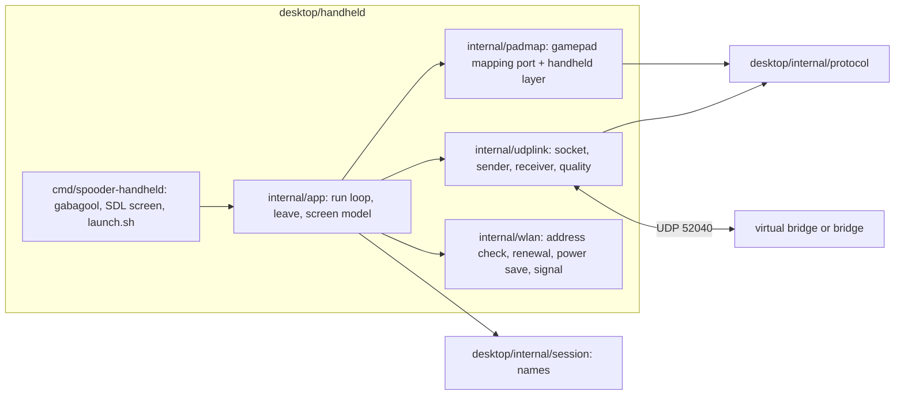

# Design

## Context

See proposal.md for the motivation. The bridge's WiFi drive (`add-wifi-drive`, design D3 and D4) takes one 21-byte command frame per UDP datagram on 192.168.4.1:52040, locks the first sender, starts each session in Sleep, ends it after 150 ms without a valid frame or on a sequence jump, and relays every robot frame (telemetry, pose and diagnostics at 10 Hz each since `relay-pose-diagnostics`) to the locked sender, byte for byte. It obliges the handheld to keep one source port per run and to send nothing for its first 150 ms. The desktop module (`desktop/`, Go, Gio) already has the link protocol (`internal/protocol`, tested against `test/golden/protocol_v3.txt`) and the names of body modes, gestures and faults (`internal/session`), neither of which imports Gio. The gamepad mapping the handheld must match is C++ (`core/gamepad_mapping`). gabagool v2.26.6 (`pkg/gabagool/init.go`) starts a power-button goroutine when `IsNextUI` is set on tg5040 (`/dev/input/event1`, code 116): a press under 2 s runs `/mnt/SDCARD/.system/tg5040/bin/suspend`, a hold of 2 s runs `/sbin/poweroff`, with no way for the application to step in. `GetWindow()` exposes the SDL window and its `Renderer`.

## Goals / Non-Goals

**Goals:** the smallest pak that drives the robot through the bridge safely (start-up, driving, the e-stop, leaving, the power button) and shows the robot's state and the link's quality, with its logic hardware-free and tested, end to end against the virtual robot, and a reproducible device build.

**Non-goals:** the leg view, voltage and current over time, the diagnostics screen (follow-ups); calibration from the handheld (the portal's job); any protocol or firmware change; joining WiFi from inside the pak (NextUI's settings do it).

## Decisions

### D1. A nested Go module at `desktop/handheld/`

The pak is the module `github.com/blackfyre/spooder/desktop/handheld` in `desktop/handheld/`, with `replace github.com/blackfyre/spooder/desktop => ../`. Go's internal rule is by import path: `desktop/internal/...` may be imported by any package whose path lies under `github.com/blackfyre/spooder/desktop`, which a nested module's packages do, so nothing moves. The nested module keeps cgo SDL2 and gabagool, and the patched gabagool's directory (D6), out of the calibrator's module: `desktop-test`, `desktop-build` and `vulncheck` stay as they are and need no SDL2 headers.

Alternatives: `desktop/cmd/spooder-handheld` in the desktop module (every desktop gate would need SDL2 headers and the fetched gabagool before it could vet or build); moving `protocol` and `session` out of `internal/` (a larger move touching every importer). If the go command refuses the nested import, the fallback is `desktop/cmd/spooder-handheld` with the fetch step added before the desktop tasks; task 1.2 checks this first.

Only `cmd/spooder-handheld` imports gabagool or go-sdl2; everything below it is tested on the host without SDL.

### D2. The mapping: a Go port of `core/gamepad_mapping`, kept in step by a golden file

`internal/padmap` ports `gamepad_mapping::update`, `stickToVector` and `toCommand` line for line (Bluepad32 units, the same dead zone, combos, steer and crab, gesture layer). A new `test/golden/gamepad_mapping.txt` lists input steps (time, connected, axes, buttons, D-pad, misc) and the expected desired state after each; a new C++ host test runs `core/gamepad_mapping` over it and the Go test runs the port over it, as `protocol_v3.txt` keeps the Go protocol in step. The golden file is written by hand from the gamepad-control scenarios plus the cases the port could get wrong (the dead-zone edge, the diagonal clamp, reverse mirroring, gait wrap, dial limits, the 1 s combos, the gesture layer, a reconnect).

The handheld layer, also in `padmap`, turns the TrimUI's controls into the gamepad's `PadState` before the port sees them, so the port stays identical to the C++:

| TrimUI | PadState |
|---|---|
| Left / right stick (SDL −32768..32767) | `axisX/Y`, `axisRX/RY`, scaled to −511..512 (SDL Y is negative for up, as Bluepad32's) |
| L2 / R2 (SDL 0..32767) beyond 16384 | `BUTTON_L2` / `BUTTON_R2` |
| A, B, X, Y, L1, R1, D-pad | the same bits |
| Start (Select not held) | `MISC_HOME` |
| Select + Start (press) | nothing; toggles the handheld's e-stop flag |
| Select + Y held | `BUTTON_THUMB_L | BUTTON_THUMB_R` (the port's 1 s fault-clear hold) |
| Y (Select held) | nothing |
| Select, Menu, Power | nothing (Menu and Power go to D5) |

`MISC_BACK` is never set, so Calibrate cannot be requested. The emergency stop is a toggle, as the bridge's GPIO35 button is; releasing it leaves the robot's EMERGENCY_STOP fault latched until a fault clear. `connected` is true while the pak drives, including during a leave.

### D3. The UDP link (`internal/udplink`)

- One socket per run: `net.DialUDP` to the bridge's address, made once after the address check, so the source port never changes and the kernel drops datagrams from any other address and port. The same socket is used again after a suspend and resume; the bridge sees a lapse, then a new session from the same port that starts in Sleep.
- The sender waits 150 ms from the socket's creation, then sends `protocol.EncodeCommand` of the mapping's command every 20 ms on a ticker, the sequence number advancing by one per frame; a send error is counted and the next tick tries again.
- The receiver reads into a buffer one byte larger than the largest robot frame, decodes each datagram with a fresh `protocol.Decoder`, and accepts it only when the decoder returns exactly one frame that spans the whole datagram and is telemetry, calibration report, pose or diagnostics; anything else is counted invalid and dropped.
- Link quality: frames per type in the last whole second; invalid datagrams; lost and late frames from the robot's sequence numbers (one counter per link on the robot, `core/robot/robot_tick`), with `d = uint8(seq - newest)`: 1 is in order, 2..127 counts `d - 1` lost, 0 or 128..255 counts late and the frame is shown but not taken as newest (its values are older); the time since the last valid frame; the signal level from `/proc/net/wireless` (D7). A frame the robot could not send for lack of UART room does not advance its sequence number, so it is not counted lost: the counts are of frames sent and not received.

### D4. The drive screen

One SDL screen drawn on gabagool's renderer (`GetWindow().Renderer`) at 1280×720, redrawn every 50 ms (20 Hz), with gabagool's fonts. Left: the robot (body mode, gait, output, faults by name from `session.FaultNames`, gesture, voltage and current), marked stale after 500 ms without telemetry. Right: what the pak requests (mode, height, speed, gait, stride, stick mode, e-stop) and the link quality (D3). gabagool's message screens show the join instructions (D7) and the leave wait (D5). The other screens are follow-ups.

### D5. Leaving, and the power button through a patched gabagool

A hardware-free state machine in `internal/app`: `Driving` → (Menu, power short, power long) → `Leaving{action, since}` → `Done{action}`. On entering `Leaving` the requested mode becomes Sleep through the mapping (its Sleep toggle state, with the mode-request counter advanced once; if Sleep is already requested nothing changes), frames keep going at 50 Hz, and the state completes when a telemetry frame received after the press reports body mode Sleep or output off, or 3 s (`LEAVE_TIMEOUT`) after the press. Further presses during `Leaving` are ignored. `Done` runs the action: exit, the suspend script, or `/sbin/poweroff`; after a suspend returns the pak is back in `Driving` with Sleep requested. 3 s is a named constant: Sleep from walking means standing and folding the legs, and the bridge's own lapse (150 ms) makes the robot sleep anyway once the pak stops.

gabagool gets a hook: the patch adds `Options.PowerButtonHook func(long bool)`; when it is set, the handler calls it instead of running the suspend script or the power-off command, leaving those to the application. The patch is `desktop/handheld/third_party/gabagool-power-hook.patch`, against v2.26.6 (commit 9776c2a). `mise run handheld-fork` runs `go mod download -json github.com/BrandonKowalski/gabagool/v2@v2.26.6` (Go verifies the module against the checksum database), copies it to `build/handheld/gabagool`, and applies the patch with `git apply --check` first; the nested `go.mod` has `replace github.com/BrandonKowalski/gabagool/v2 => ../../build/handheld/gabagool`. Every handheld task depends on `handheld-fork`. Once upstream has an equivalent hook, the replace and the patch go, and the pin becomes that release.

Alternatives: a fork on GitHub pinned by commit (needs a published repository outside this one, which this change cannot create); vendoring the patched module (26 MB, mostly embedded fonts); `IsNextUI: false` with the pak reading `/dev/input/event1` itself (loses NextUI's theme, and gabagool's NextUI handler cannot otherwise be kept from acting).

### D6. Power saving and `launch.sh`

`launch.sh` reads `iw dev wlan0 get power_save` (`on` or `off`), sets `trap restore EXIT INT TERM HUP` before anything else that changes state, runs the binary with `--device`, and restores the setting in `restore`. The binary does the same itself (read, `iw dev wlan0 set power_save off`, restore in a deferred function and on SIGINT/SIGTERM), so a binary run without the script is also clean; restoring twice is harmless. The only process the pak starts is `udhcpc` (one-shot, `-n -q`, waited for); the trap also kills any child still running. Without `--device` (desktop Linux) the pak skips the WiFi steps and the address check and uses `--addr` (default 192.168.4.1:52040), and gabagool runs without `IsNextUI`, so Power is not handled.

### D7. Joining and the address check (`internal/wlan`)

With `--device`: read `wlan0`'s IPv4 addresses (`net.InterfaceByName`); in 192.168.4.0/24 passes. Otherwise run `udhcpc -i wlan0 -n -q -t 5` once and read again. Still none: a gabagool message asks the user to join `spooder-drive-XXXX` in NextUI's WiFi settings with the password from the bridge's link page, names the current network (`iw dev wlan0 link`) if any, and offers retry or quit. The commands run through an injectable runner so the host tests cover every branch. The signal level is the `level` column of `wlan0` in `/proc/net/wireless` (dBm), shown as unknown when the file or the line is missing.

### D8. Build and packaging

- `desktop/handheld/build/Containerfile`: `debian:bullseye-slim` pinned by digest (`--platform=linux/arm64`), `gcc`, `pkg-config`, `libsdl2-dev`, `libsdl2-ttf-dev`, `libsdl2-image-dev`, `libsdl2-gfx-dev` from bullseye, and Go 1.27.1 from `go.dev/dl` with its SHA-256 checked in the Containerfile (the version `mise.toml` pins; the task checks they agree). Glibc 2.31 there is at most the device's 2.33.
- `mise run handheld-build-device` builds the image under rootless Podman (`podman build --platform linux/arm64`, qemu-user-static), then `go build -trimpath` inside it with the repository and the patched gabagool mounted, to `build/handheld/arm64/spooder-handheld`; then `desktop/handheld/scripts/check-glibc.sh` reads the binary's version needs (`readelf -V`, host binutils) and fails above GLIBC_2.31 or on a non-aarch64 ELF.
- Shipped libraries: `libSDL2_gfx-1.0.so.0` from the image, in `Spooder.pak/lib`, as Grout does. Grout and Pak Store, also on gabagool, ship only that, so the device has SDL2, SDL2_ttf and SDL2_image. `launch.sh` sets `LD_LIBRARY_PATH=/usr/trimui/lib:/usr/lib:$PAK/lib`, so the device's own libraries win and the pak's fill the gap. The on-device check (task 7.1) confirms with `ldd` that nothing is missing.
- `mise run handheld-package` zips `Spooder.pak/` (`launch.sh`, `spooder-handheld`, `lib/`) to `build/handheld/Spooder.pak.zip`, after the device build.
- `mise run handheld-build` builds the amd64 binary on the host (`build/handheld/amd64/spooder-handheld`, cgo with the host's SDL2 development packages; `desktop/handheld/scripts/check-deps.sh` names the missing Fedora or Debian packages). `mise run handheld-test` runs gofmt, go vet, staticcheck and go test over the nested module.

### D9. Security: authenticated freshness stays deferred

The UDP socket is an outside input: it is connected (D3), so the kernel drops other senders; the receiver accepts only exactly one valid robot frame per datagram and only robot frame types; the frames only update the screen and the leave confirmation, never what is sent. That is this change's part of the boundary.

Authenticated freshness of command frames (a keyed MAC and a session nonce, so a station on the WPA2 network cannot replay them) is not added. It needs a protocol version change and both firmwares (the bridge checks it, the robot's version check moves), so both boards flashed together, which is well beyond this change. The threat model of `add-wifi-drive` still holds: joining needs the random WPA2 password shown only on the bridge's screen, the access point takes one station, so a replaying station must first displace the handheld, the GPIO35 e-stop wins in every mode, and the robot refuses to recover while a fault holds. Nothing in this change widens the boundary: the handheld sends only, to a fixed address, and keeps the network's one station slot. It stays deferred, to be taken up if a station other than the handheld is ever expected on the network.

### D10. The virtual bridge, inside the virtual robot

`tools/virtual-robot` gains `--wifi-bridge [ADDR:]PORT` (default 127.0.0.1:52040). It compiles `core/wifi_drive/handheld_controller` and `relay_queue` and, each tick, before building the bridge link's bytes: reads every pending datagram from a non-blocking UDP socket within the controller's budget (`readDelayMs`), passing the sender's address and port and the tick's time; builds one command frame from `handheld_controller::desired` and `gamepad_mapping::toCommand` with the `estop` command's state ORed with `emergencyStop`, with its own sequence number, and feeds it to the bridge link's decoder where the simulated bridge's frame goes today. Robot frames written to the bridge link go through `relay_queue::relayFor` (with `beginPoll`/`endPoll` around the tick) and are sent with `sendto` to `relayTarget`. Session starts and ends are printed with the robot time. The option excludes `--bridge-pty`, `--stepped` and `--speed`. Doing it in-process, rather than as a separate program on the bridge terminal, reuses the tick loop's timing and needs no second terminal or thread; the bridge rules are the firmware's own code either way.

### D11. Tests

- Host tests (`mise run handheld-test`): the mapping against the golden file and the handheld layer's scenarios; the link's start-up wait, rate, single source port, receive validation and quality counters on loopback; the leave state machine with a fake clock (confirm, timeout, ignored second press, suspend then back to driving); the address check and power-save save and restore with a fake runner; `launch.sh` run with `sh` and stub `iw` and binary on `PATH` (the stub binary exits 1 and the trap still restores).
- End to end (`mise run e2e`, `desktop/handheld/e2e`): the app's run loop without SDL, with scripted input, against the virtual robot with `--wifi-bridge` on a free loopback port: the robot stands after Start, telemetry, pose and diagnostics arrive, the lost and invalid counts stay zero, Menu leaves only after Sleep is confirmed, a stop leads to the virtual robot's session end, and a restart from a new socket starts in Sleep. The amd64 binary itself is only built, not run, by the gates: it needs a display, and everything it does beyond the SDL drawing is in `internal/`.

### D12. CI

A `handheld` job on the Ubuntu runner: `apt-get install` of `libsdl2-dev libsdl2-ttf-dev libsdl2-image-dev libsdl2-gfx-dev`, then `mise run handheld-test`, `mise run handheld-build` and the handheld e2e (inside `mise run e2e`, which the desktop job already runs; the e2e packages import no SDL, so that job needs no new packages, only `handheld-fork`, on which `e2e` then depends, since the nested module's graph names the patched gabagool's directory). The arm64 device build stays out of CI: it runs the Go toolchain and the cgo build under qemu-user emulation, whose time on GitHub's runners is not measured; it is a local gate of this change (task 6.1), and moving it to CI is a follow-up once measured.

## Assumptions

- The nested-module import of `desktop/internal/...` is allowed by the go command (D1); the fallback is stated there.
- The TrimUI's controls reach the pak as an SDL game controller through gabagool's SDL initialisation, with the sticks and L2/R2 as axes; the mapping from SDL buttons to the table in D2 is one table in `cmd/spooder-handheld`, confirmed on the device (task 7.1).
- L2 and R2 count as pressed beyond half travel (16384 of 32767), standing for Bluepad32's trigger buttons.
- Select is the modifier for the e-stop and fault-clear combos because it has no function of its own in the gamepad mapping (`miscBack` acts only with `miscHome`, for Calibrate, which the handheld does not offer); L3/R3 do not exist.
- The handheld's e-stop is a toggle like GPIO35, and its flag is kept through a leave.
- A leave is confirmed by body mode Sleep or output off in telemetry received after the press, within 3 s.
- The device has SDL2, SDL2_ttf and SDL2_image (Grout ships only libSDL2_gfx); confirmed on the device.
- `iw`, `udhcpc` with its default script, `/proc/net/wireless` and the suspend script at `/mnt/SDCARD/.system/tg5040/bin/suspend` exist on NextUI tg5040 (the spike used `iw`; gabagool uses the script path).
- The pak shows only one screen in this change; gabagool is used for its messages and its NextUI theme and power handling.
- Robot frames carry one sequence counter per link, so gaps count frames sent and not received (D3).
- The virtual bridge runs only in real time (its datagrams come at wall-clock rate).
- Upstream gabagool will be asked for the hook by the user (a pull request needs their GitHub account); this change carries the patch ready for it.
- gabagool v2.26.6 (released 2026-10-12) and go-sdl2 v0.4.40 (2024-05-30) are both older than 7 days; their changelogs are read when they are pinned (task 4.2).

## Risks / Trade-offs

- [gabagool's power handler acts before the hook if the patch fails to apply to a new version] → the pin is an exact version, `handheld-fork` checks that the patch applies and fails the build otherwise.
- [A Power hold of 2 s powers off after up to 3 s more of waiting] → the user keeps seeing the leave message; a cut is safe anyway, since the bridge lapses in 150 ms and the robot sleeps.
- [The device lacks a library the pak needs] → the package step lists the binary's needed libraries; the on-device check runs `ldd`.
- [Emulated arm64 builds are slow] → only locally, cached image; CI builds amd64 (D12).
- [Command frames can be replayed by a station on the network] → accepted and deferred, D9.
- [WiFi power saving left off after a crash of the shell itself] → `launch.sh`'s trap covers the binary; a crash of the shell, or a power cut, leaves it off until the next pak run or reboot (NextUI's own setting applies at boot).

## Migration Plan

Nothing on the boards changes. Install by copying `Spooder.pak` to `Tools/tg5040/` on the SD card; remove by deleting it.

## Follow-ups

- The leg view (pose frame, `desktop/internal/legview`), voltage and current over time (`desktop/internal/session` history), and the diagnostics screen, as further pages of the pak.
- The arm64 build in CI, once its emulated time is measured.
- The upstream gabagool pull request for the power-button hook; then drop the patch.
- The nested module in `mise run vulncheck` and Dependabot.
- Authenticated freshness of command frames, if the network boundary proves insufficient (D9).
