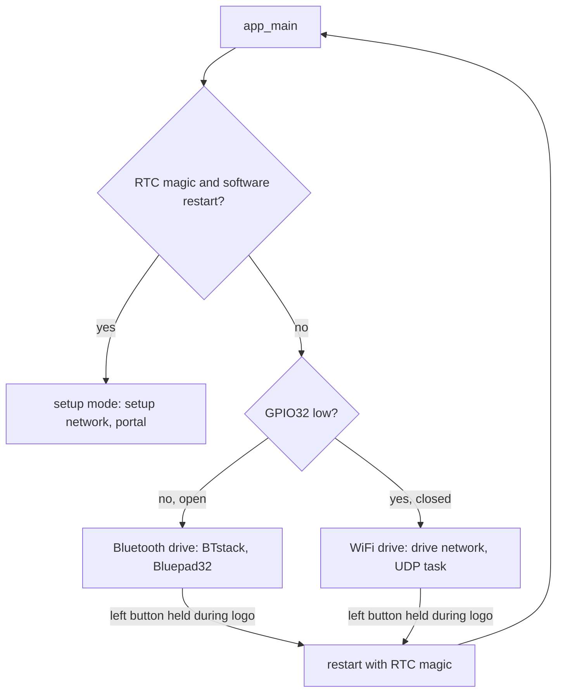

# Design

## Context

See proposal.md for the motivation. The bridge today has two boot paths, chosen in `app_main` (`firmware/bridge/main/main.c`): Bluetooth drive (BTstack and Bluepad32, then Arduino's `setup()`/`loop()` in `bridge.cpp`) and setup mode (`setup_mode_start`: frees the Bluetooth controller memory, runs a WPA2 access point at 192.168.4.1 on channel 1 with one station, a captive portal and its own task). In both, `robot_link` sends a command frame every 20 ms from a desired state, samples the GPIO35 e-stop toggle and decodes the robot's frames. In setup mode the desired state comes from `core/setup/portal_controller`, judged in the link task every period.

The robot applies a baseline-after-gap rule to the three command counters (`link_receiver`, `LINK_GAP_MS` 200 ms). The bridge's heartbeat hides a handheld restart from the robot, so the bridge must apply the same rule to the handheld.

## Goals / Non-Goals

**Goals:** the smallest bridge-side mode that a handheld app (or the probe) can drive through, with its safety rules in host-tested `core/` code.

**Non-goals:** the handheld app and its virtual bridge (`add-handheld-controller`); relaying pose and diagnostics, which the robot sends only on USB today (`relay-pose-diagnostics`; the relay here forwards whatever the robot sends, so it needs no change then); calibration over WiFi drive; more than one handheld; a protocol version change; any robot firmware change.

## Decisions

### D1. Three boot paths, decided once in `app_main`

`core/wifi_drive/drive_mode` holds the decision (`select(setupRequested, switchClosed)`) and the running switch notice (a 100 ms debounce of the sampled level against the boot mode). `main.c` configures GPIO32 as an input with the pull-up and reads it after a short settling delay (about 1 ms), before BTstack starts. WiFi drive gets its own start function (like `setup_mode_start`): it prints the build banner (`spooder bridge: build <id>`) first, frees the Bluetooth controller memory, starts Arduino, the display (logo, then the start-up log beginning with `Build <id>`, within the 3 s start-up limit, with command frames sent throughout and the status screen shown at once on an e-stop), `robot_link` in WiFi drive, the access point and the UDP task, and a WiFi drive task that runs the logo hold into setup mode, the page button and the screen, as `loop()` does in Bluetooth drive. Alternative considered: one path with a runtime flag through `bridge.cpp`; rejected because `setup()` and `loop()` call Bluepad32 throughout, and the Bluepad32 template only runs them once BTstack runs.

GPIO32 rather than GPIO33: both are free header pins on the T-Display (`hardware/lilygo-t-display`: the schematic routes IO32 and IO33 to the header, with the 32 kHz crystal not fitted), neither is a strapping pin (0, 2, 12, 15) nor input-only (34-39), and both have internal pull-ups. GPIO32 is taken; GPIO33 stays spare. The pin must be confirmed on the fitted v1.1 board (hardware task 6.1).

### D2. Separate network name and password for WiFi drive

The WiFi drive network is `spooder-drive-XXXX` (the same four MAC digits as the setup network's `spooder-XXXX`), with its own random password kept in NVS under its own key (`drive_pass`), made by the existing `access_point::makePassword`. Sharing the setup network's credentials would let the handheld join once for both, but a handheld that auto-joins the setup network takes its only station slot and locks the phone out of the portal, and it would sit on a network where nothing answers its frames. Both networks use 192.168.4.1 on channel 1 (the spike's conditions); they never run together. `access_point::ssid` gains a prefix parameter (or a second function); `SSID_SIZE` grows to fit `spooder-drive-` + 4 digits.

One station at a time, as in setup mode: the single-handheld rule is enforced on UDP (D4), and a second station would only share the airtime. A laptop running the probe (D7) joins instead of the handheld, not beside it.

### D3. UDP framing, port and address

- Port 52040 (UDP), chosen as easy to remember (the board's name); nothing else on the bridge uses UDP in WiFi drive, and the DNS server runs only in setup mode.
- The handheld sends to 192.168.4.1:52040, a fixed address: the access point's default network, which is also the gateway its DHCP lease names, so no discovery is needed. The DHCP server is the access point's default (NextUI's client renewing after a network switch is the handheld's concern, `add-handheld-controller`).
- One command frame per datagram, exactly `COMMAND_FRAME_SIZE` (21) bytes. The bridge checks the length, then decodes with a fresh `protocol::Decoder` and requires one command frame; anything else is discarded and counted. Reusing the link framing means the handheld reuses the Go protocol package unchanged.
- Robot frames go back one per datagram, byte for byte. `protocol::Decoder` gains an accessor for the raw bytes of the frame `next()` has just returned (valid until the next `push`), so the bridge never re-encodes; a field it does not know (a future frame type such as pose) passes through unchanged. This is the only `core/protocol` change; the wire format is untouched, so the golden vectors stay.
- Rate limit: the handheld controller admits at most 8 datagrams per 20 ms window (`accept` returns rate-limited beyond that, before any decoding); once the window's budget is spent, the UDP task stops reading until the next window, leaving the rest in lwIP's UDP receive mailbox. That mailbox is bounded (`CONFIG_LWIP_UDP_RECVMBOX_SIZE`, pinned to 6 in `sdkconfig.defaults`, the ESP-IDF default made explicit); lwIP drops what does not fit. Since the mailbox is smaller than one window's budget, the backlog is emptied every window: no datagram waits more than one window, so a stamp taken on receipt is at most 20 ms late. The handheld's state only reaches the robot through the bridge's own 50 Hz frames, so a flood cannot raise the rate of frames to the robot, and the cap bounds the bridge's work.

### D4. The handheld controller (`core/wifi_drive/handheld_controller`)

Hardware-free, like `portal_controller`; the UDP task feeds it, the link task reads `desired(now)` and the e-stop flag inside its lock every period, so a stalled UDP task counts as a lapse at once.

- `accept(datagram, length, sender, nowMs)`: the window budget (D3), validation (D3), the sender lock (sender = IPv4 address and port as plain integers), the sequence rule, liveness stamp, counter translation. Returns an outcome (accepted, rate-limited, malformed, other sender, stale, jump) for the counts.
- Sequence rule, with `d = (uint8_t)(seq - lastSeq)`: 1..`SEQ_WINDOW` (8) is newer and accepted; 0 or 128..255 is stale (late or repeated) and discarded; `SEQ_WINDOW + 1`..127 is a jump, which a 50 Hz sender cannot make while live (150 ms holds at most seven periods), so it means the sender restarted: the frame is discarded and the session ends at once, as on a lapse (no controller, Sleep, sender lock released). The next valid frame starts a new session with fresh baselines.
- Liveness: `LIVENESS_MS = 150`. At 50 Hz, six consecutive losses leave 140 ms between accepted frames (seven leave 160 ms and lapse); the spike's worst round trip was 34 ms. It sits under the robot's own `LINK_GAP_MS` (200 ms) so the bridge reports the lapse before the robot would have, had the link been direct: a stamp at most one window late (D3) and the link task's next period give at most 150 + 20 + 20 = 190 ms.
- A restarted handheld app does not replay its counters: a new socket gets a new source port, so it is another sender and waits for the lapse; on the same port, a first sequence number more than 8 ahead of the last is a jump and ends the session; one behind is stale, and stale frames do not refresh liveness, so the session lapses before the sequence catches up unless the last accepted number was below 8. The residual case (the same port, within 150 ms, a first sequence number within 1..8 ahead of the last, or a last number below 8) is closed by the handheld side: `add-handheld-controller` keeps its socket's ephemeral port per run and sends nothing for the first 150 ms after start.
- Session start (the first accepted frame while not live): sets the lock and the three counter baselines and the sequence baseline; the requested mode is Sleep and stays Sleep until the first mode-request change in the session.
- Translation: on each accepted frame, a changed handheld counter advances the bridge's counter by one (whatever the difference: a jump of several means lost frames, and the robot counts one request per change too), taking the frame's mode or gesture.
- Desired state: the translated counters and mode, and the newest frame's translate, rotate, height, speed, gait and stride, passed through (the robot clamps them, `link_receiver::toMovementCommand`); `controllerConnected` is live and the frame's flag. When not live: Sleep, no controller, zero translate and rotate, the gamepad defaults for the rest.
- E-stop: the newest accepted frame's flag, kept through a lapse; the link task ORs it with its GPIO35 toggle in `toCommand`.

### D5. Tasks in WiFi drive

As in setup mode: `robot_link` at priority 5 on core 1 (its WiFi drive start takes the handheld controller as the source, the way `startPortal` takes the portal); a UDP task at priority 2 on core 1 (`recvfrom` with a receive timeout of one window, stamping each datagram on receipt, and the relay sends), so a slow screen redraw never delays reading; a WiFi drive task at priority 1 on core 1 (the screen, the buttons); WiFi and lwIP on core 0. The socket is lwIP's (`socket`, `bind`, `recvfrom`, `sendto` with `MSG_DONTWAIT`), already linked for setup mode, so no new dependency.

The relay: the link task's `takeFrames` copies each frame's raw bytes into `core/wifi_drive/relay_queue`, a fixed ring of 8 frames under the link lock, without waiting: when it is full the frame is dropped and counted, so the link task never waits on the relay. The UDP task takes frames from the ring and sends each to `handheld_controller::relayTarget(now)`, the locked sender while the session is live; with no live session it drops them, and a session's end clears the ring, so a frame from one session never reaches the next session's sender. At 10 Hz telemetry (plus pose and diagnostics later) 8 frames hold well over 100 ms of output.

### D6. Screen

`status_screen::Inputs` gains the drive mode, the handheld state, the network name and password, and the switch notice. The handheld state has three values: none (no live session), idle (a live session whose frames clear the controller-connected flag, so the robot does not follow it) and in control (a live session with the flag set). The header's controller field (`NO PAD`, `PAD` in Bluetooth drive) names WiFi drive and the three states within the field's width; the link page shows the network name, the password and the handheld state in WiFi drive (in place of the gamepad line). Command frames carry no stick mode (the handheld maps its own sticks), so in WiFi drive the drive page shows the stride mode alone, never a bridge default stick mode. The status strip adds `SWITCH MOVED: RESTART` after the faults and the source state, and raises the strip's tone to at least the warning tone. The faults and the source state take precedence: when the two strip lines cannot hold the notice after them (only with many faults and the source state at once), the notice is left out rather than cutting a fault. The start-up log names WiFi drive and the network. `tools/bridge-screenshots` renders the WiFi drive drive and link pages beside the existing ones.

### D7. A desktop probe instead of a virtual bridge

`desktop/cmd/spooder-wifi-probe`: sends command frames at 50 Hz from the Go link protocol to 192.168.4.1:52040 (flags for the address, the mode to request once, the e-stop flag and when to clear it, a fault clear to send once after a delay, a pause to let liveness lapse, and a flood rate that adds extra valid datagrams for the rate-limit check), and prints the robot frames it receives per type and second, and the telemetry's body mode and faults; it counts a datagram that is not exactly one valid robot frame, or that holds a command frame, as an error. It measures no round-trip time: the bridge echoes nothing. It makes the on-board checks possible before the handheld app exists. The virtual bridge that lets the handheld app run end to end without hardware is `add-handheld-controller`'s.

## Assumptions

- The gesture-request counter is translated like the fault-clear and mode-request counters: the brief names only those two, but protocol 3's gesture counter has the same restart hazard.
- A handheld session starts in Sleep and leaves it only on a mode request, as the portal does after a lapse; the robot's own resume gate adds to this, it does not replace it.
- The handheld's e-stop flag outlasts a lapse until a frame clears it (the robot sleeps meanwhile anyway, with no controller).
- The handheld's controller-connected flag is honoured, so the app can release control (in a menu) without going quiet.
- The bridge does not clamp the handheld's analogue fields; the robot does, for every link.
- One station on the access point, as in setup mode.
- A handheld app keeps one source port per run and waits 150 ms after start before its first frame (an obligation on `add-handheld-controller`, closing the residual restart case of D4).
- The switch notice yields to the faults and the source state when the status strip is full.
- In WiFi drive the drive page shows no stick mode.
- The relay drops, and counts, robot frames when its 8-frame ring is full, rather than delay the link task.
- UDP port 52040, the fixed address 192.168.4.1 and channel 1 need no configuration.
- The switch is read about 1 ms after enabling the pull-up; GPIO32 has no external load on the T-Display v1.1 (to be confirmed on the board).
- The rate window is a fixed grid (`nowMs / 20`), so the UDP task knows when the next window starts; every datagram read counts against the budget, malformed ones included.
- `handheld_controller::epoch` advances at every session start and end; `relay_queue::relayFor` and `takeFor` clear the queue whenever it changes (called under the link lock, where both the push and the take happen), so a frame never crosses sessions even when a lapse and a new session fall between two link periods.
- A datagram is stamped inside the link lock, as soon as `recvfrom` returns, not before taking the lock: the link task judges liveness against a time it takes inside the lock, and a stamp taken earlier could be older than a judgement made in between and end a live session.
- `protocol::Decoder::frameBytes()` is a copy of the returned frame, kept until `next()` returns another one (stronger than "until the next push").
- `access_point::SSID_SIZE` is 19, the drive network's size; the setup network's join code still fits `JOIN_CODE_SIZE`.
- The header's controller field stays within 8 characters (the width of `PAD 100%`): `WF NONE`, `WF IDLE` (both in the warning tone) and `WF CTRL` (good). The link page's WiFi drive lines are `NET <name>`, `PASS <password>` and `HANDHELD NONE`, `HANDHELD IDLE` or `HANDHELD IN CONTROL`; how they share the body's height with the four rate lines is the bridge's drawing (task 2.3).
- With the switch notice alone the strip shows the notice, not `NO FAULTS`.
- The bridge reads the switch through ESP-IDF's GPIO driver (`gpio_get_level`), in `app_main` and while it runs, not through Arduino's `digitalRead`, which reads 0 (closed) for a pin it did not configure itself.
- In WiFi drive the screen's e-stop (the status strip, and the status screen shown at once) is the one the command frames carry: the GPIO35 toggle or the handheld's flag.
- The WiFi drive link page draws its seven lines in the 10 px font at 11 px spacing, in place of the five 12 px lines of Bluetooth drive.
- The UDP task reads into a buffer one byte longer than a command frame, so lwIP's truncation of a longer datagram still reads as too long; relayed frames wait at most one receive timeout (20 ms) before they are sent.
- The outcome counts, the relay's drops and failed sends go to the bridge console every 10 s when they changed; the screen does not show them.
- The access point password is kept in NVS namespace `spooder` under `drive_pass`, made by the setup mode's password loader, shared with setup mode and given the key.
- The probe's flood datagrams are copies of its latest regular frame (same sequence number), so the bridge accepts at most one of them and discards the rest as stale; flooding with new sequence numbers would make the bridge see jumps and end the session, which tests the sequence rule rather than the rate limit.
- The probe waits 150 ms after it starts before its first frame, as a handheld must (D4); its times (`--mode-after`, `--estop-clear-after`, `--clear-after`, `--pause-after`) are measured from its start, and a counter changes only in a frame after the first, which the bridge takes as the session's baseline. It reports a connected controller in every frame, with a gamepad's rest values (no translation or rotation, height 0, speed 44).
- The probe counts calibration set frames as errors too, since a robot never sends them; its socket is connected to the bridge's address, so the kernel drops datagrams from anyone else. `mise run desktop-build` also builds it, without cgo, to `build/desktop/spooder-wifi-probe`.

## Risks / Trade-offs

- [The bridge image grows with lwIP sockets in a third path] → setup mode already links WiFi and lwIP; `scripts/check_image_size.py` reports the headroom on every build.
- [A spoofed station on the WPA2 network could drive the robot] → the WPA2 network is the boundary, with a random password shown only on the bridge; frames are CRC-checked, one sender is locked, the rate is capped and the bridge's own e-stop always wins.
- [A handheld app restarted on the same port within 150 ms could replay its counter resets as requests] → the sequence jump rule and stale frames not refreshing liveness close most cases; the rest is closed by the handheld app's start-up wait (D4).
- [A flood from the locked sender, then silence, keeps the session live a little longer] → the receive mailbox is smaller than a window's budget, so at most 20 ms longer; the lapse still reaches the robot's command frames within 190 ms, under the robot's 200 ms gap.
- [Liveness of 150 ms trips on WiFi stalls longer than the spike saw] → the robot only sleeps; the timeout is a named constant, and the probe and on-board checks measure the lapse count.
- [GPIO32 read before the pull-up settles reads low and starts WiFi drive by mistake] → a settling delay before the read, and the screen names the drive mode; a wrong mode is visible and safe (no gamepad connects, nothing moves).

## Migration Plan

No protocol change: only the bridge is reflashed. With no switch fitted the bridge behaves as before. Rollback is reflashing the previous bridge image.

## Follow-ups

- The switch's place and wiring route on the electronics mount: `add-electronics-mount`.
- Pose and diagnostics to the bridge link, then to the handheld: `relay-pose-diagnostics`.
- The handheld app and the virtual bridge: `add-handheld-controller`.
