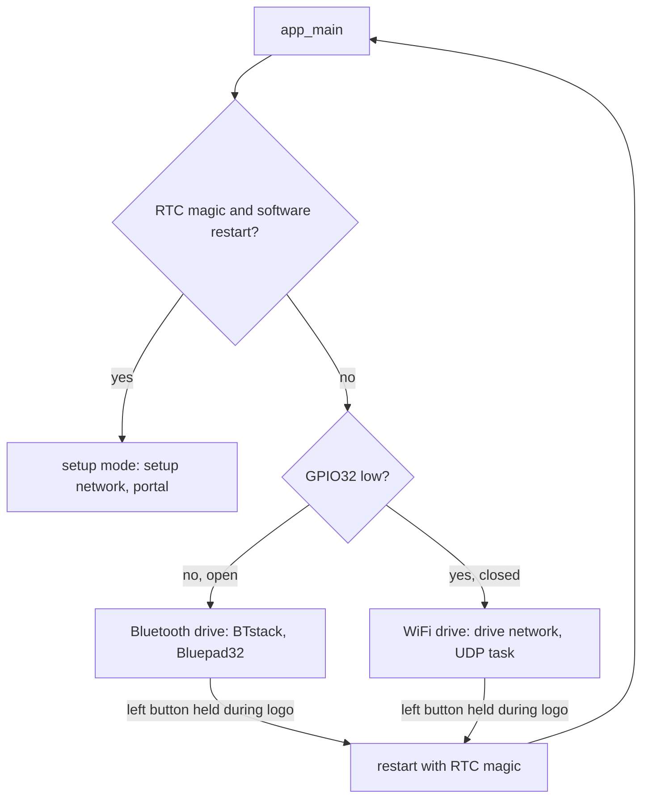

# Design

## Context

See proposal.md for the motivation. The bridge today has two boot paths, chosen in `app_main` (`firmware/bridge/main/main.c`): Bluetooth drive (BTstack and Bluepad32, then Arduino's `setup()`/`loop()` in `bridge.cpp`) and setup mode (`setup_mode_start`: frees the Bluetooth controller memory, runs a WPA2 access point at 192.168.4.1 on channel 1 with one station, a captive portal and its own task). In both, `robot_link` sends a command frame every 20 ms from a desired state, samples the GPIO35 e-stop toggle and decodes the robot's frames. In setup mode the desired state comes from `core/setup/portal_controller`, judged in the link task every period.

The robot applies a baseline-after-gap rule to the three command counters (`link_receiver`, `LINK_GAP_MS` 200 ms). The bridge's heartbeat hides a handheld restart from the robot, so the bridge must apply the same rule to the handheld.

## Goals / Non-Goals

**Goals:** the smallest bridge-side mode that a handheld app (or the probe) can drive through, with its safety rules in host-tested `core/` code.

**Non-goals:** the handheld app and its virtual bridge (`add-handheld-controller`); relaying pose and diagnostics, which the robot sends only on USB today (`relay-pose-diagnostics`; the relay here forwards whatever the robot sends, so it needs no change then); calibration over WiFi drive; more than one handheld; a protocol version change; any robot firmware change.

## Decisions

### D1. Three boot paths, decided once in `app_main`

`core/wifi_drive/drive_mode` holds the decision (`select(setupRequested, switchClosed)`) and the running switch notice (a 100 ms debounce of the sampled level against the boot mode). `main.c` configures GPIO32 as an input with the pull-up and reads it after a short settling delay (about 1 ms), before BTstack starts. WiFi drive gets its own start function (like `setup_mode_start`): it frees the Bluetooth controller memory, starts Arduino, the display (logo, start-up log), `robot_link` in WiFi drive, the access point and the UDP task, and a WiFi drive task that runs the logo hold into setup mode, the page button and the screen, as `loop()` does in Bluetooth drive. Alternative considered: one path with a runtime flag through `bridge.cpp`; rejected because `setup()` and `loop()` call Bluepad32 throughout, and the Bluepad32 template only runs them once BTstack runs.

GPIO32 rather than GPIO33: both are free header pins on the T-Display (`hardware/lilygo-t-display`: the schematic routes IO32 and IO33 to the header, with the 32 kHz crystal not fitted), neither is a strapping pin (0, 2, 12, 15) nor input-only (34-39), and both have internal pull-ups. GPIO32 is taken; GPIO33 stays spare. The pin must be confirmed on the fitted v1.1 board (hardware task 6.1).

### D2. Separate network name and password for WiFi drive

The WiFi drive network is `spooder-drive-XXXX` (the same four MAC digits as the setup network's `spooder-XXXX`), with its own random password kept in NVS under its own key (`drive_pass`), made by the existing `access_point::makePassword`. Sharing the setup network's credentials would let the handheld join once for both, but a handheld that auto-joins the setup network takes its only station slot and locks the phone out of the portal, and it would sit on a network where nothing answers its frames. Both networks use 192.168.4.1 on channel 1 (the spike's conditions); they never run together. `access_point::ssid` gains a prefix parameter (or a second function); `SSID_SIZE` grows to fit `spooder-drive-` + 4 digits.

One station at a time, as in setup mode: the single-handheld rule is enforced on UDP (D4), and a second station would only share the airtime. A laptop running the probe (D7) joins instead of the handheld, not beside it.

### D3. UDP framing, port and address

- Port 52040 (UDP), chosen as easy to remember (the board's name); nothing else on the bridge uses UDP in WiFi drive, and the DNS server runs only in setup mode.
- The handheld sends to 192.168.4.1:52040, a fixed address: the access point's default network, which is also the gateway its DHCP lease names, so no discovery is needed. The DHCP server is the access point's default (NextUI's client renewing after a network switch is the handheld's concern, `add-handheld-controller`).
- One command frame per datagram, exactly `COMMAND_FRAME_SIZE` (21) bytes. The bridge checks the length, then decodes with a fresh `protocol::Decoder` and requires one command frame; anything else is discarded and counted. Reusing the link framing means the handheld reuses the Go protocol package unchanged.
- Robot frames go back one per datagram, byte for byte. `protocol::Decoder` gains an accessor for the raw bytes of the frame `next()` has just returned (valid until the next `push`), so the bridge never re-encodes; a field it does not know (a future frame type such as pose) passes through unchanged. This is the only `core/protocol` change; the wire format is untouched, so the golden vectors stay.
- Rate limit: the UDP task reads at most 8 datagrams per 20 ms period and discards the rest; the handheld's state only reaches the robot through the bridge's own 50 Hz frames, so a flood cannot raise the rate of frames to the robot, and the cap bounds the bridge's work.

### D4. The handheld controller (`core/wifi_drive/handheld_controller`)

Hardware-free, like `portal_controller`; the UDP task feeds it, the link task reads `desired(now)` and the e-stop flag inside its lock every period, so a stalled UDP task counts as a lapse at once.

- `accept(datagram, length, sender, nowMs)`: validation (D3), the sender lock (sender = IPv4 address and port as plain integers), the sequence rule (newer means `(uint8_t)(seq - lastSeq)` in 1..127), liveness stamp, counter translation. Returns an outcome (accepted, malformed, other sender, stale) for the counts.
- Liveness: `LIVENESS_MS = 150`. At 50 Hz, seven consecutive losses leave 140 ms between accepted frames; the spike's worst round trip was 34 ms. It sits under the robot's own `LINK_GAP_MS` (200 ms) so the bridge reports the lapse before the robot would have, had the link been direct.
- Session start (the first accepted frame while not live): sets the lock and the three counter baselines and the sequence baseline; the requested mode is Sleep and stays Sleep until the first mode-request change in the session.
- Translation: on each accepted frame, a changed handheld counter advances the bridge's counter by one (whatever the difference: a jump of several means lost frames, and the robot counts one request per change too), taking the frame's mode or gesture.
- Desired state: the translated counters and mode, and the newest frame's translate, rotate, height, speed, gait and stride, passed through (the robot clamps them, `link_receiver::toMovementCommand`); `controllerConnected` is live and the frame's flag. When not live: Sleep, no controller, zero translate and rotate, the gamepad defaults for the rest.
- E-stop: the newest accepted frame's flag, kept through a lapse; the link task ORs it with its GPIO35 toggle in `toCommand`.

### D5. Tasks in WiFi drive

As in setup mode: `robot_link` at priority 5 on core 1 (its WiFi drive start takes the handheld controller as the source, the way `startPortal` takes the portal); a WiFi drive task at priority 1 on core 1 (the UDP receive with a non-blocking socket, the screen, the buttons); WiFi and lwIP on core 0. The relay is done in the link task's `takeFrames`, which hands each frame's raw bytes to a small queue the UDP side sends from, so a slow `sendto` never delays command frames. The socket is lwIP's (`socket`, `bind`, `recvfrom`, `sendto` with `MSG_DONTWAIT`), already linked for setup mode, so no new dependency.

### D6. Screen

`status_screen::Inputs` gains the drive mode, the handheld state, the network name and password, and the switch notice. The drive page's controller field shows `WIFI: HANDHELD` or `WIFI: NO HANDHELD`; the link page shows the network name, the password and the handheld state in WiFi drive (in place of the gamepad line); the status strip adds `SWITCH MOVED: RESTART` in the warning tone after the faults. The start-up log names WiFi drive and the network. `tools/bridge-screenshots` renders the WiFi drive drive and link pages beside the existing ones.

### D7. A desktop probe instead of a virtual bridge

`desktop/cmd/spooder-wifi-probe`: sends command frames at 50 Hz from the Go link protocol to 192.168.4.1:52040 (flags for the address, the mode to request once, and a pause to let liveness lapse), and prints the robot frames it receives per type and second, and the telemetry's body mode and faults. It measures no round-trip time: the bridge echoes nothing. It makes the on-board checks possible before the handheld app exists. The virtual bridge that lets the handheld app run end to end without hardware is `add-handheld-controller`'s.

## Assumptions

- The gesture-request counter is translated like the fault-clear and mode-request counters: the brief names only those two, but protocol 3's gesture counter has the same restart hazard.
- A handheld session starts in Sleep and leaves it only on a mode request, as the portal does after a lapse; the robot's own resume gate adds to this, it does not replace it.
- The handheld's e-stop flag outlasts a lapse until a frame clears it (the robot sleeps meanwhile anyway, with no controller).
- The handheld's controller-connected flag is honoured, so the app can release control (in a menu) without going quiet.
- The bridge does not clamp the handheld's analogue fields; the robot does, for every link.
- One station on the access point, as in setup mode.
- UDP port 52040, the fixed address 192.168.4.1 and channel 1 need no configuration.
- The switch is read about 1 ms after enabling the pull-up; GPIO32 has no external load on the T-Display v1.1 (to be confirmed on the board).

## Risks / Trade-offs

- [The bridge image grows with lwIP sockets in a third path] → setup mode already links WiFi and lwIP; `scripts/check_image_size.py` reports the headroom on every build.
- [A spoofed station on the WPA2 network could drive the robot] → the WPA2 network is the boundary, with a random password shown only on the bridge; frames are CRC-checked, one sender is locked, the rate is capped and the bridge's own e-stop always wins.
- [Liveness of 150 ms trips on WiFi stalls longer than the spike saw] → the robot only sleeps; the timeout is a named constant, and the probe and on-board checks measure the lapse count.
- [GPIO32 read before the pull-up settles reads low and starts WiFi drive by mistake] → a settling delay before the read, and the screen names the drive mode; a wrong mode is visible and safe (no gamepad connects, nothing moves).

## Migration Plan

No protocol change: only the bridge is reflashed. With no switch fitted the bridge behaves as before. Rollback is reflashing the previous bridge image.

## Follow-ups

- The switch's place and wiring route on the electronics mount: `add-electronics-mount`.
- Pose and diagnostics to the bridge link, then to the handheld: `relay-pose-diagnostics`.
- The handheld app and the virtual bridge: `add-handheld-controller`.
