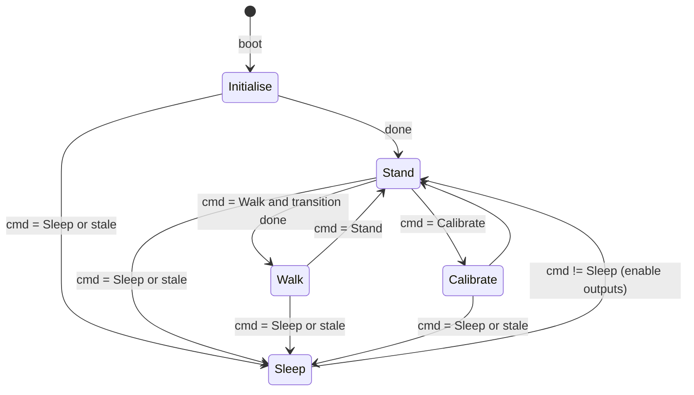

# Design

## Context

- All movement logic is in `src/movement/movement.cpp`, which holds about 60 file-level globals. It is token-identical to upstream `ca5ed27`, apart from servo output on two PCA9685 boards. `stateStanding` busy-waits for about 1 s. Nothing calls the state functions.
- The main loop (`loop()`) services MLC, ToF and the display, then waits 50 ms. `loop2` (gamepad) is a pre-emptive RTOS thread that never touches I²C. See `.claude/skills/spooder-firmware-shape`.
- I²C is never configured beyond `Wire.begin()`, so it runs at 100 kHz. `loopDisplay()` sends the full 1 KB SH1107 frame twice per loop (`displayLogMessages()` and then `loopDisplay()` each call `display.display()`). That alone is about 200 ms of bus time per iteration.
- `Adafruit_PWMServoDriver::begin()` sets a 1000 Hz PWM frequency, and `setupServos()` never sets 50 Hz. `writeMicroseconds()` also reads the prescale register over I²C on every call.
- No tests exist, and there is no native build.

## Goals / Non-Goals

**Goals:**
- Split movement into a hardware-free core that can be unit-tested on the host, plus a thin hardware layer.
- Run movement at a steady step rate of about 50 Hz on the shared main loop.

**Non-Goals:**
- Gamepad integration and the cross-thread input snapshot. That belongs to the controller change, which will produce `MovementCommand` values in `loop2` and hand them to `loop()`.
- Re-tuning gait parameters, or calibrating offsets on our robot.
- Moving movement into its own thread.

## Decisions

### D1. Module layout: pure core plus hardware adapter

```
src/movement/
  movement.h / .cpp   public API: setupMovement(), movementTick(nowMs, cmd), MovementCommand
  body.h / .cpp       body state machine (modes, transitions, smoothing, gaits)      [pure]
  gait.h / .cpp       gait table, phase, foot-path (Bezier) maths                    [pure]
  kinematics.h / .cpp IK, target validation, angle->pulse conversion                 [pure]
  vectors.h           Vector2/Vector3 (+ lerp, magnitude, normalize)                 [pure]
  servos.h / .cpp     PCA9685 setup, channel map, pulse writes, output enable        [hardware]
```

- **Pure files** include only `<math.h>`, `<stdint.h>` and each other. They have no Arduino and no driver headers.
  - The `toString()` methods in `vectors.h` move into `reporting`, which is the only place that formats vectors.
  - `vectors.h` stops including `main.h`.
- **State** lives in one `BodyState` struct owned by `movement.cpp`.
  - Pure functions take a reference to it, rather than reading globals.
  - Tests build their own instance.
- **The pure core produces foot targets.** `movement.cpp` passes them to `servos` through `kinematics`.
- **Alternative considered:** keep `movement.cpp` and make it non-blocking in place. Rejected, because the globals and Arduino dependencies make the logic untestable, and the spec's tick-rate and zero-input scenarios need host tests.

### D2. Movement tick: `movementTick(nowMs, cmd)` called from `loop()`

- `movementTick` computes `dt` from the last call and clamps it to `MAX_STEP_MS = 100`. It advances the body state machine by `dt`, then writes the resulting foot targets.
- It runs on the main loop because that loop owns I²C (firmware-shape bus rule).
- The fixed `delay(50)` in `loop()` is replaced by a period scheduler with `LOOP_PERIOD_MS = 20`: sleep for whatever remains of the period, or yield if over.
- **Default command:** until the controller change lands, `main.cpp` builds a Stand command stamped with the current time on every tick. The stale-command rule therefore never triggers on it.
- **Alternatives considered:**
  - A dedicated movement thread at higher priority. Rejected for now: it needs a module-level I²C lock shared with display, ToF and MLC, which is a bigger change.
  - Keeping the per-tick `delay(50)`. Rejected: it makes the step rate depend on everything else in the loop.

### D3. I²C bus budget

- Set `Wire.setClock(400000)` after `Wire.begin()`. Every device on the bus supports 400 kHz: PCA9685, SH1107, VL6180X and LSM6DSOX.
- **Display:**
  - Remove the duplicate `display.display()` in `loopDisplay()`.
  - Redraw only when the log buffer has changed, and at most every 200 ms (5 Hz).
  - One full frame at 400 kHz is about 25 ms of bus time. When it happens, that step runs long and `dt` absorbs it.
- **Servos:**
  - Write pulses through `setPWM` with a pulse count precomputed from a cached prescale, instead of `writeMicroseconds()`. That removes 18 register reads per step.
  - Skip a channel when its pulse count has not changed since the last write.
- **Budget:** 18 servo writes is about 18 × 6 bytes ≈ 2.5 ms at 400 kHz. ToF and MLC add under 2 ms. A 20 ms period is therefore feasible on steps without a display redraw.

### D4. Servo frame rate and output enable

- In `setupServos`, call `setPWMFreq(50)` on both drivers after `begin()` and read the prescale back once to cache it.
  - The PCA9685's internal oscillator is nominally 25 MHz but varies between chips.
  - Keep `setOscillatorFrequency` at the library default. Record the measured pulse width as part of the hardware check, with the spec's 2 % tolerance.
- **Disable:** `setPWM(ch, 0, 4096)` (full-off bit) on all 18 channels, and record `outputEnabled = false`.
- **Enable:** clear `outputEnabled` and invalidate the channel cache, so the next write sends every channel.
- Do not use the chip's `sleep()`/`wakeup()`. They stop the oscillator, and waking needs a 500 µs settle that the tick would have to wait out.
- Store the leg table as `Leg legs[6]`. Each `ServoChannel` holds an `Adafruit_PWMServoDriver*` and a channel number; nothing copies the drivers.

### D5. Time-based rates

Upstream's per-tick constants are converted to per-second rates, using a 20 ms reference step. That keeps today's feel at the target loop rate.

| Quantity | Today (per tick) | New |
|---|---|---|
| Gait cycle progress | `progressChangeAmount` units/tick | × 50 → units/s |
| Stand transition progress | 25 (+ high-lift term) /tick | 1250 units/s |
| Translate smoothing | upstream lerp 0.08 | first-order filter, τ = 250 ms: `α = 1 − exp(−dt/τ)` |
| Rotate smoothing | upstream lerp 0.12 | τ = 160 ms |
| Body height smoothing | upstream lerp 0.04 | τ = 500 ms |
| Sleep fold | upstream lerp 0.03 | τ = 330 ms, snap when within 1 mm |
| Calibration approach | 0.5 mm/tick (ours), 5 mm/tick (upstream) | 50 mm/s signed step, `min(|Δ|, rate·dt)` toward the target |

All are named `constexpr` values in `body.cpp`, and they are expected to be tuned on hardware. Tuning does not change the spec.

### D6. Body state machine



- **Single transition function.** `bodyStep` resolves the requested mode against the current mode and whether any transition is still in progress.
  - Sleep and stale-command requests pre-empt everything.
  - Every other request waits until the current transition has completed.
- **Stand** carries sub-state: the start and in-between points per leg, the current leg group (up to three legs), and progress.
  - It is upstream's algorithm with the `while` loop unrolled across ticks.
  - Sleep and Calibrate are added to the "move all at once" entry list.
- **Walk** keeps the existing gait table and our enum order.
  - **Zero-input guard:** if `|forward| + |turn| < ε`, gait progress stops and the leg holds its last target. This covers the 0/0 NaN.
  - **Rotate-only input** works because `forward = 0` and `turn ≠ 0` still give a non-zero weight.
- **Fixed internal time grid:** `step()` runs the whole state machine in 5 ms sub-steps (`INTEGRATION_STEP_MS`): mode resolution, holds, Stand progress, Sleep fold, Calibrate, smoothing, and gait progress with phase tracking. Every transition, hold and phase change then lands on the same grid for any tick that is a multiple of 5 ms, and leftover time carries across boundaries. Patching boundaries one at a time left 16 to 45 mm divergences at 20 ms against 50 ms. Sub-steps only record feet after the cheap reachability check (`kinematics::isValidTarget`); full IK runs once per step for legs that moved, and Walk evaluates its foot paths once per step. Leaving Walk mid-step first brings the feet to the gait position. Each step advances gait progress *before* computing foot targets, so positions match the current time instead of lagging by one step. When a leg changes between the ground and swing phases, the new segment starts from the end point of the previous segment's path, not from the foot's last stepped position. Upstream captures the last position, which makes the path depend on step size: about 5.7 mm of divergence between 20 ms and 50 ms steps, against 1.3 mm with end-point capture. Entering Walk from Reset or Standing still starts from the actual foot position.
- **Fixed stride:** upstream's `dynamicStrideLength == false` branch, with `Vector2::normalize()` guarded for zero.
- **Initialise** is the existing two poses, (160,0,0) then (225,0,115), with a 25 ms and then a 500 ms hold, expressed as timed sub-steps.

### D7. Kinematics and validation

- `solveLeg(target, offsets) → optional<JointAngles>` returns empty for non-finite input or `|target| > 340 mm`.
  - `movement.cpp` updates the recorded position only when a solution exists, which fixes the record-before-check bug.
  - Angles are clamped to 0–180° before they are converted to pulses.
- **Rejection reporting** happens once per leg, on the transition from accepted to rejected, so that a held unreachable target does not flood the serial port.

### D8. Host tests

- Add `[env:native]` (`platform = native`) with `test_build_src = yes` and `build_src_filter` limited to the pure movement files.
- Unity tests in `test/test_movement/` cover:
  - the IK calibration pose
  - rejection of out-of-reach and NaN targets
  - Bézier end points
  - gait phase and re-phase
  - zero and rotate-only input staying finite
  - tick-rate independence (20 ms against 50 ms steps)
  - a Stand transition from Walk moving at most three legs at a time
  - Sleep entry and wake ordering
  - signed calibration steps
- Add a `mise` task `test` that runs `pio test -e native`.
- `pio run` (the firmware env) remains the default build.

## Risks / Trade-offs

- [Boot behaviour changes on the robot: Initialise, then a live Stand state, with servos at 50 Hz for the first time] → Run the first flash with the robot on a stand, following `spooder-hardware-check`. The proposal and the tasks call this out.
- [Correct 50 Hz pulses may expose wrong offsets, because the offsets were inherited from upstream] → Expect a calibration pass. The offsets stay `const` and get re-measured by hand.
- [Converted rates and τ values may feel different from upstream] → Tune them after the hardware check. They are constants, not spec values.
- [A long display redraw step makes `dt` jumps of up to about 25–30 ms] → The `MAX_STEP_MS` clamp and time-based maths absorb it. The 5 Hz redraw cap bounds how often it happens.
- [The restructure is larger than a line-by-line port and could change gait output] → Host tests pin the gait maths before and after the move. Port the gait functions unchanged, apart from the dt and guard edits.
- [The native build needs the `native` platform package] → `pio pkg install -e native` installs it, and the mise task covers it.

## Migration Plan

1. Land the code, run `mise run build`, then `mise run test`.
2. Flash with the robot on a stand. Check the boot sequence, Stand and Sleep through a temporary test hook (see tasks), and measure the pulse width and loop period.
3. Rollback: revert the change commit. There is no persistent state or data migration.

## Open Questions

- The actual loop period on hardware with display redraws. It only affects τ and rate tuning, not the design.
