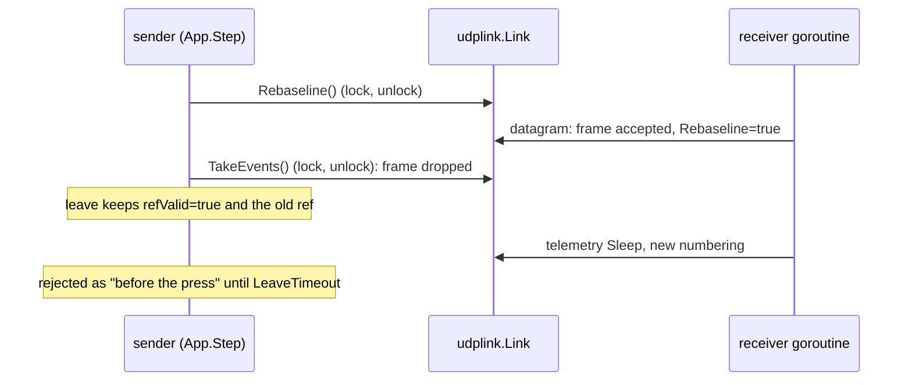

# Design

## Context

The brief lists seven groups of implicit state in `desktop/handheld/`. Only one is a defect: the rejoin path in `internal/app` (D2 of the brief). This change delivers that defect and the explicit reference state it needs. The remaining groups are independent refactors with no behaviour change and are recorded under Follow-ups.

## D1. One lock for rebaseline and drain

`udplink.Link.Rebaseline` rebaselines the receiver and empties the event queue under the same lock acquisition. The separate drain after it is removed from both callers (`App.resume` and the rejoin in `App.Step`). With one method there is no ordering for a caller to get wrong. The `app.Link` interface keeps `Rebaseline()` with this documented meaning; the fake link in `app_test.go` drains its queue in it.

## D2. Numbered baselines instead of a flag

The receiver keeps a baseline number (`uint64`, 0 before the first frame). Every rebaseline (the first frame, the first after `Rebaseline()`, the first after `Gap` of silence) increments it. `Event.Baseline` and `Quality.Baseline` carry it. `Event.Rebaseline` stays for the receiver's own shown-frame logic and the screen.

The leave records `ref = {baseline, newest}` from `Status` at the press, with no validity flag. `leave.observe` orders a telemetry frame by its baseline:

| Frame's baseline | Meaning | Counted |
|---|---|---|
| lower than `ref.baseline` | taken before the press | no |
| equal to `ref.baseline` | same numbering as the press | only if its sequence number is 1..127 ahead of `ref.newest` |
| higher than `ref.baseline` | numbered afresh after the press | yes |

Before any frame, `ref.baseline` is 0 and every frame has baseline 1 or more, so every frame counts, as `refValid=false` did. A rebaseline can no longer be missed: if its first frame is drained, the frames after it still carry the higher baseline. This replaces the inference from `ev.Rebaseline && ev.At.After(since)`, and the event's arrival time is no longer used for ordering.

Alternative considered: have the app clear the leave's reference when it rebaselines. That covers the rejoin and the resume but not a `Gap` rebaseline, which happens inside the receiver, so the flag inference would stay. The baseline number covers all three in one rule.

## D3. The regression test

The test injects a robot frame between the receiver's rebaseline and the queue drain, through a hook in the fake link's `Rebaseline` that runs after `rx.Rebaseline()` and before the drain. This models the receiver goroutine winning the race. The scenario: drive, press Menu with telemetry received, go off the network, rejoin, then feed two Sleep telemetry frames whose sequence numbers are behind the press's newest. The leave must act on the second frame, well before `LeaveTimeout`. Against the current code this test fails: the injected frame is drained and `refValid` stays true.

## Assumptions

- A frame drained by the rebaseline is lost to the leave's count. This is the existing behaviour and is harmless: at most one confirmation is delayed by one telemetry period. The spec's "no robot frame received in that moment SHALL be lost to the ordering" means its numbering is not lost, not that the frame itself counts.
- `Event.Rebaseline` and `Quality.HaveNewest` stay. Removing them is follow-up F5; `HaveNewest` equals `Baseline > 0` after this change.
- The delta modifies `Leaving safely` as `handheld-network-check` left it, since neither that change nor `add-handheld-controller` is archived yet. Archive order must keep `handheld-network-check` before this change.
- No hardware check is needed. The race is timing-dependent on the device and is proven by the deterministic host test.

## Follow-ups

Each is its own change, a refactor without a spec delta unless noted. Numbers follow the brief.

- **F2. Network check.** `network == ""`, `offNetwork`, `nowOn`, `rejoined` (`internal/app/app.go`), written from the sampler and sender goroutines: one enum {Unchecked, On, Off, Rejoined} with `observeSample()` and `takeRejoin()`.
- **F3. Satellites of `app.State`.** `Handheld.neutral` (`internal/padmap/handheld.go`) duplicating Leaving/Acting, `App.done` duplicating Done, `App.leave` kept after Done, `App.begun` duplicating `!start.IsZero()`: carry the data in the state and derive neutral from it. Coordinate with `explicit-state-core`, which owns padmap's mapping mirror and `Handheld.RequestSleep`.
- **F4. `feedback.Detector`** (`internal/feedback/feedback.go`): link judging (started, seen, wasFresh, leaving), gesture acknowledgement (gesturePending, pendingGesture, sawNotPlaying, gestureAt) and playback (playing and playUntil, played[] duplicating lastAt) as separate explicit machines with step functions.
- **F5. `udplink` receiver.** `rebase`, `HaveNewest` and `HaveFrame` (always equal), and the zero `LastValid` and `Shown.TakenAt`: derive from the baseline number of D2.
- **F6. Run phase** (`cmd/spooder-handheld/main.go`): a nil atomic pointer never cleared, read by the power hook, becomes an explicit atomic phase {Joining, Driving, Ended}.
- **F7. Screen and pak state** (`cmd/spooder-handheld/`): `sound.on` mirroring `soundOff`, `overlayState` haveSeq/openedAt/litUntil, `drawTiming` zero times, `startPage.checking`, and the link status (NoFrames, Link, Stale, OffNetwork) classified twice by nested ifs, which becomes one classification function.
- Out of scope here by the brief: padmap's mapping mirror and `Handheld.RequestSleep` (`explicit-state-core`), and the stopped-body flag (`body-stopped-telemetry`).
